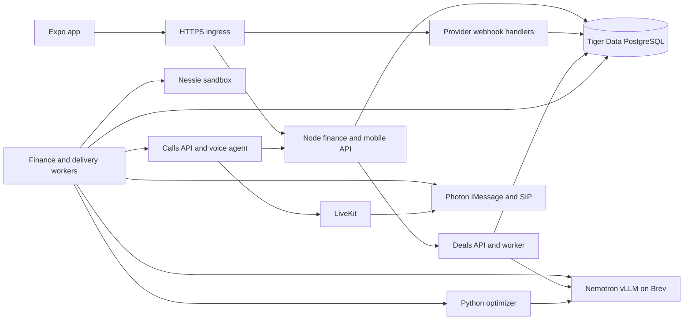

# Hands-Off Banking backend integration plan

Prepared November 8, 2026. This plan covers the sandbox demo, a locally signed iPhone build, and the remaining backend work needed to connect the team's implementations. Proposed defaults and routes below are implementation decisions to verify during the integration. The final live test is a real location event leading to a financially eligible recommendation and one real Photon delivery to an opted-in recipient.

The first implementation is documented in the [backend runbook](backend-runbook.md). The checkout supports one sandbox owner, call-bound live Nemotron follow-ups, a private optimizer, versioned alert settings, device-scoped location, and a durable Photon delivery queue. The cashflow endpoint now combines documented bills, exact-match reconciliation, and separate payroll and spending estimates. Undated loan schedules, full owner authentication and onboarding, live offer pricing and eligibility, provider receipt webhooks, and the deployed handset tests remain open.

## Starting point

| Workstream | Evidence reviewed | Integration gap |
| --- | --- | --- |
| Finance and location | `feat-rs` at `0d5f3ec` plus the current working-tree edits. Node reads Nessie, builds routines, persists profiles and confirmed memory in Tiger Data, and checks foreground/simulated visits. The local edits add Photon text and forwarded-email obligations and tests. | The prototype uses one configured sandbox account, a shared demo token, a local offer catalog, and in-process visit state. The text and email edits need review and an explicit commit before integration. |
| Calls | [`main` at `2429d90`](https://github.com/Owen-Isenhart/HackUTD-2026/blob/2429d90/Calls.md) records successful outbound calls over LiveKit and Photon SIP with a dummy recommendation response. | Wire the real API and persist per-call context. Resolve intermittent first-dial `403 permission_denied`, and distinguish answered, declined, no-answer, ended and failed. |
| Deals | [`deals` at `69e588b`](https://github.com/Owen-Isenhart/HackUTD-2026/blob/69e588b/docs/deals-validation.md) has scoped Fastify endpoints, worker, migrations, an inbound Photon email trace, and an assisted merchant enrollment flow. | Combine owner identity, purchases and candidate retrieval. The [Capital One sync implementation](https://github.com/Owen-Isenhart/HackUTD-2026/blob/69e588b/src/capital_one.ts) seeds static terms. Its output is fixture data until a live source and the user's eligibility are established. |
| Optimizer | [`arjun` at `bebf551`](https://github.com/Owen-Isenhart/HackUTD-2026/blob/bebf551/optimizer/README.md) has a Python/OR-Tools engine, Nemotron client, and brute-force oracle tests. | It currently accepts CLI/file inputs. Add a typed adapter over the team's data and reuse its ranking and validation as the final decision engine. |
| Mobile | [`frontend` at `f4c4e09`](https://github.com/Owen-Isenhart/HackUTD-2026/tree/f4c4e09/app) has sign-in, deals, spending, upcoming and account screens. `feat-rs` has the real finance/foreground test harness. | Keep one Expo app. Wire the screens to the API and carry the restricted test harness into it for integration and device testing. |

## Service layout on Brev

- Start with the shared Brev VM `following-copper-silkworm`. Run the Node API, finance/delivery worker, deals API/worker, Python optimizer and Calls API/agent as separately supervised processes with pinned dependencies. Use `8787` for Node, `3001` for Deals, `8788` for Calls, `8789` for the optimizer, and keep vLLM on `8000`. Use loopback for a host-process deployment or an unexposed private network for containers. Give the model container the GPU and cap background inference concurrency so location and voice jobs can meet their deadlines. [Team Brev handoff](brev-nemotron-handoff.md)
- Give the phone and provider webhooks one stable HTTPS origin. Prefer a managed Cloudflare Tunnel for a domain the team controls with path-based routing to the appropriate loopback services. Verify HTTPS and authentication over cellular and verify callbacks from Photon and LiveKit. A Quick Tunnel can serve a temporary demo but changes URLs on restart. Brev's browser-authenticated tunnel and developer SSH forward are for team access. Keep the call, optimizer, database and model endpoints private. [Brev connectivity](https://docs.nvidia.com/brev/cli/connectivity) · [Cloudflare Tunnel](https://developers.cloudflare.com/cloudflare-one/networks/connectors/cloudflare-tunnel/) · [Quick Tunnel limits](https://developers.cloudflare.com/tunnel/get-started/quick-tunnels/)
- Run migrations once per release under a separate migration role and lock. Start workers after schema readiness and enable outbound channels individually after dry runs. Use separate local, staging and demo settings, with sandbox bank data and allowlisted recipients in staging/demo. Keep the previous release available for rollback. Roll back services with compatible schema changes still in place. Keep worker queues and persisted memory in Tiger Data across Brev restarts.

| Runtime | Required configuration |
| --- | --- |
| Finance and jobs | `TIGER_DATA_URL`, Nessie API key and sandbox account mapping, finance timezone, session and device credential keys, rollout flags and provider limits. |
| Inference | `NEMOTRON_BASE_URL=http://127.0.0.1:8000/v1` for host processes, `NEMOTRON_MODEL=nemotron-bolt`, and a separate private model key if required. |
| Photon and Deals | Project and scoped API key, verified iMessage sender, authorized recipients and inbox aliases, per-destination webhook secrets, Deals database role and owner-bound service credentials. |
| Calls and voice | Existing `LIVEKIT_URL`, `LIVEKIT_API_KEY`, `LIVEKIT_API_SECRET`, SIP trunk config, `NVIDIA_API_KEY`, `CALLS_API_KEY` and separate `RECOMMENDATION_API_KEY`. Set `RECOMMENDATION_API_URL` to the private finance route. |
| Mobile | Public `EXPO_PUBLIC_FINANCE_API_URL`. Runtime session and device credentials are issued by the backend and stored in SecureStore. |

## Data and request flow

### Identity, durable memory and onboarding

1. Issue one-time invitations for the hackathon. Exchange an invite for an expiring owner session and a rotating, revocable refresh token. Give every owner an immutable UUID. Map each owner to the permitted Nessie account, deals tenant and operator-verified Photon destinations server-side. Use owner-scoped service credentials across services and map the UUID into the existing deals tenant policies. Use separate, short-lived device credentials with scope to submit location events so the background task can authenticate without retrieving broad financial access. Reuse the same owner identity after a reinstall. The shared `FINANCE_DEMO_TOKEN` is a staging compatibility bridge for one sandbox owner during the cutover.
2. Store owner settings, consents by source/channel, budgets, goals, preferences, corrected routines, payment-method eligibility, source connections, onboarding drafts and versions in Tiger Data. Make the onboarding interview resumable. On request, start a separately consented call. Save proposed budgets, goals or preferences as drafts with evidence and explicit confirmation. The in-app review uses the same versioned write path. An inferred routine never overwrites a confirmed correction.
3. Apply finance migrations `001` through `003` and the deals migrations through `004` in staging first. Add migrations for owner mapping, normalized transactions and provider cursors, reconciled obligations and versioned forecasts, device sessions, encounters, recommendations, call/delivery state, webhook deduplication and durable jobs. Keep existing rows during the transition and map the old sandbox account to the correct owner before the new routes serve it. Use PostgreSQL constraints and owner-scoped row access. Store identity/provider mappings and destinations separately from analytic records. Require verified TLS, restricted roles and separate backup permissions. Rehearse a restore into a separate database and confirm plan and budget versions survive. [Tiger Data connection details](https://www.tigerdata.com/docs/integrate/find-connection-details) · [Tiger Cloud backups](https://www.tigerdata.com/docs/deploy/tiger-cloud/tiger-cloud-aws/high-availability/backup-restore)
4. Keep derived memory through logout, clearing local data, reinstall and deployment. Deletion is an explicit authenticated account operation that revokes sessions and consent, cancels deliveries and removes owner-scoped records under a documented backup/retention policy. Distinguish local deletion from provider retention. Store no raw GPS trail. Keep the current seven-day raw message body window, subject to verifying purge and backup behavior. Retain minimal derived evidence and operational IDs. Keep transcripts off by default and recording disabled.

### Nessie ingestion and forecasting

1. Import the configured sandbox account, purchases and branch metadata. Add supported bill, deposit, withdrawal and transfer reads with per-source freshness and coverage. Include loan payment schedules only when the API exposes them for the configured account and the data can be reconciled. Contract-test optional feeds before enabling them. Bootstrap 90 days for routines and replay overlapping source windows or complete snapshots if Nessie lacks usable cursors. Refresh in a worker, initially every 15 minutes for active demo owners and on demand. Preserve the last successful snapshot and surface missing or stale sources explicitly.
2. Normalize provider transaction ID, account, source version/status, signed amount in integer cents, currency, category, exact branch when known, occurrence precision and timestamps. Use owner/account/source-scoped upserts and deduplicate transfers between linked accounts. Corrected status, refunds and reversals update the original facts. Distinguish day-only dates from timed visits and sandbox history from verified real purchases. Bank evidence controls posted transactions and balance. Sandbox history can exercise discovery but cannot trigger live merchant enrollment or assert cardholder eligibility. Nessie simulates bank accounts. Real customer data requires a separately approved provider integration. [Nessie API](https://nessieisreal.com/docs) · [Capital One production access](https://developer.capitalone.com/)
3. Keep two inbound pipelines. Financial texts and consented forwarded Gmail/Calendar messages feed obligations. Merchant promotional emails feed the Deals worker through its existing alias/webhook. Use the actual project, line or allocated recipient to route and authorize. Preserve the shared email destination and deploy the text webhook separately if enabled. Reconcile with cursor-based Photon polling and deduplicate by provider message/event ID. Restrict financial forwarding to the user's filtered mail and text ingestion to conversations that reach the Photon line. Keep merchant messages and financial messages in distinct pipelines even if both come from Photon.
4. Interpret only likely financial messages with Nemotron and a strict schema. Check evidence spans, amount, date, payer direction and consent deterministically. Include sufficiently evidenced upcoming expenses, reserve known ambiguous amounts conservatively, and create clarification items for missing facts. A missing amount can suppress affordability claims. Confirm/dismiss using a versioned update. Reconcile across duplicate text/email evidence and posted Nessie transactions using verified IDs or high-confidence merchant/amount/date evidence, with uncertain matches left for review. Compute a rolling 30-day cashflow projection from current balance, supported expected income, bills and obligations. Avoid counting a posted purchase, pending plan and bill as separate expenses for the same event. Enforce immediate payable cost, the active local budget period and projected liquidity before recommending a purchase.

### Offers, routines and recommendation decisions

1. Deals discovers programs from eligible purchase evidence, manages the verified enrollment state, and expires, suppresses and reconciles offers. Wire its existing assisted Chipotle and Panera flows for OTP/account steps. Keep loyalty and promotional outcomes separate and use the existing one-calendar-year inactivity policy, preserving loyalty status and processing external unsubscribe where supported. Re-enable an eligible enrollment only on a valid return or explicit owner action. Persist offer terms with source, revision, branch, dates, minimum spend, activation, payment and stacking restrictions. Require review for unresolved offer evidence.
2. Gate Capital One Offers and Capital One Shopping independently. Record a permitted no-cost acquisition route, source terms, freshness and owner-specific redemption requirements before activating real candidates. Quarantine static seeds and demo cashback in a fixture namespace. Online or cardholder-only offers may enter a real proximity recommendation only with verified in-store/branch and owner eligibility. Show the feed as unavailable where acquisition or applicability is unverified. [Capital One Offers and Shopping](https://www.capitalone.com/learn-grow/money-management/capital-one-offers/)
3. Recompute routines on material transaction or memory changes. Use repeated distinct local days and observed branch/daypart from `feat-rs`. Ask Brev Nemotron to interpret aggregate routines and unclear intent, propose structured constraints and explain validated decisions. Version/cache the outputs by input digest, prompt and model. Pass only the fields required for each inference. Give text extraction no tools and exclude account IDs and GPS from routine/explanation prompts. Use schema and evidence validators and measure Bolt on the team's cases before relying on inferred suitability. [vLLM structured outputs](https://docs.vllm.ai/en/v0.31.0/features/structured_outputs/)
4. Build a typed optimizer request from the owner snapshot, current forecast, purchase intent, geospatial candidates, eligible offer revisions, prices, payment methods and preferences. Replace the Python optimizer's file/demo-world inputs in the live path with that request. Keep its arithmetic and constraints authoritative. Rank feasible options by effective cost, with stable ties, while checking the amount due now independently from later cashback. Suppress irrelevant alternatives and known commute pass-throughs. If inference times out, use a deterministic explanation and any independently evidenced candidates. Return `skip` if known candidates fail affordability, and `unavailable` or `clarification_required` when a necessary input is missing. Show the reason, source, payable/discount/cashback cents and confidence. Never infer live redemption from a fixture.

### Location, decisions and delivery

1. Precompute a short set of likely places and time windows from current routines and offers. The phone registers nearby regions first and refreshes the set on app open, significant movement or plan expiry. Use at most 20 iOS regions. A region entry wakes the native task and requests a fresh accurate fix. Use lower-duty background updates only when needed to cover motion outside registered areas, then stop after exit or inactivity. A predicted visit can warm finance/offer/model caches. A qualifying real fix and current eligibility are required for outbound proximity delivery. [Expo Location SDK 58](https://docs.expo.dev/versions/v58.0.0/sdk/location/) · [Apple background location](https://developer.apple.com/documentation/corelocation/handling-location-updates-in-the-background)
2. Use one event contract for foreground, native background and restricted stationary demos. Record an event ID, device ID, source, timestamp, event type and region ID when available. A fix includes latitude, longitude and horizontal accuracy in meters. Start with the prototype's 300 m bubble including accuracy, 20-second maximum fix age at eligibility evaluation, and 30-minute finance freshness. Reject invalid coordinates, future timestamps beyond a small clock-skew tolerance and missing/inadequate accuracy. Enter/dwell/exit logic and server-side visit deduplication handle GPS jitter and multiple devices. Drop stale offline fixes on replay. An out-of-date balance pauses delivery and triggers refresh, followed by reevaluation on a fresh fix.
3. Evaluate once per eligible encounter. Save the recommendation, material input versions, provenance, encounter, expiry and one outbox item in the same transaction. Start an outbound delivery within the 20-second fix window or let the event expire. Recheck consent, time window, current versions and channel cooldown immediately before dispatch. A call that starts in time gets its own immutable, owner-scoped opening summary bound to the call and recommendation IDs, valid for the active call up to its five-minute cap or earlier input invalidation. If it becomes invalid, the voice tool returns unavailable and offers to refresh in the app. This replaces the single global `latestVisit` and avoids an answer depending on a newer scan or an already expired fix while the phone is ringing.
4. Default to no automated call or iMessage until the user opts into each channel. Store quiet hours in the owner's timezone, a 24-hour per-place cooldown, and a distinct verified destination. Offer one selected external channel per encounter. On a definite failure, permit one fallback only when the owner enabled it and the recommendation still qualifies. If the provider may have accepted the first request, reconcile its ID before retrying or falling back. Preserve first-notification eligibility after a suppressed commute. After an ignored alert, wait for a later opening or verified purchase. Record a place mute immediately. Only a verified purchase occurring after the mute can reactivate it, subject to global preferences. Include an in-app record for each recommendation and clarification. Use an opaque record ID in deep links and avoid financial details on the lock screen or in outbound previews.
5. For iMessage, reuse the script's Photon user → space → message flow. Cache the verified recipient and space. Use stable idempotency keys for creation and send. Treat `202` as accepted and update delivery from provider events or reconciliation. For voice, keep the existing Calls API and LiveKit/Photon SIP trunk, bind the server-derived owner and recommendation to dispatch, and connect the agent's recommendation tool to the real finance API. Keep hosted NVIDIA Parakeet and Magpie for speech, and test the voice reasoning model on Brev before switching it from the working hosted configuration. The agent can propose scoped memory edits and accept/decline decisions through validated server tools. Explicit confirmation and the current version are required for consequential changes. [Photon 2.0](https://photon.codes/blog/introducing-photon-2.0) · [LiveKit outbound calls](https://docs.livekit.io/telephony/making-calls/outbound-calls/) · [LiveKit webhooks](https://docs.livekit.io/intro/basics/rooms-participants-tracks/webhooks-events/)

## API inventory

One public origin for the app. **Existing** identifies a route in one of the workstreams, **extend** preserves a route while changing the backing integration, and **new** is proposed here. Path braces identify a parameter or explicitly list sibling routes. Public app routes are owner-scoped unless the table specifies an exception. Use JSON, ISO 8601 UTC timestamps, local dates for budget periods, integer cents with currency, stable opaque IDs and cursor pagination. Standard errors include `400` invalid input, `401` invalid credentials, `403` missing scope, `404` unknown owner-scoped record, `409` stale version or idempotency conflict, `429` rate limited and `503` unavailable. Return `202` and a job/resource ID for work queued asynchronously. Replaying an identical event or idempotency key returns its original result. A reused key with a different payload returns `409`.

### App and operations

| Method and path | Status | Contract |
| --- | --- | --- |
| `GET /health`, `GET /ready` | New at gateway | Minimal public liveness and gateway readiness. Readiness checks schema/core storage. Optional provider outages appear as degraded source status. Keep component diagnostics private. |
| `POST /api/v1/session/exchange` | New | Redeem an expiring one-time invitation for an owner session and refresh token. Rate-limit attempts. |
| `POST /api/v1/session/refresh`, `DELETE /api/v1/session` | New | Rotate refresh/session tokens, or revoke the current session and bound device credentials. |
| `GET /api/v1/me`, `DELETE /api/v1/me` | New | Read owner/timezone/capabilities, or queue confirmed account erasure after fresh authentication. |
| `GET /api/v1/settings`, `PUT /api/v1/settings` | New | Read or update versioned consents, timezone, location mode, enabled channels, quiet hours and delivery preference. Server provisions or verifies destinations. Disablement cancels unsent work. |
| `GET /api/v1/onboarding`, `PUT /api/v1/onboarding` | New | Retrieve resumable steps/drafts or record confirmations with `version`, `action` and reviewed values. |
| `POST /api/v1/onboarding/call` | New | Start a separately consented onboarding call for the verified owner. Return `callId` and initial state. No client-supplied destination. |
| `GET /api/finance-profile` | Existing, extend | Preserve current response during migration. Serve a persisted snapshot with `asOf`, coverage and freshness, balance, spending, routines, obligation summary and `memoryVersion`. Move provider refresh out of the read path. |
| `POST /api/v1/finance/sync` | New | Request a deduplicated Nessie refresh and dependent routine/forecast jobs. Return `jobId`. |
| `GET /api/v1/finance/transactions?cursor=…` | New | Paginated owner ledger for Spending, with source provenance and transaction precision. |
| `GET /api/v1/finance/forecast?days=30` | New | Daily projected balances, confirmed/reserved amounts, pending clarifications, coverage and input versions. Bound `days` server-side. |
| `GET /api/v1/jobs/{id}` | New | Owner-visible sync/erasure job status and sanitized failure code. |
| `GET /api/v1/finance/memory`, `PUT /api/finance-memory` | New read, extend existing write | Read durable budgets, goals, preferences and corrections. Existing write takes `confirmed`, `version`, `budget` and `goals`; extend with validated preferences and corrections using the same versioned transaction. |
| `GET /api/text-obligations`, `PUT /api/text-obligations/{id}` | Existing, extend | Read obligations and ingestion status. Confirm/correct amount and date or dismiss using `confirmed`, `version` and `action`; recompute forecast. |
| `POST /api/texts/sync` | Existing, extend | Queue an owner-scoped, deduplicated Photon reconciliation. Return `jobId` after the current synchronous compatibility phase. |
| `POST /api/v1/devices`, `DELETE /api/v1/devices/{id}` | New | Register a device, rotate its location-scoped token while an owner session is active, or revoke it. When push is enabled, also associate its verified app push token and report capability. |
| `GET /api/v1/location/regions` | New | Return `revision`, `expiresAt` and at most 20 branch regions with center, radius and expected time window. Support `If-None-Match`. No delivery side effects. |
| `POST /api/v1/location/events` | New | Accept `eventId`, `deviceId`, `type`, `source`, `observedAt`, optional `regionId` and fix. Return `202`, `encounterId` and processing state or reason. Device token or owner session must bind the device. |
| `POST /api/finance-recommendation` | Existing, extend | Keep immediate foreground/manual preview and the test harness. Feed the same decision service. Preview has no delivery side effect. Only the restricted test mode can turn simulated movement into a send to an allowlisted recipient. |
| `GET /api/v1/recommendations`, `GET /api/v1/recommendations/{id}` | New | List encounters/decisions or retrieve the owner's current/expired recommendation with public reasons, cost breakdown and delivery state. |
| `POST /api/v1/recommendations/{id}/feedback` | New | Record idempotent `opened`, `accepted`, `dismissed` or `declined` signals. Provider acceptance and user opening stay distinct. |
| `PUT /api/v1/places/{id}/alerts` | New | Set versioned place-level mute/unmute. Cancel queued sends and preserve the timestamp for purchase reactivation. |
| `GET /api/v1/calls/{id}` | New | Owner-scoped projection of the private calls record for onboarding or recommendation delivery. |

### Deals service

Preserve the existing Fastify paths. Expose owner-facing routes through the gateway with the shared owner identity and `deals:user` scope. Purchases and candidates remain service-only with owner-bound `deals:purchase` and `deals:optimizer` scopes respectively. [Deals routes at `69e588b`](https://github.com/Owen-Isenhart/HackUTD-2026/blob/69e588b/src/app.ts)

| Method and path | Contract |
| --- | --- |
| `GET /health`, `GET /ready` | Component process/database checks on the private port. |
| `GET /v1/deals/status` | Source status, consent, delivery alias and recoverable failures. |
| `POST /v1/deals/consent`, `DELETE /v1/deals/consent` | Allocate alias and start intake, or revoke it and suppress further processing. |
| `GET /v1/deals/programs`, `GET /v1/deals/discoveries` | Supported merchant programs and purchase-driven discoveries. |
| `GET /v1/deals/enrollments`, `POST /v1/deals/enrollments` | List enrollment states or request an explicit registration with program, intent and existing-membership state. |
| `GET /v1/deals/enrollments/{id}/flow` | Fetch next assisted action and evidence needed. |
| `POST /v1/deals/enrollments/{id}/{existing-membership,attempt,confirm,retry,opt-out,resume,confirm-unsubscribe}` | Versioned enrollment transitions with verified membership/sender/outcome evidence as required. |
| `GET /v1/deals/messages`, `GET /v1/deals/messages/{id}` | Owner-scoped offer evidence list/detail, with retention limits. |
| `GET /v1/deals/offers`, `GET /v1/deals/offers/{id}` | Offer terms, provenance, status and revision. |
| `POST /v1/deals/offers/{id}/review` | Correct or confirm evidenced terms with expected revision. |
| `POST /v1/deals/purchases` | Scoped importer supplies normalized purchases and provenance. Sandbox data stays marked as such. |
| `POST /v1/deals/candidates` | Scoped optimizer requests eligible candidates with owner and verified context. Returns IDs, revision, conditions and expiry. |
| `GET /v1/deals/events?after=…` | Ordered revision/invalidation feed. Restrict integration access to owner-bound service scope on cutover. |
| `POST /v1/deals/sources/{product}/retry` | Retry `photon_email`, `capital_one_offers` or `capital_one_shopping` with source gates. |
| `POST /v1/deals/sources/capital-one/sync` | Keep seed behavior in test only. Release real sync only after permitted acquisition and eligibility pass. |
| `POST /v1/deals/jobs/{id}/retry` | Retry a recoverable failed job with owner authorization and bounded attempts. |

### Internal APIs and inbound provider hooks

| Method and path | Access and contract |
| --- | --- |
| `POST /internal/v1/optimizer/evaluate` | New private service endpoint. Takes a versioned normalized world, intent and constraints. Returns a decision, ranked feasible candidates, typed rejections and validated explanation. |
| `GET /health`, `POST /calls`, `GET /calls/{call_id}` | Existing private Calls API. `POST` takes `to_number`, `scenario`, `user_id` and `idempotency_key` with `x-api-key`. Extend to include owner-bound encounter/recommendation IDs and persistent call state. Phone never calls this directly. |
| `POST /api/recommendations/evaluate` | Extend existing private voice tool. Preserve `{user_id,scenario,user_text}` during cutover, add required `call_id` after updating the caller, and resolve `recommendationId` and owner from stored dispatch. Return structured answer/status with no unsupported amounts. Use separate service authentication. |
| `POST /internal/v1/calls/{id}/actions` | New authenticated voice tool endpoint. Accept `propose_memory`, `confirm_memory` or `record_decision`, a typed payload, version and idempotency key. Verify active call binding and a prior proposal for confirmation. |
| `POST /webhooks/photon` | Existing signed email handler. Preserve destination and recipient checks, pinned schema and deduplication. |
| `POST /webhooks/photon/texts` | Existing optional signed text handler. Verify project, resource, timestamp and raw body. Acknowledge irrelevant events without retaining them. Polling can run independently. |
| `POST /webhooks/photon/delivery` | New signed iMessage event receiver after verifying exact event types and support in the project. Correlate by provider message ID and reconcile via polling when needed. |
| `POST /webhooks/livekit` | New signed call lifecycle receiver. Validate the raw body with the LiveKit SDK and map correlated SIP/room events to durable call and delivery states. |
| `GET /internal/metrics` | New private operational counters for worker lag, source freshness, inference, recommendation reasons, provider outcomes and deduplication. |

### Outbound provider interfaces

| Provider | Planned calls |
| --- | --- |
| Nessie | Existing `GET /accounts/{id}`, `GET /accounts/{id}/purchases`, `GET /accounts/{id}/bills`, `GET /accounts/{id}/deposits`, `GET /merchants/{id}` on `https://prod-api.nessieisreal.com`. Contract-check `GET /accounts/{id}/withdrawals`, `GET /accounts/{id}/transfers` and `GET /accounts/{id}/loans` with the sandbox schema before enabling. No customer/account mutations. Redact the `key` query parameter. |
| Nemotron/vLLM | Private `GET /health`, `GET /v1/models`, `POST /v1/chat/completions` on loopback. Use the served `nemotron-bolt` alias, JSON schema, timeouts and measured context limits. Smoke test structured output/tool calls before changing deployment. |
| Tiger Data | PostgreSQL TLS connection using the server-side `TIGER_DATA_URL`, SQL transactions, migrations and backup/restore tools. The phone has no database connection. |
| Photon Beta | `GET /v1/projects/{projectId}/messages` with source platform, direction, window and page token for reconciliation. `POST /v1/projects/{projectId}/users`, `/spaces` and `/messages` under the same project prefix for iMessage. SIP for voice via the configured Photon trunk. For setup only, the Deals reconciler uses `GET` and `POST /v1/projects/{projectId}/webhooks/destinations` and `PATCH /v1/projects/{projectId}/webhooks/destinations/{id}` with the project owner. [Photon messaging API example](https://photon.codes/blog/introducing-photon-2.0) |
| LiveKit and NVIDIA speech | LiveKit server SDK uses `POST /twirp/livekit.AgentDispatchService/CreateDispatch`, `POST /twirp/livekit.SIP/CreateSIPParticipant` and `POST /twirp/livekit.RoomService/DeleteRoom`. Use the voice agent's existing NVIDIA SDK-backed streaming Parakeet STT and Magpie TTS. No arbitrary dialing from Expo. [LiveKit server APIs](https://docs.livekit.io/reference/telephony/sip-api/) |
| Expo Push Service, later | `POST https://exp.host/--/api/v2/push/send` and `POST https://exp.host/--/api/v2/push/getReceipts` after signed-build/APNs credentials are available. Remove invalid device tokens from receipt results. [Expo push sending](https://docs.expo.dev/push-notifications/sending-notifications/) |

## Device paths

| Expo Go now | Xcode Personal Team build on the iPhone |
| --- | --- |
| Verify the installed Expo Go and the repo's SDK 58 are compatible. Point `EXPO_PUBLIC_FINANCE_API_URL` at Brev HTTPS. Use foreground GPS, the controlled map/Friday Chipotle fixture and local notifications for feedback. Enable a restricted live-delivery test for an allowlisted consenting phone, using actual Nessie/offer/provider responses. A local notification or in-app speech demo alone proves UI behavior. | On a Mac, add `expo-task-manager`, register the task at module scope, configure the `expo-location` plugin for Always permission and background location updates, and rebuild the native app. In Xcode use a unique bundle ID, Automatic Signing and the Apple Account's Personal Team. Enable Developer Mode, connect the iPhone, and run the workspace or `npx expo run:ios --device`. Once working, install a locally signed Release configuration with a bundled JS build so the locked-phone test can run away from Metro. Free provisioning expires after seven days and requires rebuilding/reinstalling. |
| Expo Go exercises all backend logic and actual Photon delivery while open. | Request While Using first and Always only after the user enables background alerts. Store the device-scoped credential with `AFTER_FIRST_UNLOCK_THIS_DEVICE_ONLY` and test access on a locked phone. Keep the broader owner session under a more restrictive policy. If permissions, Background App Refresh, token validity or connectivity prevent a background check, show the status on reopening and fall back to foreground checks. Test system suspension separately from user force-quit. Use Photon for external delivery on the free build. APNs push is a separate signed capability with credentials. |

[Expo TaskManager](https://docs.expo.dev/versions/v58.0.0/sdk/task-manager/) · [Expo SecureStore](https://docs.expo.dev/versions/v58.0.0/sdk/securestore/) · [Expo local builds](https://docs.expo.dev/guides/local-app-development/) · [Apple Personal Team](https://developer.apple.com/help/account/basics/about-your-developer-account) · [Expo push setup](https://docs.expo.dev/push-notifications/push-notifications-setup/)

## Integration order and test gates

Start an integration branch from current `origin/main`. Bring finance, deals, optimizer and frontend in as separate reviewable changes. Relocate colliding top-level files before merging and retain each workstream's lockfile and tests. Use one Expo entry point for the demo. Record the commit, sanitized trace ID and outcome for each gate. Run the affected suites on every change and the combined suite before merging or pushing implementation to `main`.

| Stage | Build and test before advancing |
| --- | --- |
| 1. Mergeable baseline | Import pinned workstreams into the integration checkout. Run `npm test` for finance, the deals build and tests on a disposable PostgreSQL database, `uv run pytest -q` for Calls and optimizer, frontend typecheck and an iOS Expo export. Keep integration provider stubs deterministic and choose safe test credentials explicitly. |
| 2. Auth, storage and ingress | Deploy Brev staging with dispatch disabled. Migrate twice against a disposable database and once against staging; test upgrade from old rows, restore, tenant isolation, expired/revoked auth and signed-hook replay/tampering. Confirm mobile HTTPS over cellular. Clear the app and restart Brev services, sign in again and read the same budget, goals, obligations and preferences. |
| 3. Finance, Nemotron and offers | Smoke-test read-only Nessie endpoints with the seeded sandbox account and `GET /v1/models` plus structured inference on Brev. Replay duplicate, partial, corrected and stale data. Verify ambiguous text clarification, Gmail receipt exclusion, text/email deduplication, posted reconciliation, DST/budget boundaries and refund handling. Run a real consented Photon inbound test. Verify one actual merchant offer with valid location/price/eligibility or record why real delivery stays gated. |
| 4. Foreground vertical slice | In Expo Go, run real and controlled movement through the same backend. Verify typed candidate mapping, optimizer/oracle tests, an unaffordable option with a suitable cheaper alternative, commute suppression, stale/inaccurate fixes, duplicate events, a model timeout and an offer invalidated before send. Inspect one trace across ingestion, candidate retrieval, finance guards, decision and outbox. |
| 5. Photon end to end | With explicit recipient consent and dispatch enabled for one channel at a time, verify actual iMessage receipt and a real outbound call using the same stored recommendation. Check that the voice tool still resolves the bound recommendation after ringing and a second scan, and refuses cross-owner or invalidated reads. Test timeout after provider acceptance, worker restart, no answer, reject, fallback, opt-out, quiet hours and replay with no duplicate call/message. Exercise onboarding draft and confirmed budget update through the same memory API. |
| 6. Native background acceptance | Install on the physical iPhone. Register the region, lock the screen, cross the boundary with Metro disconnected, and confirm an actual call or iMessage with one delivery record. Test cellular, poor accuracy, offline→online, permission downgrade, reboot/unlock, manual force-quit/reopen and provisioning expiry. Record OS/permission state, observed location-to-provider latency and failed deliveries. The simulator or a foreground export cannot satisfy this gate. |

### Failure handling and rollout

- Use a PostgreSQL outbox, unique provider event and decision keys, leased jobs with bounded exponential retry, and dead-letter status. Persist a dispatch attempt before contacting a provider and acknowledge webhook writes after committing. Reconcile an ambiguous SIP dial using the persisted room/dispatch identity before any redial. Add status reconciliation for missed/out-of-order callbacks. Revalidate versions and consent after a retry, even if a worker already claimed the job.
- Return cached finance for display if Nessie is down and suspend new affordability-dependent sends. Treat an unavailable deals source separately from a valid empty result. If Tiger Data is unavailable, disable durable changes and delivery. Use a deterministic explanation if Nemotron fails and eligibility is independently known. Provide visible stale/unknown statuses and a manual refresh where supported.
- Keep credentials server-side. `EXPO_PUBLIC_` contains only the public API origin and non-secret flags. Use separate keys per environment and scope, redact payloads, GPS, provider keys, destinations and transcripts, and log trace IDs with outcome codes. Track last successful bank/Photon sync, queue age, model timeout, decision reason, duplicate suppression and provider acceptance/delivery. Start with one owner and one destination, and disable each channel independently during rollback.

## Verification and open gates

- Verified in the current checkout while preparing the plan. Node `24.15.0` ran all 31 finance/HTTP tests successfully with loopback allowed, and the iOS Expo export completed with `.env` loading disabled. In the restricted sandbox, the two HTTP tests initially failed with loopback `EACCES`. The same tests passed once loopback was allowed.
- Existing Git lock files prevented some remote-tracking ref updates. The fetched commits were available and reviewed by SHA against the remote branch heads.
- Voice has historical live outbound evidence using a dummy recommender. Deals has branch-reported inbound and database tests. The integrated Brev deployment, real offer eligibility, live iMessage delivery from a recommendation, real call with the integrated recommender and locked-phone background delivery still need the staged tests above.
- Capital One seed data, standalone catalogs and simulated movement carry explicit provenance. Use fixtures for repeatable tests. If the team cannot obtain a valid real offer or a verified contact/channel, report that gate as open and disable the corresponding live delivery path.
