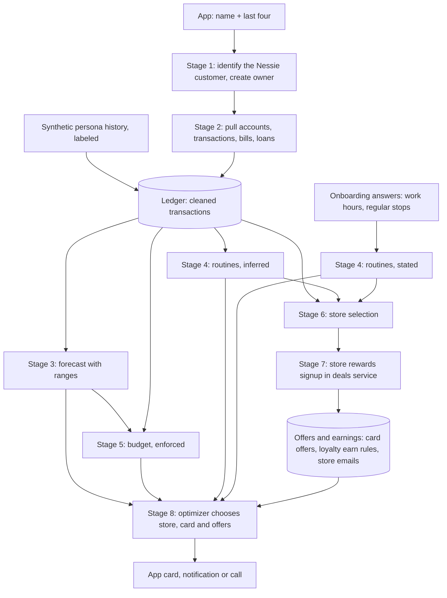

# Derived data pipeline — implementation plan

Written 2026-11-08 against `main` at commit `eaa65cd`. The companion file [derived-data-pipeline-context.md](derived-data-pipeline-context.md) describes what exists today. This file says what to build, in what order, and how each piece is shown to work.

Nothing in this plan has been built yet. Section 19 says what was checked while writing it, and how.

"Derived data pipeline" means the chain that starts from the user's raw bank data and computes everything after it: the forecast, the routines, the budget, the chosen stores, the store rewards signups, and the rewards-maximizing recommendation.

## Contents

1. Decisions this plan is built on
2. Problems in today's code that this plan fixes
3. How the finished pipeline fits together
4. Identity and storage
5. Stage 1 — Onboarding by name and last four digits
6. Stage 2 — Bank pull into a clean transaction ledger
7. The labeled synthetic persona history
8. Stage 3 — Forecast
9. Stage 4 — Routines
10. Stage 5 — Budget
11. Stage 6 — Store selection
12. Stage 7 — Store rewards signup
13. Stage 8 — Rewards-maximizing recommendation
14. Running the stages in order
15. App screens
16. Order of work
17. Changes to the spec and checklist
18. Blockers: what needs a person or a credential
19. How this plan was checked
20. Open questions for Arjun

Steps are numbered by section. "Step 6.3" means the third step of section 6. When a step refers to another, it also names it.

---

## 1. Decisions this plan is built on

### 1.1 Arjun's answers, 2026-11-08

| Question | Answer | What it means for the build |
| --- | --- | --- |
| How store signup works | Assisted, plus simulated signups labeled "simulated" | The app does everything except the store's own verification step. A store with no usable real path gets a signup clearly marked simulated. |
| Where routines come from | Ask during onboarding, plus a labeled synthetic persona history | Onboarding asks work hours and regular stops. A generated purchase history with human habits sits next to the Nessie data, labeled synthetic everywhere. |
| How the derived budget becomes a limit | Enforce automatically | The budget computed from the forecast is a hard limit at once, without a confirmation tap. The spec changes to say so (section 17). The user can still edit it. |
| Where this plan goes | A file in the repo | This file, on branch `docs/derived-data-pipeline-plan`. |

### 1.2 What "assisted plus simulated" means for the demo user

The demo user, Alex Taylor, is a synthetic person created in the Nessie sandbox (the mock bank Capital One provides for hackathons).

A real store signup needs a real person's name, phone number and SMS code. Signing up a synthetic person at a real store would mean submitting invented identity details. The spec forbids that (`context.md` section 14, "Do not bypass CAPTCHA or fabricate identity data").

So the rule in this plan is:

- **A synthetic owner gets simulated signups only.** Every signup is labeled simulated in the database, the API and the app. Nothing is sent to the store.
- **A real owner gets assisted signups.** The app prepares everything and the person completes the store's verification step themselves. The existing Chipotle and Panera flows for the operator (the team member running the demo) are this case.

### 1.3 Defaults this plan picks for the other open questions

The context file's section 6 lists twelve open decisions. Four were answered above. For the rest, this plan picks a default. Each can be overridden.

1. **Nessie v2 only.** The synthetic data exists only in Nessie v2 (`v2-prod-api.nessieisreal.com`). The old client (`backend/nessie.js`) is retired once nothing uses it (step 6.7).
2. **Capital One offers are labeled "sample offers".** The 12 offers in `services/deals/src/capital_one.ts` are hand-written. They are not scraped, and they are not in the Nessie data. They stay usable in the demo, with a visible "sample" label. Step 12.3 removes the parts that present them as verified.
3. **The card's own rewards are modeled from public terms.** The synthetic card is nicknamed "Capital One SavorOne Rewards". Its earn rates per category are read from Capital One's public SavorOne product page, with the page address and the date recorded. The app labels it "sandbox card modeled on public SavorOne terms".
4. **A store can have two kinds of program.** One kind is a card-linked offer (a Capital One discount tied to the card). The other is the store's own loyalty program. Today the database allows only one program per store. Step 12.1 changes that.
5. **Store selection is by frequency.** A store is selected when the user visits it often or it is part of a routine. Section 11 gives the exact rule.
6. **The forecast is a structured model with measured uncertainty.** Known bills and pay are placed on their dates. Everyday spending is simulated from the user's own past weeks to give a range, not one number. Its accuracy is measured on past data before anyone calls it "state of the art". Section 8 gives the method.
7. **One identity across finance and deals.** One random ID that never changes (a UUID) identifies a user in both the finance backend and the deals service.
8. **The Python optimizer makes the final choice.** It receives the full set of inputs: places, cards, Capital One offers and store loyalty earnings. The Node backend keeps its money checks in front of it as a second guard.
9. **The app is `app/`.** It is the one already connected to the backend.
10. **Work hours come from the user.** Onboarding asks for them. Purchases cannot reveal them.

---

## 2. Problems in today's code that this plan fixes

Each item names the file and line, what goes wrong, and the step that fixes it.

### 2.1 Data labeling

1. **Sandbox purchases are labeled as verified.** `services/deals/scripts/sync-nessie-deals.ts` line 85 tags every Nessie sandbox purchase `provenance: "verified_import"`. The deals service deliberately refuses to start a store enrollment from sandbox data (`services/deals/src/service.ts` lines 150–155). The wrong label gets around that refusal. Fixed in step 6.8.
2. **The Capital One seed marks loyalty memberships as confirmed.** `capital_one.ts` lines 443–460 upsert the Chipotle and Panera *loyalty* enrollments to `enrolled` and `confirmed`. That overwrites the "needs your input" state that migration `004_assisted_merchant_handoff.sql` set. Fixed in step 12.3.
3. **The Capital One "evidence" checks itself.** `capital_one.ts` lines 283–391 build a feed text from the hand-written list, then check each offer's quotes against that same text. The check cannot fail. The stored message also claims `verified: true` and the sender `offers@capitalone.com` (lines 415–426). Fixed in step 12.3.
4. **Capital One sources are marked ready on consent.** `service.ts` lines 49–62 set both Capital One sources to `ready` as soon as a user consents, with no offers actually acquired. Fixed in step 12.3.
5. **"Automatic" signup writes success without contacting the store.** `service.ts` lines 227–282 set an enrollment to `enrolled` and `confirmed` with evidence `automated_cardholder_enrollment`. Nothing is sent anywhere. Fixed in step 12.4.

### 2.2 Bank data

6. **The deals sync reads the wrong rows.** `sync-nessie-deals.ts` lines 53–63 read the tenant-wide `/transactions` list. A tenant is everything under one Nessie API key, so this includes other customers. It also stops at 500 rows. Nessie lists simulated rows in the order they were generated, not by date, so these are not the newest 500. Fixed in step 6.8.
7. **The simulator's descriptions don't match the renamed stores.** The seed script renamed the simulator's merchants to Dallas-area brands. The statement text (the "descriptor") still names the simulator's original stores, for example `SQ *BLUEBIRD COFFEE ALEXANDRIA VA`. Store matching must use the merchant ID, never the descriptor. Handled in step 6.4.
8. **The simulator plants fraud-like charges.** The seed ran with `anomaly_rate: 0.02`, so about 2% of rows are planted patterns such as card testing or a distant purchase. Some purchases are later refunded or charged back. Spending baselines must leave these out. Handled in step 6.5.

### 2.3 Forecast and money checks

9. **A credit card gets no starting balance.** `backend/finance-forecast.js` line 149 refuses a starting balance when the account type is "credit card". `services/deals/docs/nessie-synthetic-handoff.md` lines 41–45 recommend the credit card as the configured account. With both, there is no forecast. Fixed in step 8.2.
10. **Any loan blocks "safe to spend".** `backend/nessie-cashflow.js` lines 64–67 count every active loan as an unresolved schedule, because Nessie gives no due date. The synthetic user has a $225 monthly student loan. So "safe to spend" is always empty. Then `backend/recommendation.js` line 93 always returns `forecast_incomplete`, and no recommendation is ever made. Fixed in step 8.2.
11. **The checking balance is $150,717.17.** A cash-only limit will never bind for this user. The budget must come from income and spending flows, not from the balance. Handled in section 10.

### 2.4 Routines

12. **The routine detector accepts coincidences.** `backend/finance-profile.js` line 76 accepts any store, weekday and part-of-day combination seen on 2 or more days. On the simulator data that produces false routines (step 9.1 explains why). Fixed in section 9.
13. **The Nessie history has no human daily rhythm.** The saved evidence (`services/deals/docs/nessie-synthetic-evidence.json`) shows the five newest simulated rows exactly 7 hours 0 minutes 39 seconds apart. Nessie's documentation says timestamps are "set by the server", and a purchase request takes only a merchant, an amount and a description. So history cannot be backdated. Handled by the persona history (section 7).
14. **The routine stores barely appear in the data.** Chipotle, Chick-fil-A and Panera have one purchase each. The seed script created those purchases while it ran, early on 2026-11-08 UTC, which is the middle of the night in Richardson. Uber Eats, Lululemon and Macy's have none. Taco Bell and JCPenney don't exist in the data. Handled in section 7.

### 2.5 Recommendation

15. **The recommender uses a 3-store demo list.** `recommendVisit` in `backend/recommendation.js` uses `src/nearbyOffers.js`: three stores, made-up cashback percentages, and merchant IDs from the old Nessie API. Replaced in section 13.
16. **The optimizer sees one cash payment method.** `backend/optimizer.js` line 22 sends a single `cash` method with no card rewards, so the optimizer cannot choose a card. Fixed in step 13.2.
17. **One owner per running server.** `scripts/finance-profile.js` lines 436–438 bind storage, calls and location to the single configured `NESSIE_ACCOUNT_ID`. The refresh state (`lastProfile`, `inFlight`, `refreshFailed`, lines 71–73) is also shared by everyone. Fixed in step 4.5.

---

## 3. How the finished pipeline fits together

### 3.1 The flow



### 3.2 Who owns which stage

| Stage | Runs in | New code | Output stored in |
| --- | --- | --- | --- |
| 1. Onboarding | Node finance backend | `backend/onboarding.js`, `backend/owners.js` | `hackutd_finance.owner`, `owner_account`, `owner_session` |
| 2. Bank pull | Node finance backend | `backend/nessie-v2.js`, `backend/ledger.js`, `backend/brands.js`, `backend/anomaly-screen.js` | `hackutd_finance.ledger_transaction`, `merchant` |
| Persona history | Node finance backend | `scripts/generate-persona-history.mjs`, `backend/persona.js` | `hackutd_finance.ledger_transaction` (labeled) |
| 3. Forecast | Node finance backend | `backend/forecast-bands.js` | `hackutd_finance.forecast_snapshot` |
| 4. Routines | Node finance backend | `backend/routines-v2.js`, `backend/stated-routines.js` | `hackutd_finance.routine_fact` |
| 5. Budget | Node finance backend | `backend/budget-derive.js`, `backend/budget-policy.js` | `hackutd_finance.budget` |
| 6. Store selection | Node finance backend | `backend/store-selection.js` | `hackutd_finance.store_selection` |
| 7. Rewards signup | Deals service (TypeScript) | changes in `services/deals/src/` | `deals.enrollment`, `deals.program` |
| 8. Recommendation | Node gathers inputs; Python optimizer decides | `backend/optimizer-world.js`, optimizer model changes | `hackutd_finance.recommendation_call` (existing) |
| Running the stages | Node finance backend | `backend/pipeline.js` | `hackutd_finance.pipeline_job` |

### 3.3 Labels for where data came from

Every record carries a label saying where it came from (its "provenance"). The app shows a small tag on anything that is not real.

| Label | Meaning | Shown in the app as |
| --- | --- | --- |
| `nessie_sandbox` | From the Nessie mock bank | "Sandbox bank data" |
| `synthetic_persona` | From the generated habit history (section 7) | "Synthetic demo history" |
| `synthetic_fixture` | A hand-written sample, such as the Capital One offers | "Sample offer" |
| `simulated_signup` | A store signup that did not contact the store | "Simulated signup (demo)" |
| `public_terms` | Read from a company's public web page, with address and date | No tag; the source link is shown |
| `user_stated` | Typed or confirmed by the user | No tag |
| `derived` | Computed by code from the records above | Inherits the weakest label of its inputs |

"Inherits the weakest label" means: a routine computed only from persona rows is shown as "Synthetic demo history". A recommendation that uses a sample offer is shown with "Sample offer".

### 3.4 What Nemotron does, and what it does not

Nemotron is the team's language model, served on the Brev machine. The spec says code calculates everything that can be calculated exactly (`context.md` section 7.1). In this pipeline:

- **Nemotron does:** turn the user's typed description of their regular stops into structured entries, each with a quote (step 9.5). Classify store welcome emails (step 12.5). It also keeps its existing optimizer jobs: guessing the purchase intent when no routine matches, judging whether an alternative suits the need, and writing the one-sentence explanation.
- **Nemotron does not:** decide that a routine exists, compute the forecast, set the budget, choose stores, or rank options.

---

## 4. Identity and storage

### Step 4.1 — One owner ID across both services

- **What.** At onboarding, create one random UUID per user. That same UUID becomes `deals.owner.id` in the deals service.
- **Why.** Today the finance backend keys data by the old Nessie account ID. The deals service keys data by its own UUID. Nothing links them (context file section 4).
- **Old rows.** Rows keyed by the old Nessie account ID stay where they are, untouched. They hold old-API data and simply stop being read. Deleting them is a separate decision for Arjun.

### Step 4.2 — Migration `backend/migrations/006-owners.sql`

```sql
CREATE TABLE IF NOT EXISTS hackutd_finance.owner (
  id uuid PRIMARY KEY,
  nessie_customer_id text NOT NULL UNIQUE,
  card_account_id text NOT NULL,
  first_name text NOT NULL,                -- for greetings only; no last name stored
  time_zone text NOT NULL,
  persona_enabled boolean NOT NULL DEFAULT false,
  is_synthetic_person boolean NOT NULL,    -- true for sandbox customers such as Alex Taylor
  onboarding_step text NOT NULL DEFAULT 'identified'
    CHECK (onboarding_step IN ('identified','importing','questions','stores','signups','done')),
  onboarding_version integer NOT NULL DEFAULT 1 CHECK (onboarding_version > 0),
  created_at timestamptz NOT NULL DEFAULT now()
);

CREATE TABLE IF NOT EXISTS hackutd_finance.owner_account (
  owner_id uuid NOT NULL REFERENCES hackutd_finance.owner (id) ON DELETE CASCADE,
  account_id text NOT NULL,
  account_type text NOT NULL CHECK (account_type IN ('Checking','Savings','Credit Card')),
  last4 text NOT NULL CHECK (last4 ~ '^[0-9]{4}$'),  -- the full account number is never stored
  nickname text,
  PRIMARY KEY (owner_id, account_id)
);

CREATE TABLE IF NOT EXISTS hackutd_finance.owner_session (
  token_hash text PRIMARY KEY,             -- SHA-256 of a 32-byte random token
  owner_id uuid NOT NULL REFERENCES hackutd_finance.owner (id) ON DELETE CASCADE,
  expires_at timestamptz NOT NULL,
  revoked_at timestamptz,
  created_at timestamptz NOT NULL DEFAULT now()
);
```

- `is_synthetic_person` is true whenever the customer came from the Nessie sandbox. Every Nessie customer is synthetic, so today it is always true. It exists so that a future real bank connection can set it to false. Section 12 uses it to choose simulated or assisted signup.

### Step 4.3 — Migration `backend/migrations/007-ledger.sql`

```sql
CREATE TABLE IF NOT EXISTS hackutd_finance.brand (
  key text PRIMARY KEY,                    -- 'chipotle', 'taco_bell', … same keys as deals.program.merchant_id
  display_name text NOT NULL,
  category text NOT NULL                   -- dining, coffee, groceries, fuel, retail, travel, electronics, other
);

CREATE TABLE IF NOT EXISTS hackutd_finance.brand_alias (
  normalized_name text PRIMARY KEY,        -- output of normalizeMerchantName (step 6.4)
  brand_key text NOT NULL REFERENCES hackutd_finance.brand (key)
);

CREATE TABLE IF NOT EXISTS hackutd_finance.merchant (
  id text PRIMARY KEY,                     -- Nessie merchant ID (merch_…), or osm:<id> for OpenStreetMap branches
  name text NOT NULL,
  category text,
  lat double precision,
  lon double precision,
  brand_key text REFERENCES hackutd_finance.brand (key),
  brand_match text NOT NULL CHECK (brand_match IN ('alias','manual','unresolved')),
  provenance text NOT NULL CHECK (provenance IN ('nessie_sandbox','openstreetmap')),
  fetched_at timestamptz NOT NULL
);

CREATE TABLE IF NOT EXISTS hackutd_finance.ledger_transaction (
  owner_id uuid NOT NULL REFERENCES hackutd_finance.owner (id) ON DELETE CASCADE,
  id text NOT NULL,                        -- Nessie txn_… ID, or persona_… ID
  provenance text NOT NULL CHECK (provenance IN ('nessie_sandbox','synthetic_persona')),
  account_id text,                         -- null for persona rows
  kind text NOT NULL,                      -- purchase, deposit, withdrawal, transfer, bill_payment, fee, interest_credit, refund, chargeback
  status text NOT NULL CHECK (status IN ('pending','completed','declined','cancelled')),
  direction text NOT NULL CHECK (direction IN ('outflow','inflow','internal')),
  amount_cents bigint NOT NULL CHECK (amount_cents >= 0),
  occurred_at timestamptz NOT NULL,
  merchant_id text,
  brand_key text,
  category text,
  descriptor text,                         -- statement text; kept for display, never used for matching
  parent_id text,                          -- the purchase a refund or chargeback answers
  reversed_cents bigint NOT NULL DEFAULT 0 CHECK (reversed_cents >= 0),
  screen_flags text[] NOT NULL DEFAULT '{}',
  content_hash text NOT NULL,
  version integer NOT NULL DEFAULT 1 CHECK (version > 0),
  imported_at timestamptz NOT NULL DEFAULT now(),
  PRIMARY KEY (owner_id, id)
);
CREATE INDEX IF NOT EXISTS ledger_owner_time ON hackutd_finance.ledger_transaction (owner_id, occurred_at DESC);
CREATE INDEX IF NOT EXISTS ledger_owner_brand ON hackutd_finance.ledger_transaction (owner_id, brand_key, occurred_at DESC);

CREATE TABLE IF NOT EXISTS hackutd_finance.provider_cursor (
  owner_id uuid NOT NULL REFERENCES hackutd_finance.owner (id) ON DELETE CASCADE,
  source text NOT NULL,                    -- 'nessie_events:<account_id>'
  cursor jsonb NOT NULL,
  updated_at timestamptz NOT NULL DEFAULT now(),
  PRIMARY KEY (owner_id, source)
);
```

- The merchant table is not per owner, because Nessie merchants belong to the API key, not to a customer.
- The same migration seeds `brand` and `brand_alias` (step 6.4 lists the rows).

### Step 4.4 — Migration `backend/migrations/008-derived.sql`

```sql
CREATE TABLE IF NOT EXISTS hackutd_finance.pipeline_job (
  id uuid PRIMARY KEY,
  owner_id uuid NOT NULL REFERENCES hackutd_finance.owner (id) ON DELETE CASCADE,
  run_id uuid NOT NULL,
  kind text NOT NULL CHECK (kind IN ('bank_pull','persona_load','forecast','routines','budget','store_selection','enrollment_sync')),
  input_hash text,
  state text NOT NULL DEFAULT 'queued' CHECK (state IN ('queued','running','completed','skipped','failed','dead')),
  attempts integer NOT NULL DEFAULT 0,
  max_attempts integer NOT NULL DEFAULT 5 CHECK (max_attempts BETWEEN 1 AND 10),
  available_at timestamptz NOT NULL DEFAULT now(),
  lease_token uuid,
  lease_until timestamptz,
  last_error text,                         -- a short code, never message text or money
  output_version integer,
  created_at timestamptz NOT NULL DEFAULT now(),
  updated_at timestamptz NOT NULL DEFAULT now(),
  UNIQUE (owner_id, run_id, kind)
);
CREATE INDEX IF NOT EXISTS pipeline_job_ready ON hackutd_finance.pipeline_job (available_at) WHERE state IN ('queued','running');

CREATE TABLE IF NOT EXISTS hackutd_finance.forecast_snapshot (
  owner_id uuid NOT NULL REFERENCES hackutd_finance.owner (id) ON DELETE CASCADE,
  version integer NOT NULL,
  input_hash text NOT NULL,
  method text NOT NULL,                    -- 'weekly_block_bootstrap_v1'
  as_of timestamptz NOT NULL,
  valid_until timestamptz NOT NULL,
  horizon_days integer NOT NULL CHECK (horizon_days BETWEEN 1 AND 90),
  summary jsonb NOT NULL,
  daily jsonb NOT NULL,
  PRIMARY KEY (owner_id, version)
);

CREATE TABLE IF NOT EXISTS hackutd_finance.routine_fact (
  id uuid PRIMARY KEY,
  owner_id uuid NOT NULL REFERENCES hackutd_finance.owner (id) ON DELETE CASCADE,
  version integer NOT NULL,
  kind text NOT NULL CHECK (kind IN ('inferred','stated')),
  purpose text NOT NULL CHECK (purpose IN ('purchase','work','commute')),
  brand_key text,                          -- null for work hours
  branch_merchant_id text,
  weekdays smallint[] NOT NULL,            -- 1 = Monday … 7 = Sunday
  window_start_minute integer NOT NULL CHECK (window_start_minute BETWEEN 0 AND 1439),
  window_end_minute integer NOT NULL CHECK (window_end_minute BETWEEN 0 AND 1439),
  typical_low_cents bigint, typical_mid_cents bigint, typical_high_cents bigint,
  confidence numeric(4,3),                 -- share of weeks with a visit; null for stated facts
  support jsonb NOT NULL,                  -- counts, p-value, sources by label
  evidence text NOT NULL,                  -- one sentence a person can check
  provenance text[] NOT NULL,
  superseded_by uuid,
  valid_from timestamptz NOT NULL DEFAULT now(),
  valid_to timestamptz
);
CREATE INDEX IF NOT EXISTS routine_active ON hackutd_finance.routine_fact (owner_id) WHERE valid_to IS NULL;

CREATE TABLE IF NOT EXISTS hackutd_finance.budget (
  owner_id uuid NOT NULL REFERENCES hackutd_finance.owner (id) ON DELETE CASCADE,
  category text NOT NULL,                  -- a category key, or 'all' for total spending
  version integer NOT NULL CHECK (version > 0),
  period text NOT NULL CHECK (period IN ('week','month')),
  limit_cents bigint NOT NULL CHECK (limit_cents >= 0),
  source text NOT NULL CHECK (source IN ('derived','user')),
  effective_from timestamptz NOT NULL DEFAULT now(),
  superseded_at timestamptz,
  evidence jsonb NOT NULL,                 -- formula inputs, so the number can be re-derived by hand
  PRIMARY KEY (owner_id, category, version)
);
CREATE UNIQUE INDEX IF NOT EXISTS budget_active ON hackutd_finance.budget (owner_id, category) WHERE superseded_at IS NULL;

CREATE TABLE IF NOT EXISTS hackutd_finance.store_selection (
  owner_id uuid NOT NULL REFERENCES hackutd_finance.owner (id) ON DELETE CASCADE,
  brand_key text NOT NULL,
  version integer NOT NULL,
  selected boolean NOT NULL,
  decided_by text NOT NULL CHECK (decided_by IN ('rule','user')),
  reasons text[] NOT NULL,
  stats jsonb NOT NULL,
  branches jsonb NOT NULL,                 -- frequented branches with coordinates
  created_at timestamptz NOT NULL DEFAULT now(),
  PRIMARY KEY (owner_id, brand_key, version)
);

CREATE TABLE IF NOT EXISTS hackutd_finance.onboarding_answer (
  owner_id uuid NOT NULL REFERENCES hackutd_finance.owner (id) ON DELETE CASCADE,
  key text NOT NULL CHECK (key IN ('work_schedule','regular_stops')),
  version integer NOT NULL CHECK (version > 0),
  value jsonb NOT NULL,
  source text NOT NULL CHECK (source IN ('user_typed','model_extracted_user_confirmed')),
  created_at timestamptz NOT NULL DEFAULT now(),
  PRIMARY KEY (owner_id, key, version)
);
```

- `backend/tiger-memory.js` `migrateTiger` already runs every file matching `NNN-name.sql` in order, inside one transaction with a lock. No runner change is needed.
- These tables have no row-level security (database rules that limit each owner to their own rows). Owner scoping is done by every query taking `owner_id`. Step 4.6 tests that a request for another owner's data fails.

### Step 4.5 — Sessions, and per-owner services in the server

- **New module `backend/owners.js`:**
  - `createOwner(pool, fields)`
  - `findOwnerByCustomer(pool, customerId)`
  - `issueSession(pool, ownerId)`: makes a 32-byte random token. Only its SHA-256 hash is stored. It expires after 30 days.
  - `resolveSession(pool, bearer)`: compares hashes in constant time and checks expiry and revocation.
  - `revokeSession(pool, tokenHash)`
- **Who a request belongs to, in `scripts/finance-profile.js`:** replace the single shared-token check (`matchesToken(req.headers.authorization, expected)`) with `authenticate(req)`. It returns `{ ownerId }`. It accepts:
  - a session token, which gives that session's owner;
  - the existing `FINANCE_DEMO_TOKEN`, which gives the owner named in a new setting `FINANCE_OPERATOR_OWNER_ID`. This keeps scripts and existing tests working during the change.
- **Per-owner state.** `lastProfile`, `inFlight` and `refreshFailed` become `Map`s keyed by owner ID. `createTigerMemory(pool, ownerId)` is created per request. It is cheap, because it only closes over the pool and the ID.
- **Left as they are.** Text-message ingestion, calls and location alerts stay bound to the operator owner (`FINANCE_OPERATOR_OWNER_ID`). Their routing comes from Photon settings that name one person. Making them per-owner is outside this plan.

### Step 4.6 — Tests for identity and storage

New file `test/owners.test.js`. It follows the pattern of `test/tiger-location-delivery.test.js`:

- It runs only when a setting opts in. The new setting is `TEST_TIGER_PIPELINE=1`.
- It uses a real PostgreSQL database.
- It renames `hackutd_finance` to a throwaway schema name in every query.
- It runs the migrations twice.
- It rolls everything back at the end.

It needs a database (section 18). The cases:

- A session token resolves to its owner. An expired token is rejected. A revoked token is rejected.
- Two owners: owner A's token cannot read owner B's forecast, ledger, budget, routines or stores. Each must return 404, not B's data. This is the evidence for checklist item DATA-02 (owner-scoped persistence).
- `FINANCE_DEMO_TOKEN` resolves to the operator owner only.
- Running `migrateTiger` twice succeeds, and the second run changes nothing.

---

## 5. Stage 1 — Onboarding by name and last four digits

Name plus last four digits is not bank authentication. `context.md` section 18 says it "selects a sandbox record and must not be presented as real bank authentication". Every screen and response in this stage says so.

### Step 5.1 — Nessie v2 client: `backend/nessie-v2.js`

Facts from the public Nessie v2 API description (`https://v2.nessieisreal.com/openapi.json`, read 2026-11-08) that this client follows:

- The key goes in an `Authorization: Bearer` header, never in the address.
- Money is integer cents (`amount_cents`), except bills, which use a dollar `payment_amount`.
- Lists page with `cursor` and `limit` (at most 100). Exceptions: the tenant-wide `/transactions` allows up to 5,000 rows per page, and the per-account `/accounts/{id}/transactions` takes only `limit` (at most 5,000) and has no cursor.
- Errors are RFC 9457 "problem" JSON with a stable `type`.
- Each key has a rate limit of 120 requests a minute, with bursts of 30. A rejection is HTTP 429 with a `Retry-After` header.
- `/events` reads the transaction log after a sequence number (`after`). It can be filtered by `account_id`. An empty page carries a `Retry-After` hint.

What to build:

- `createNessieV2({ baseUrl, apiKey, fetchImpl })`. Settings `NESSIE_V2_BASE_URL` (default `https://v2-prod-api.nessieisreal.com`) and `NESSIE_V2_API_KEY`. A separate name keeps the old-API key and the new key from being confused during the change.
- Every request uses `redirect: 'error'` and an 8-second timeout, like `backend/nessie.js`.
- On 429: wait for `Retry-After` plus 0.5 s, up to 3 tries. Then fail with code `nessie_rate_limited`.
- On a problem-JSON error: throw an error whose `code` is the problem `type`. Never put the response body in a log.
- Check the shape of IDs before putting them in a path. `cust_`, `acct_`, `merch_`, `bill_` and `loan_` IDs match `^[a-z]+_[0-9a-z]{26}$`. Simulated transaction IDs look like `txn_sim_01m6x5w4pajwm81918c472c14f_i0000002499_0`, so transaction IDs use the looser `^txn_[a-z0-9_]+$`.
- Functions:
  - `listCustomers()`: all pages, capped at 5 pages (500 customers).
  - `customerAccounts(customerId)`
  - `account(id)`
  - `accountTransactions(id, { limit: 5000 })`
  - `tenantTransactions({ cursor, limit })`
  - `bills(accountId)`, `loans(accountId)`
  - `merchants()`: all pages.
  - `events({ after, accountId, limit })`
  - `createMerchant(body)`: used only by the one-time setup script in step 7.3.

Tests in `test/nessie-v2.test.js`, with a fake `fetch` like `test/finance-profile.test.js`:

- The key appears only in the `Authorization` header. The address never has `?key=`.
- Paging follows `next_cursor` until it is empty, and stops at the page cap.
- A 429 with `Retry-After: 1` is retried. Three 429s in a row fail with `nessie_rate_limited`.
- A problem-JSON 404 fails with its `type` as the code.
- An ID with a slash or a dot is rejected before any request is made.

### Step 5.2 — Find the customer: `identifyCustomer` in `backend/onboarding.js`

Input: `{ firstName, lastName, last4 }`.

1. **Normalize the names.** Apply Unicode NFKC, trim, collapse inner spaces, lowercase. Reject a name that is empty or over 60 characters. Reject `last4` unless it is exactly 4 digits.
2. **Match the name.** List customers (step 5.1) and keep those whose normalized first and last names both equal the input exactly. No fuzzy matching: a near-miss must not select someone else's record.
3. **Match the digits.** For each matching customer, list their accounts and keep accounts whose `account_number` ends with `last4`.
4. **Decide.**
   - If no account matches, return `no_match`.
   - If accounts of more than one customer match, return `ambiguous`.
   - Otherwise the customer is identified. The matched account becomes `card_account_id`. If one customer has several matching accounts, prefer the one of type `Credit Card`.
5. **Never log** names or digits. Log only a SHA-256 hash of the normalized name, cut to 12 characters, for rate-limit debugging.

### Step 5.3 — Route `POST /api/v1/onboarding/identify`

- **Request.** JSON `{ firstName, lastName, last4 }`, up to 4 KB. No authentication, because this route creates the session.
- **Rate limit.** In memory: 5 attempts per 10 minutes per client address, and per name hash. Over the limit returns 429.
- **Responses:**
  - `201` for a new owner, or `200` when the customer already has an owner (the onboarding resumes). Body: `{ ownerId, session: { token, expiresAt }, runId, onboardingStep, sandbox: true, notice: "This finds a record in the Nessie sandbox bank. It is not bank sign-in." }`.
  - `404 { error: "no_sandbox_match" }`. Exactly the same body whether the name or the digits were wrong, so the response does not reveal which part matched.
  - `409 { error: "ambiguous_sandbox_match" }`.
  - `429` when rate-limited. `503` when Nessie is unreachable.
- **On success, in one database transaction:**
  1. Insert the `owner` row with `time_zone` from `FINANCE_TIME_ZONE` (default `America/Chicago`), `is_synthetic_person = true`, and `persona_enabled` per step 7.4.
  2. Insert `owner_account` rows, keeping only the last four digits of each account number.
  3. Issue the session.
  4. Queue a pipeline run (section 14).
- **After the transaction:** create the matching owner in the deals service (step 5.4). If deals is unreachable, the owner still exists. The `enrollment_sync` job retries the deals step later.

### Step 5.4 — Create the same owner in the deals service

- **New deals route `POST /internal/v1/owners`.** Body `{ id, timezone, syntheticPerson }`. It requires a service token with the new scope `deals:provision`, signed by the finance backend with the shared `DEALS_AUTH_SECRET`. It calls the existing `bootstrapOwner(pool, id, timezone)` (`service.ts` line 970), which is already safe to repeat. `bootstrapOwner` gains a fourth argument that stores `syntheticPerson` in the new `deals.owner.synthetic_person` column (step 12.1). Section 12 uses that column to choose a simulated or an assisted signup.
- **Change `backend/deals-gateway.js`.** `ownerToken(scope)` becomes `ownerToken(ownerId, scope)`. The token subject is the owner ID passed in, not the fixed `DEALS_OWNER_ID`. The gateway also gains `serviceToken(scope)` for the provisioning call.
- **Consent is separate.** Creating the deals owner does not consent to anything. The burner email address is created only when the user turns on "Create a private email address for store rewards" in onboarding (step 15.3). The app then calls the existing `POST /v1/deals/consent` through the gateway with the owner's token.

### Step 5.5 — Route `GET /api/v1/onboarding`

Returns `{ step, version, missing: [...], runId, stages: [...] }`:

- `missing` lists what the user still has to do, for example `work_schedule`, `regular_stops`, `deals_consent` or `signup_action:<enrollmentId>`.
- `stages` is the latest pipeline run's state per stage, for the progress screen (step 15.2).

A new session on the same customer returns the same owner and resumes at the saved step. Answers already confirmed are kept (checklist item ONBOARD-04).

### Step 5.6 — Tests in `test/onboarding.test.js`

- An exact name match with the right digits creates one owner. Repeating the request returns `200` with the same owner ID and a new session.
- Case, extra spaces and full-width characters normalize to the same match.
- A wrong name and wrong digits return byte-identical `404` bodies.
- Two customers with the same name and matching digits return `409`.
- The sixth attempt within 10 minutes returns `429`.
- The response and the logs never contain the full account number. (The test captures `console.error`.)

---

## 6. Stage 2 — Bank pull into a clean transaction ledger

The ledger is the table of cleaned, labeled transactions (`hackutd_finance.ledger_transaction`). Every later stage reads it.

### Step 6.1 — First, measure the real data (a probe script)

Do this before writing the thresholds in sections 6, 8 and 9. They depend on what the data actually looks like.

- **New script `scripts/nessie-v2-probe.js`.** It only reads. It prints counts and distributions, never names, account numbers or descriptors.
- **It writes `docs/nessie-v2-probe.json` with:**
  - customers, and accounts per customer with their type;
  - transactions per account and per kind and status;
  - the date range;
  - how far apart consecutive rows are in time (smallest, median, largest);
  - a histogram of purchases by hour of day in America/Chicago;
  - purchases per merchant;
  - deposits whose descriptor contains "PAYROLL", with their dates, to check whether pay has a schedule;
  - refunds and chargebacks that name a parent;
  - the event types seen on `/events`;
  - whether any account returned exactly 5,000 rows, which would mean the list was cut off.
- **What it settles:**
  - whether the 7-hour spacing seen in the five newest rows holds across all 2,500;
  - whether payroll has a regular schedule;
  - whether the synthetic tenant still exists. Nessie's documentation describes a data purge for tenants that are not marked exempt.
- **Blocked until** someone supplies `NESSIE_V2_API_KEY` (section 18).

### Step 6.2 — Import: `importFromNessie(ownerId)` in `backend/ledger.js`

1. Read the owner's accounts from `owner_account`.
2. For each account, call `account(id)` for the balance and `accountTransactions(id, { limit: 5000 })`. If a call returns exactly 5,000 rows, record `coverage.truncated = true` for that account. Then read the tenant-wide `/transactions` pages instead, keeping rows whose `payer_id` or `payee_id` is one of the owner's accounts.
3. **Remove duplicates across accounts.** The per-account list "includes transactions where the account is the payee", so a transfer between two of the owner's accounts appears twice. Keep one row per transaction ID.
4. Call `bills()` and `loans()` for each account, and `merchants()` once.
5. Turn each Nessie row into a ledger row (step 6.3), then upsert it (step 6.6).
6. Record per-account coverage and freshness in the import result: rows read, whether the list was cut off, and the time of the read. The forecast reports these, so a missing source is visible and never silently counted as zero.

### Step 6.3 — Rules for turning a Nessie row into a ledger row

**Direction**, from the owner's point of view:

| Nessie `kind` | Direction | Note |
| --- | --- | --- |
| `purchase`, `withdrawal`, `fee`, `bill_payment` | outflow | A card purchase is an outflow on the day it happens (see step 8.2). |
| `deposit`, `interest_credit` | inflow | |
| `refund`, `chargeback` | inflow | Also add the amount to the parent purchase's `reversed_cents` when `parent_transaction_id` names one of the owner's rows. |
| `transfer` between two of the owner's accounts | internal | Excluded from spending and income. This covers card payments. |
| `transfer` to anyone else | outflow | Incoming from anyone else: inflow. |

**Status:** `completed` rows count as posted. `pending` rows count as committed outflows in the forecast. `declined` and `cancelled` rows are stored but never counted.

**Amount:** `amount_cents` as given, which is never negative. The direction carries the sign.

**Time:** `created_at`, stored as UTC. Every local-time calculation converts using the owner's `time_zone`.

### Step 6.4 — Matching merchants to store brands: `backend/brands.js`

- `normalizeMerchantName(name)`:
  1. NFKC, then lowercase.
  2. Remove store numbers (`#1234`, `store 1234`) and punctuation.
  3. Drop a trailing generic word from this list: `coffee`, `coffee roasters`, `fuel`, `store`, `supercenter`, `mexican grill`, `bread`, `travel`.
  4. Collapse spaces.
- Look up the result in `brand_alias`. A miss sets `brand_match = 'unresolved'`. The purchase still counts in spending totals, but it is never guessed into a brand. The import result shows how many purchases had no brand (checklist item DATA-04: ambiguous matches stay explicit).
- **Never use the descriptor** for matching (problem 7 in section 2).
- **Brand seed rows** (`key`, display name, category). The keys match the store keys the deals service already uses, so the two services agree.

| Key | Display name | Category | Nessie merchant name today |
| --- | --- | --- | --- |
| `chipotle` | Chipotle | dining | Chipotle Mexican Grill |
| `chick_fil_a` | Chick-fil-A | dining | Chick-fil-A |
| `panera` | Panera Bread | dining | Panera Bread |
| `taco_bell` | Taco Bell | dining | none yet (step 7.3) |
| `uber_eats` | Uber Eats | dining | Uber Eats |
| `starbucks` | Starbucks | coffee | Starbucks Coffee |
| `bluebird_coffee` | Bluebird Coffee | coffee | Bluebird Coffee Roasters |
| `walmart` | Walmart | groceries | Walmart Supercenter |
| `target` | Target | groceries | Target |
| `shell` | Shell | fuel | Shell Fuel |
| `chevron` | Chevron | fuel | Chevron Fuel |
| `booking_com` | Booking.com | travel | Booking.com Travel |
| `bestbuy` | Best Buy | electronics | Best Buy |
| `nike` | Nike | retail | Nike Store |
| `homedepot` | The Home Depot | retail | The Home Depot |
| `sephora` | Sephora | retail | Sephora |
| `lululemon` | Lululemon | retail | Lululemon |
| `macys` | Macy's | retail | Macy's |
| `jcpenney` | JCPenney | retail | none yet (step 7.3) |

- **Category mapping for Nessie v2.** The v2 merchant categories are `restaurant`, `coffee`, `groceries`, `gas`, `travel`, `electronics` and `retail`. They map to `dining`, `coffee`, `groceries`, `fuel`, `travel`, `electronics` and `retail`. Today's map in `backend/finance-profile.js` lines 10–16 expects the old names `coffee shop` and `gas station`. Without this change, every v2 coffee and fuel purchase would fall into `other`.

### Step 6.5 — Screening for planted anomalies: `backend/anomaly-screen.js`

This is a screen that keeps planted charges out of baselines. It is not fraud detection, and it never deletes a row. It adds codes to `screen_flags`. Baselines skip any row with a flag. The ledger API still returns flagged rows, with their flags.

The rules follow the patterns Nessie's documentation says the simulator plants. Each threshold is a named constant in the module, to be tuned against the probe output (step 6.1).

| Flag | Rule |
| --- | --- |
| `card_testing` | 3 or more purchases under $2.00 on one account within 10 minutes |
| `velocity_spike` | The day's purchase count is above the 99th percentile of daily counts over the last 180 days |
| `geo_distant` | The merchant is more than 150 km from the owner's home area, where the home area is the median coordinate of the owner's purchases over the last 180 days. Online brands (`uber_eats`, `booking_com`) are exempt. |
| `structuring` | 3 or more transfers or withdrawals within 7 days, each between 90% and 100% of the same round amount ($1,000, $5,000 or $10,000) |
| `large_transfer_new_payee` | A transfer to a payee never paid before, above the 99th percentile of transfer amounts |
| `foreign_atm_cashout` | 2 or more withdrawals within 1 hour, each with an out-of-network ATM fee row |
| `reversed` | `reversed_cents >= amount_cents`, meaning fully refunded |

### Step 6.6 — Upsert, versions and replay

- `content_hash` is the SHA-256 of the normalized row's fields, excluding `imported_at`.
- **Upsert by `(owner_id, id)`.**
  - Same hash: no write.
  - Different hash: update the row and increase `version`.
- Replaying an import therefore changes nothing. A corrected status or a new refund updates the original row (checklist item DATA-03).
- **Incremental updates.** For each owner account, poll `/events?after=<seq>&account_id=<id>` every 60 seconds while the owner is active. The cursor is stored in `provider_cursor`. A new or changed transaction queues a `bank_pull` job (section 14).
- **Fallback.** A full re-read every 6 hours, and on request. This covers missed events, and event types the probe has not seen yet.

### Step 6.7 — Keep today's features working during the change

- **New adapter `profileFromLedger(ownerId)` in `backend/ledger.js`.** It builds the same snapshot shape that `buildFinanceProfile` returns today: balance, `spend`, `transactions`, `bankCashflow` and `routines`. `financeForecast`, `recommendVisit` and the app keep working while later stages land.
- A setting `FINANCE_PIPELINE_V2=1` switches `refreshProfile` in `scripts/finance-profile.js` from `buildFinanceProfile` (old API) to the ledger.
- When every test passes on the ledger path, `backend/nessie.js` and the old-API branch of `buildFinanceProfile` are removed in a separate commit. Their tests move to v2 fixtures.

### Step 6.8 — Fix the deals sync

- **The problem.** `services/deals/scripts/sync-nessie-deals.ts` mislabels sandbox data (problem 1 in section 2) and reads the wrong rows (problem 6).
- **The replacement.** The finance pipeline now sends purchases to deals itself, through the existing `POST /v1/deals/purchases` with the scope `deals:purchase`. Each purchase has `provenance: "nessie_sandbox"` or `"synthetic_test"` for persona rows. Only completed purchases with a brand are sent.
- **The old script.** Its header gets a deprecation note pointing here, and the mislabel on line 85 changes to `nessie_sandbox`. Deleting the script is Arjun's call (section 20).
- **What that means for enrollment.** Sandbox purchases still never start an enrollment by themselves (`service.ts` lines 150–155 stay as they are). Enrollment starts from store selection instead (step 11.5).

### Step 6.9 — Tests for stage 2

New file `test/ledger.test.js`, with fake v2 responses:

- Importing the same fixture twice writes once.
- A transfer between two owner accounts produces one `internal` row.
- A refund naming its parent sets the parent's `reversed_cents`. A full refund gets the `reversed` flag.
- An account returning exactly 5,000 rows sets `truncated` and switches to the tenant-wide list.
- A merchant named `Bluebird Coffee Roasters` resolves to `bluebird_coffee`. `Unknown Diner` stays unresolved.
- Category mapping: a v2 merchant with category `coffee` gets ledger category `coffee`, and `gas` gets `fuel`.
- The `card_testing` and `geo_distant` flags fire on hand-made fixtures, and stay off on normal rows.
- Owner A's import never writes rows for owner B's accounts.

---

## 7. The labeled synthetic persona history

The persona history is a generated, two-year purchase history for the demo user, with human habits that Nessie cannot produce (problems 13 and 14 in section 2). It is labeled `synthetic_persona` everywhere.

### Step 7.1 — What it is for, and what it never does

| Used for | Persona rows count? |
| --- | --- |
| Finding routines (section 9) | Yes |
| Choosing stores (section 11) | Yes |
| Everyday-spending baseline in the forecast (section 8) | Yes |
| Deriving the budget, and budget spent so far (section 10) | Yes |
| The account balance | **No.** The balance comes only from Nessie. |
| Starting a store enrollment by itself | **No.** Only store selection starts one. |
| Anything sent to Nessie | **No** |

- **Why persona spending counts toward budgets.** Without it, the Nessie data has almost no restaurant spending: the three restaurant brands have one purchase each. A derived dining budget would then be near $0, and with automatic enforcement it would block every lunch.
- **The cost of this choice.** The balance does not go down for persona purchases. With $150,717.17 in checking this does not change any decision. The app states it on the history screen: "Synthetic demo purchases do not change your sandbox balance."

### Step 7.2 — The generator: `scripts/generate-persona-history.mjs`

- **Output.** `data/persona/alex-taylor.v1.json`, committed to the repo so anyone can read it.
- **Deterministic.** A seeded random number generator (mulberry32, a few lines, no new dependency) with seed 2026. A fixed end date, 2026-11-07, keeps the output identical on every run.
- **File header:**

  ```json
  {
    "provenance": "synthetic_persona",
    "generator": "generate-persona-history.mjs",
    "generatorVersion": 1,
    "seed": 2026,
    "nessieCustomerId": "cust_01m6x5w635z27trg3dfbhjxjvx",
    "timeZone": "America/Chicago",
    "from": "2024-11-09",
    "to": "2026-11-07",
    "notice": "Generated demo habits. Not real purchases."
  }
  ```

- **Habit table.** Every row is a constant at the top of the script, so the habits are easy to read and change. The amounts are illustrative choices, not real menu prices.

  | Brand | Days | Local time window | Chance per eligible day | Amount range |
  | --- | --- | --- | --- | --- |
  | Chipotle (283 W Campbell Rd) | Mon–Fri | 11:00–11:25 | 0.80 | $11.50–$16.00 |
  | Starbucks (UTD Student Union) | Mon, Wed, Fri | 08:05–08:30 | 0.85 | $5.25–$7.45 |
  | Chick-fil-A (UTD Student Union) | Tue, Thu | 12:10–12:40 | 0.50 | $8.50–$12.50 |
  | Taco Bell (branch from step 7.3) | Fri | 21:00–22:30 | 0.60 | $8.00–$14.00 |
  | Panera (1405 E Campbell Rd) | Sat | 10:30–12:00 | 0.25 | $12.00–$18.00 |
  | JCPenney (branch from step 7.3) | One Saturday a month | 13:00–16:00 | 0.90 | $35.00–$90.00 |
  | Macy's (6121 W Park Blvd) | Every 6th Saturday | 14:00–17:00 | 0.80 | $40.00–$120.00 |

- **Times.** Within each window, the minute is drawn from a normal distribution centered on the window's midpoint, with a spread of one-sixth of the window, then clamped to the window.
- **Breaks.** Two-week gaps with no campus habits (Chipotle, Starbucks, Chick-fil-A) in mid-December to early January and in late May, both years. The detector must cope with gaps.
- **Converting local time to UTC.** Compute the offset with `Intl.DateTimeFormat` in two passes: guess, then correct. Test it on the US daylight-saving change days 2025-03-09, 2025-11-02, 2026-03-08 and 2026-11-01.
- **Each record:** `{ id: "persona_<12 hex characters of SHA-256(seed, brand, local timestamp)>", brand, merchantId, occurredAt (UTC), amountCents, category }`. `merchantId` is the Nessie merchant ID for brands that exist in Nessie, and the ID from step 7.3 for Taco Bell and JCPenney.
- **Expected size.** About 850 records over two years. The test checks a range, not an exact count, so habit tweaks don't break it.

### Step 7.3 — Real branches for Taco Bell and JCPenney

- **Pick the branches.** Choose one Taco Bell and one JCPenney near Richardson from OpenStreetMap (using the same Overpass query style as `app/src/location/nearbyStores.ts`). Record the OpenStreetMap ID, address and coordinates in the brand seed. No address is invented.
- **New one-time script `scripts/nessie-v2-add-merchants.js`.** It creates the two merchants in the team's Nessie tenant with `createMerchant`, using those addresses and coordinates. Its output is the two new `merch_` IDs, which go into the persona generator's constants.
- **Why they also go into Nessie.** During a live demo, the operator can then make a real sandbox purchase at Taco Bell (`POST /accounts/{card}/purchases`). That shows a new purchase flowing through the whole pipeline (step 16.4).
- **This writes to the shared sandbox tenant.** It needs the Nessie key, and the operator should run it once (section 18).

### Step 7.4 — Loading it: `backend/persona.js`

- `loadPersona(ownerId)` runs only when both are true:
  - the setting `PERSONA_HISTORY_ENABLED=1` is on;
  - the owner's `nessie_customer_id` equals the file's `nessieCustomerId`.

  The onboarding step sets `owner.persona_enabled` from the same test.
- It upserts every record into the ledger with `provenance = 'synthetic_persona'`, `account_id = null`, `direction = 'outflow'`, `status = 'completed'` and `kind = 'purchase'`. Upserting by ID makes reloading safe.
- If the file's `generatorVersion` changes, rows from the old version are removed for that owner before loading the new one. These are synthetic rows the pipeline itself created, so no real data is lost.

### Step 7.5 — Tests for the persona history

New file `test/persona.test.js`:

- Running the generator twice gives byte-identical output. A SHA-256 of the file is pinned in the test.
- Every record's local time falls inside its habit window, including records on daylight-saving change days.
- No campus-habit record falls inside a break.
- The loader does nothing for an owner whose customer ID differs, or when the setting is off.
- Loading twice writes nothing the second time.

---

## 8. Stage 3 — Forecast

### Step 8.1 — What "state of the art" means here

The request asks for a state-of-the-art forecast. With this data, the honest best method is not a large machine-learning model:

- The Nessie history comes from a simulator with evenly spaced timestamps (problem 13 in section 2). A model fitted to it would learn the simulator, not a person.
- The parts of a personal cash flow that matter most are known exactly: rent, bills, loan payments and pay dates.

So the method has three parts:

1. **Known items on their dates.** Bills, loan payments, detected pay, and obligations read from texts and email. This part is exact.
2. **Everyday spending as a range.** Many possible next months are simulated by re-drawing whole weeks from the user's own last 26 weeks. This is a "block bootstrap" (re-sampling blocks of history instead of single days, so weekday patterns stay intact; Künsch, 1989, *Annals of Statistics*). It gives a low, middle and high balance for every day.
3. **Measured accuracy.** The method is tested by forecasting each past month using only the data before it, then comparing with what happened. This is "rolling-origin evaluation" (Tashman, 2000, *International Journal of Forecasting*). The scores are "pinball loss" for the low, middle and high lines (a standard score for ranges; Gneiting and Raftery, 2007, *Journal of the American Statistical Association*), and how often the real balance fell inside the predicted range.

The method is kept only if it beats both comparison forecasts in step 8.5. Checklist item DISC-08 (a written comparison of methods from primary sources) still needs its own short write-up. This section is the proposal it would evaluate.

### Step 8.2 — Inputs, and the two fixes

- **Starting balance.** The checking account's `available_cents` (money that can be spent now). Savings is shown separately and never counted as spendable.
- **Card purchases.** Each card purchase counts as an outflow from spendable money on the day it happens. Card payments are internal transfers, so they are excluded, and nothing is counted twice. This is more cautious than modeling the statement date, and it is simpler.
  - **Fix for problem 9** (no starting balance for a credit card). The start no longer depends on which account was used to identify the user. `finance-forecast.js` line 149 keeps its check, but the new forecast never passes it a card balance.
- **Bills.** Each recurring bill on its `recurring_date`, as today (`bankOccurrences` in `finance-forecast.js`). The scheduled bill and its posted payment are matched so they are not counted twice; the existing `uniqueMatches` logic is reused.
- **Loans.** Nessie gives the monthly amount but no due day.
  1. Look for that exact amount leaving checking in each of the last 3 months. If it appears on the same day of the month (within 2 days) each time, use that day.
  2. Otherwise, reserve the full monthly amount on the first day of the forecast in each month where no matching payment has posted yet. This is the most cautious placement.
  - **Fix for problem 10** (any loan blocks "safe to spend"). Either way, the loan no longer makes the forecast "incomplete". `normalizeBankCashflow` in `nessie-cashflow.js` lines 64–67 stops adding loans to `unresolvedSchedules` once they are handled this way.
- **Pay.**
  - Use deposits whose descriptor matches the existing payroll pattern (`PAYROLL` in `nessie-cashflow.js`).
  - If the existing `inferCadence` finds a weekly, every-two-weeks, twice-monthly or monthly schedule from at least 6 deposits, future pay goes on those dates. The amount is the lowest of the last 6 deposits, to stay cautious.
  - If no schedule is found, future pay is left out of the low line and the middle line. It is shown as "income without a schedule".
- **Obligations from texts and email.** From `summarizeObligations`, at their upper amount, as today.
- **Everyday spending history.** Completed outflow purchases in the categories dining, coffee, groceries, fuel, retail, travel, electronics and other, over the last 182 days (26 weeks).
  - It skips rows with any screen flag, subtracts `reversed_cents`, and excludes bill payments, which are already scheduled.
  - It includes persona rows (step 7.1).

### Step 8.3 — The algorithm: `forecastBands(inputs, { horizonDays, paths })` in `backend/forecast-bands.js`

1. **Build the weekly blocks.** Make 26 blocks of 7 daily spending totals, each running Monday to Sunday in the owner's time zone, ending with the last complete week.
2. **Fix the random seed.** The seed is the first 8 bytes of SHA-256(owner ID + input hash). The same inputs always give the same numbers, as the spec requires of a deterministic calculation.
3. **Simulate paths.** Default 1,000 paths. For each path, and each future week, draw one of the 26 blocks with the seeded generator. Today's remaining days use the matching days of the drawn block.
4. **Compute each day's balance on each path:** yesterday's balance, minus scheduled outflows and obligations, plus scheduled pay, minus that day's drawn spending. On the same day, money out is applied before money in, matching `optimizer/src/optimizer/forecast.py`.
5. **Read off the outputs.** All money stays in integer cents. Percentiles use the nearest-rank method on sorted integers, so there is no rounding drift.
   - For each day: the 10th, 50th and 90th percentile balances (the low, middle and high lines).
   - `minimumBalanceLowCents`: take each path's lowest balance over the horizon, then the 10th percentile of those lowest balances. This answers "how low could the balance get" more honestly than the low line of any single day.
   - `chanceBelowReserve`: the share of paths that ever dip below the reserve.
   - `safeToSpendCents = max(0, minimumBalanceLowCents − reserveCents)`. It stays empty (`null`) when a text or email obligation has no amount, which matches today's rule (`pendingUnknownAmounts`).
6. **Cost.** 1,000 paths over 90 days is 90,000 additions, which is milliseconds in Node.

### Step 8.4 — Storage and API

- Each run writes a `forecast_snapshot` row with `method = 'weekly_block_bootstrap_v1'`, `valid_until = as_of + 30 minutes` (the same freshness as `MAX_PROFILE_AGE_MS` today), the daily rows, and a summary.
  - The summary holds the starting balance, `minimumBalanceLowCents`, `safeToSpendCents`, `chanceBelowReserve`, coverage, missing sources, and the input versions.
- `GET /api/v1/finance/forecast?days=30` returns the newest snapshot. If it is past `valid_until`, the response has `status: "stale"` and a refresh job is queued. Existing clients see the same top-level fields as today, plus a new `bands` object.
- The old `financeForecast` stays in the code as the comparison forecast for the backtest.

### Step 8.5 — Backtest: `scripts/backtest-forecast.js`

- **Method.** For each of the last 12 month starts, run the forecast for 30 days using only ledger rows before that date. Then compare it with the real path, computed from the rows after that date.
- **Comparisons:**
  1. today's `financeForecast`, which gives one number per day;
  2. a naive forecast: "the next 30 days repeat the last 30".
- **Scores:**
  - pinball loss at the 10th, 50th and 90th percentiles for the day-30 balance and for 30-day total spending;
  - how often the real day-30 balance fell between the low and high lines (target: about 80%, acceptable 70–90%);
  - the average error of the middle line.
- **Output.** `docs/forecast-backtest.json`, with the numbers and the date ranges used.
- **Acceptance rule.** The new forecast replaces the old one in the recommender only if its pinball loss is lower than both comparisons and its coverage is between 70% and 90%. If it fails, the old forecast stays, and the failure is written down.
- **Limitation, stated in the output file.** On this data, the backtest measures the method on simulator plus persona data. It says nothing about real people.

### Step 8.6 — Optional comparison with a pretrained model

A pretrained time-series model such as Chronos (Ansari et al., 2024) could be run on the daily spending series inside the optimizer's Python environment, as a third comparison in step 8.5. It is adopted only if it beats the bootstrap on the same scores. It is not on the critical path, and it is skipped if time is short.

### Step 8.7 — Tests for the forecast

New file `test/forecast-bands.test.js`:

- The same inputs give identical output twice (fixed seed). Changing one ledger row changes the input hash and the output.
- All money fields are safe integers.
- The low line is never above the middle line, and the middle never above the high, on every day.
- A $1,450 bill on day 1 lowers every path by exactly $1,450 from day 1 on.
- A loan with no matching history is reserved on the first forecast day, and the forecast is not marked incomplete.
- A pending text obligation with no amount makes `safeToSpendCents` empty.
- A credit-card-only owner still gets a starting balance from checking.
- On a daylight-saving week the weekly blocks still have 7 days each.
- Regression: the existing `test/finance-forecast.test.js` still passes unchanged.

---

## 9. Stage 4 — Routines

### Step 9.1 — Why the detector must be stricter

The five newest simulated rows are exactly 7 hours 0 minutes 39 seconds apart. Twenty-four such gaps make 168 hours 16 minutes, almost exactly one week. So if the whole history is spaced this way (step 6.1 checks), the simulator's purchase times land at nearly the same weekday and hour every week, drifting about 16 minutes later each week.

That pattern repeats by construction, not by habit. A detector that accepts "2 or more days at the same store, weekday and part of day", which is today's rule, will report many of these repeats as routines. The new detector must show that a pattern is far stronger than chance before calling it a routine.

### Step 9.2 — From purchases to visits

- **Input.** Completed outflow purchases with a brand, without screen flags, from the last 26 weeks. Both Nessie and persona rows are used.
- **One visit.** Purchases at the same brand within 30 minutes of each other count as one visit.
- **Local time.** Each visit gets its local weekday (1–7) and its local minute of day (0–1439) in the owner's time zone.

### Step 9.3 — The detector: `detectRoutines(visits, now)` in `backend/routines-v2.js`

All thresholds are named constants at the top of the module. They are tuned once against the probe output and the persona fixture.

1. **Group** visits by brand and weekday.
2. **Enough weeks.** Keep a group only if it has visits in at least 6 of the last 26 weeks (`MIN_WEEKS = 6`), and at least 2 of the last 8 weeks (`MIN_RECENT_WEEKS = 2`). The second rule makes stale habits drop out.
3. **A narrow time window.** Take the 10th and 90th percentile of the group's minutes of day. Times near midnight are handled on a 24-hour circle, so 23:50 and 00:10 count as 20 minutes apart. The window must be at most 90 minutes wide (`MAX_WINDOW_MINUTES = 90`).
4. **Stronger than chance.** If visit times were spread evenly over the day, the chance of one visit landing in a window of width `w` is `w / 1440`. Compute the binomial probability of seeing at least `k` of the group's `n` visits inside the window by chance. Keep the group only if that probability is below `0.01 / m`, where `m` is the number of groups tested for this owner. This is a Bonferroni correction (dividing the threshold by the number of tests, so testing many groups doesn't produce false finds).
5. **Merge days.** Merge weekdays at the same brand whose windows overlap by at least half. "Mon–Fri 11:00–11:25" becomes one routine, not five.
6. **Describe it.**
   - `confidence` is the share of weeks with a visit.
   - The typical spend is the 25th, 50th and 75th percentile of visit amounts (nearest rank, in cents).
   - The branch is the most frequent merchant ID.
   - `support` stores `n`, `k`, the window, the probability, and the count of visits by source label.
7. **Evidence sentence.** Code writes it, never the model. For example: "Visited on 21 of the last 26 Mondays, usually 11:02–11:24 (synthetic demo history)."

### Step 9.4 — What happens to routines that stop

- The detector reruns whenever the ledger changes.
- An inferred routine that fails the rules for 4 runs in a row, spanning at least 4 weeks, gets `valid_to = now()`. It is never deleted, so its history stays.
- A stated routine (step 9.5) is never ended by the detector (checklist item MEMORY-02: explicit corrections supersede inferred facts).

### Step 9.5 — Stated routines from onboarding: `backend/stated-routines.js`

**Work hours** come from a form: chosen days, a start time and an end time. They are stored as `purpose = 'work'`. Code derives two commute windows on work days: 45 minutes before the start, and 45 minutes after the end. Notifications are held back during those windows, which covers the spec's commute example (checklist item NOTIFY-01).

**Regular stops** come from free text, for example: "I grab Chipotle around 11 most weekdays, and I drive past the Shell on Campbell every morning but never stop."

1. Send the text to Nemotron through the existing `requestInsight` helper in `backend/nemotron.js`. It uses strict JSON-schema output, `max_tokens` 400, and stays within Bolt's 8,192-token limit.
2. The schema allows at most 8 entries. Each entry has:
   - `brand` (one of the brand keys, or `unknown`);
   - `purpose` (`purchase` or `commute`);
   - `days` (weekday names);
   - `start` and `end` (`HH:MM`, or empty);
   - `quote` (the exact words it came from).
3. **Code checks every entry:**
   - the quote must appear in the user's text exactly;
   - the brand must be a known key;
   - the times must parse;
   - if the quote contains a clock time and the model's time disagrees, the time is dropped;
   - any failing entry is dropped, and the user sees it as "not understood".
4. The app shows the accepted entries for the user to confirm or edit (step 15.4). Only confirmed entries are stored, with `kind = 'stated'` and `source = 'model_extracted_user_confirmed'`.
5. A `commute` entry at a brand (such as the Shell example) holds back notifications at that brand's branches during the stated times.

**Conflicts.** A stated routine and an inferred routine at the same brand, sharing a weekday, with overlapping windows: the stated one wins. The inferred one gets `superseded_by` set to the stated one's ID.

### Step 9.6 — Who reads routines

1. **Today's recommender**, during the change. `profileFromLedger` (step 6.7) turns each routine into today's format: one row per weekday, with `daypart` from `src/routineTime.js` using the window midpoint, `typicalPurchaseCents` as the middle amount, and `provenance.merchantSourceId` as the branch merchant ID.
2. **The optimizer.** Each routine becomes a `RoutineEntry` (`optimizer/src/optimizer/models.py`):
   - `days` from the weekdays;
   - `start` and `end` from the window;
   - `typical_spend_low` and `typical_spend_high` from the 25th and 75th percentiles;
   - `purpose`;
   - `evidence` from the evidence sentence.
3. **Location regions.** `routineRegions` in `backend/location-alerts.js` registers up to 20 regions from the selected stores' frequented branches (step 11.3).

### Step 9.7 — Tests for routines

New file `test/routines-v2.test.js`:

- **The simulator trap.** A fixture of 2,500 purchases spaced exactly 25,239 seconds apart, with brands assigned at random from 11, produces **zero** routines.
- **The persona fixture** produces a Chipotle routine on Mon–Fri with a window inside 11:00–11:25, and a Starbucks routine on Mon, Wed and Fri.
- A habit that stopped 10 weeks ago fails the recent-weeks rule.
- Visits at 23:50 and 00:10 fall in one 20-minute window.
- Routines found in the week that daylight saving time ends still use local times.
- A stated routine replaces an overlapping inferred one, and survives a rerun that would have ended the inferred one.
- Regular-stops extraction:
  - a model reply whose quote is not in the text is dropped;
  - a reply with an unknown brand is dropped;
  - a reply saying 12:00 when the quote says "around 11" has its time dropped;
  - a model timeout leaves the text for the user to fill in by hand.

---

## 10. Stage 5 — Budget

### Step 10.1 — The rule Arjun chose

The pipeline derives a budget from the forecast and spending history, and enforces it immediately, without a confirmation tap. The user can edit it at any time. An edit creates a new version that the pipeline never overwrites.

Code derives it. Nemotron is not involved. So it does not conflict with the optimizer's rule that "a rule the model inferred … is held for the user to confirm". Section 17 updates the spec and the optimizer README to say this.

### Step 10.2 — The formula: `deriveBudgets(ledger, forecast, obligations, policy)` in `backend/budget-derive.js`

The constants live in `backend/budget-policy.js`, so they can be changed in one place. They are product choices, open to Arjun (section 20).

| Constant | Default | Meaning |
| --- | --- | --- |
| `HISTORY_MONTHS` | 6 | Complete calendar months of history used |
| `SAVINGS_SHARE` | 0.20 | Share of income set aside before spending, following the common 50/30/20 rule of thumb |
| `MIN_SCALE` | 0.60 | The furthest a budget is cut below the user's normal spending in one step |
| `ROUND_TO_CENTS` | 500 | Budgets round down to whole $5 amounts |
| `PERIOD` | `month` | Budget period, in the owner's time zone |

Calculation, with all money in integer cents:

1. **Normal spending per category.** `H[c]` is the median monthly spending in category `c` over the last 6 complete months. It counts completed outflow purchases without screen flags, net of refunds, including persona rows, and excluding bill payments and internal transfers.
2. **Total normal spending.** `H` is the sum of `H[c]`.
3. **Monthly income.** `I` is the median of the monthly payroll totals over the last 6 complete months.
   - If fewer than 3 of those months have any payroll, `I` is unknown.
   - This uses monthly totals, so it works even when pay has no regular schedule.
4. **Fixed costs.** `F` is the sum of monthly bills, plus loan payments, plus confirmed recurring obligations.
5. **Savings.** `S` is `SAVINGS_SHARE × I`, or the user's own savings goal if they set one.
6. **Room for spending.** `C = I − F − S`. If `I` is unknown, `C` is treated as unlimited, and the budget is flagged `income_unknown`.
7. **Scale.** `k = 1` if `C ≥ H`. Otherwise `k = max(MIN_SCALE, C / H)`. If `C / H < MIN_SCALE`, the budget is flagged `spending_above_income`. The app then says: "Your usual spending is more than your income supports. This budget cuts 40% now. It can't close the whole gap."
8. **Per-category limits.** `limit[c]` is `k × H[c]`, rounded down to a multiple of 500 cents. Categories with `H[c] = 0` get no category budget. They are still bound by the total.
9. **Total limit.** `limit['all']` is `k × H`, rounded down the same way.
10. **Evidence.** Every input above is stored in `budget.evidence`, so anyone can redo the arithmetic by hand.

### Step 10.3 — When it is derived

- **At onboarding**, for the current month. Spending already made this month counts against it.
- **On the 1st of each month**, in the owner's time zone, for the new month.
- **Mid-month, only when a material input changes.** That means detected monthly income changes by more than 10%, or a fixed cost of $50 or more is added or removed. The new version records the reason.
- **Never because the user spent more.** Re-deriving on spending would make the budget follow the spending, which defeats its purpose.

### Step 10.4 — Edits and versions

- **`GET /api/v1/budgets`** returns each active budget with its source, version, evidence and amount spent so far.
- **`PUT /api/v1/budgets/{category}`.** Body `{ version, limitCents, period }`.
  - It creates a new version with `source = 'user'` and marks the old row `superseded_at`.
  - A stale `version` returns 409, as `PUT /api/finance-memory` does today.
- **`DELETE /api/v1/budgets/{category}/user`** returns that category to the derived budget at the next derivation.
- Derivation never replaces a `user` budget.
- **The existing single budget.** `hackutd_finance.confirmed_memory.budget` today holds one total budget. On first derivation, if it exists, it is copied in as a `user` budget for category `all`, so nothing the user set is lost.

### Step 10.5 — Enforcement

**In Node.** `recommendationFinances` in `backend/recommendation.js` reads the active budgets instead of `profile.confirmedBudget`:

- Spent so far is the sum of ledger outflows in that category and period, persona rows included.
- The limit for an option is the smallest of these:
  - the remaining budget in its category;
  - the remaining total budget;
  - the money available now;
  - `minimumBalanceLowCents − reserve`.
- A refusal keeps today's reason codes: `budget_limit`, `budget_reserved_for_plans` and `forecast_liquidity`.

**In the optimizer.** The world (step 13.1) carries one `Budget` per active budget. `all_spending: true` is set for category `all`, and `scope_categories: [c]` otherwise. Each has its version and an evidence sentence such as "Derived 2026-11-01, version 3: median dining $182/month × 0.85". The optimizer's `budgets.py` already enforces these in the user's time zone. The ledger rows for the current month are sent as `transactions`, so it can compute what has been spent.

### Step 10.6 — An illustrative example

These numbers are made up to show the arithmetic. They are not the synthetic user's numbers; the probe (step 6.1) gives the real ones.

- Normal monthly spending: dining $240, coffee $90, groceries $300, retail $150. Total `H` = $780.
- Income `I` = $3,000. Fixed costs `F` = $2,092.49. Savings `S` = $600.
- Room `C` = $307.51. That is less than `H`, so `k = max(0.60, 307.51 / 780) = max(0.60, 0.394) = 0.60`. The budget is flagged `spending_above_income`.
- Limits: dining $144 → $140, coffee $54 → $50, groceries $180, retail $90. Total $468 → $465.

### Step 10.7 — Tests for the budget

New file `test/budget-derive.test.js`:

- The worked example above gives exactly those limits.
- With income unknown, the limits equal normal spending and the flag is `income_unknown`.
- A category with no history gets no category budget.
- Re-deriving mid-month after extra spending gives the same version. Re-deriving after an income change of more than 10% gives a new version with a reason.
- A user edit survives the next monthly derivation.
- Months are counted in the owner's time zone: a purchase at 23:30 local time on Oct 31 is an October purchase, even though it is November in UTC.
- Integration: `recommendVisit` refuses a $16 Chipotle option with `budget_limit` when $10 of dining budget is left, and still recommends a $9 Taco Bell option if one is suitable and in range.

---

## 11. Stage 6 — Store selection

### Step 11.1 — The rule: `selectStores(ownerId)` in `backend/store-selection.js`

A brand is **selected** when all of these hold:

1. **It has at least one program** in the deals catalog: a store loyalty program or a card-linked offer (step 12.1).
2. **The user frequents it.** Either it has at least 2 visits in the last 180 days (`MIN_VISITS_180D = 2`), or it belongs to an active stated or inferred routine.
3. **No paid-only membership.** It is not on the exclusion list (step 12.2), such as programs that cost money to join.

Among selected brands, at most 10 are kept (`MAX_SELECTED = 10`), ranked by:

1. routine membership;
2. visits in the last 90 days;
3. days since the last visit, fewest first;
4. brand key, alphabetical (so ties always break the same way).

The rest are "eligible, not selected", with a one-tap add.

**Why this differs from the spec.** The spec's section 6.1.1 says every merchant in the history should trigger signup. The request says "the locations the user frequents". This rule follows the request. One-off purchases appear as "Seen once, not selected". Section 17 records the change.

### Step 11.2 — What is saved

Each run writes a new `store_selection` version for every brand seen:

- `selected`;
- `decided_by`: `rule`, or `user` when the user toggled it;
- reason codes such as `routine_member`, `visits_180d_ge_2`, `no_program`, `seen_once`, `paid_membership` or `over_max_selected`;
- stats: visits in the last 90 and 180 days, days since the last visit, share of spending, and visit counts by source label.

A user toggle (`PUT /api/v1/stores/{brand}` with `{ selected, version }`) is a `user` decision. It is never overridden by later rule runs.

### Step 11.3 — Frequented branches and location regions

For each selected brand, `branches` lists the merchant IDs visited, with coordinates and visit counts, most visited first.

`routineRegions` (`backend/location-alerts.js`) now builds the phone's region list from these branches, up to 20 regions in total, preferring branches in routines. A region is the area around a store that the phone watches for.

### Step 11.4 — Output to the deals service

- For each brand that becomes selected, the `enrollment_sync` job (section 14) calls `POST /v1/deals/enrollments` through the gateway, with the owner's token and scope `deals:user`. The body is `{ programId, existingMembership: "unknown", intent: "loyalty_and_promotions", initiation: "store_selection" }`, for each of the brand's store loyalty programs.
- `initiation: "store_selection"` is a new allowed value (step 12.1). It records that the pipeline asked, not a purchase.
- The existing `requestEnrollment` returns the existing enrollment when one exists, so repeating the call is safe (checklist item REWARD-08: no duplicate accounts).
- A brand that becomes unselected does not cancel its enrollment. The existing one-year inactivity rule handles stale stores (`context.md` section 14).

### Step 11.5 — Tests for store selection

New file `test/store-selection.test.js`:

- Persona plus Nessie fixtures select Chipotle, Starbucks, Chick-fil-A, Taco Bell, Panera, JCPenney and Macy's, plus any Nessie-only brands that pass the rule.
- A brand with one visit is `seen_once` and not selected.
- A brand with no program is `no_program`.
- An eleventh qualifying brand is `over_max_selected`.
- A user un-selection survives the next run.
- Running twice with the same ledger writes no new version.
- Owner A's selection never creates owner B's enrollment.

---

## 12. Stage 7 — Store rewards signup

### Step 12.1 — Catalog changes: migration `services/deals/migrations/005_program_kinds.sql`

```sql
-- One brand may now have a store loyalty program AND a card-linked offer program.
ALTER TABLE deals.program DROP CONSTRAINT IF EXISTS program_merchant_id_key;
ALTER TABLE deals.program
  ADD COLUMN IF NOT EXISTS kind text NOT NULL DEFAULT 'store_loyalty'
    CHECK (kind IN ('store_loyalty','card_linked_offer')),
  ADD COLUMN IF NOT EXISTS provenance text NOT NULL DEFAULT 'public_terms'
    CHECK (provenance IN ('public_terms','synthetic_fixture')),
  ADD COLUMN IF NOT EXISTS assisted_supported boolean NOT NULL DEFAULT false,
  ADD COLUMN IF NOT EXISTS paid_membership boolean NOT NULL DEFAULT false,
  ADD COLUMN IF NOT EXISTS earn_terms jsonb;   -- points per dollar and cash value, each with url, quote and date
CREATE UNIQUE INDEX IF NOT EXISTS program_one_per_kind ON deals.program (merchant_id, kind);

-- The Capital One rows are card-linked sample offers, not store memberships.
UPDATE deals.program SET kind = 'card_linked_offer', provenance = 'synthetic_fixture'
  WHERE id LIKE 'capital_one_%';

-- Give Chipotle and Panera their own card-linked programs, so their sample offers
-- stop hanging off the loyalty programs.
INSERT INTO deals.program (id, merchant_id, name, adapter_version, signup_url, preferences_url,
  sender_domains, capabilities, policy_evidence, kind, provenance)
VALUES
  ('capital_one_chipotle', 'chipotle', 'Chipotle (Capital One sample offer)', 'capital-one-v1',
   'https://www.capitalone.com/offers', 'https://www.capitalone.com/offers', '{capitalone.com}',
   '{"loyalty":false,"promotions":true,"mode":"none"}', '{"source":"synthetic_fixture"}',
   'card_linked_offer', 'synthetic_fixture'),
  ('capital_one_panera', 'panera', 'Panera (Capital One sample offer)', 'capital-one-v1',
   'https://www.capitalone.com/offers', 'https://www.capitalone.com/offers', '{capitalone.com}',
   '{"loyalty":false,"promotions":true,"mode":"none"}', '{"source":"synthetic_fixture"}',
   'card_linked_offer', 'synthetic_fixture')
ON CONFLICT (id) DO NOTHING;
UPDATE deals.offer SET program_id = 'capital_one_chipotle' WHERE campaign_key = 'c1-chipotle-3off15-2026';
UPDATE deals.offer SET program_id = 'capital_one_panera'   WHERE campaign_key = 'c1-panera-20pct-2026';

-- Whether the owner is a synthetic sandbox person (step 12.4 reads this).
ALTER TABLE deals.owner ADD COLUMN IF NOT EXISTS synthetic_person boolean NOT NULL DEFAULT false;

-- Enrollment can now be started by store selection, and can be a labeled simulation.
ALTER TABLE deals.enrollment DROP CONSTRAINT IF EXISTS enrollment_initiation_check;
ALTER TABLE deals.enrollment ADD CONSTRAINT enrollment_initiation_check
  CHECK (initiation IN ('purchase','owner_request','store_selection'));
ALTER TABLE deals.enrollment ADD COLUMN IF NOT EXISTS simulated boolean NOT NULL DEFAULT false;
ALTER TABLE deals.enrollment DROP CONSTRAINT IF EXISTS enrollment_loyalty_status_check;
ALTER TABLE deals.enrollment ADD CONSTRAINT enrollment_loyalty_status_check
  CHECK (loyalty_status IN ('unknown','existing','enrolled','unsupported','simulated'));
ALTER TABLE deals.enrollment ADD CONSTRAINT enrollment_simulated_is_labeled
  CHECK (NOT simulated OR (loyalty_status IN ('simulated','unknown') AND evidence->>'kind' = 'simulated_demo_signup'));

-- Repair the loyalty rows the Capital One seed overwrote (problem 2 in section 2).
UPDATE deals.enrollment
SET state = 'needs_user_input', signup_status = 'awaiting_user', loyalty_status = 'unknown',
    promotion_status = 'unknown', reason = 'complete_merchant_signup_with_alias',
    evidence = '{}'::jsonb, version = version + 1, updated_at = now()
WHERE program_id IN ('mypanera','chipotle_rewards')
  AND evidence->>'kind' = 'capital_one_cardholder_automatic_enrollment';
```

- **Check before running.** The default name of the inline `UNIQUE(merchant_id)` and the inline `CHECK` constraints must be confirmed with `\d deals.program` and `\d deals.enrollment` against a disposable database first. PostgreSQL's usual names are `program_merchant_id_key`, `enrollment_initiation_check` and `enrollment_loyalty_status_check`.
- **Rows left alone.** Enrollment rows for the `capital_one_*` programs, written earlier by the seed, are not deleted. Card-linked programs stop reading enrollments (step 12.3), so the rows become unused. Removing them is Arjun's call (section 20).
- **Code that relies on one program per store.** `updateEnrollmentFromPurchases` (`service.ts` line 131) and the discoveries query in the sync script look a program up by `merchant_id` alone. They change to `merchant_id = $1 AND kind = 'store_loyalty'`.

### Step 12.2 — Store loyalty program catalog (needs checking)

Each program below needs these facts read from its **official page** and recorded with the address, the exact quote and the date:

- that it exists and is free to join;
- the signup page;
- what it asks for (email, phone, SMS code, birthday);
- how points are earned per dollar;
- whether points have a published fixed cash value.

None of these facts are asserted here. The list only names the candidates.

| Brand | Candidate program to check | Notes |
| --- | --- | --- |
| Chipotle | Chipotle Rewards (`chipotle_rewards`, exists) | Already recorded with a terms page from 2026-11-07 |
| Panera | MyPanera (`mypanera`, exists) | Already recorded with a terms page from 2026-11-07 |
| Taco Bell | Taco Bell Rewards | |
| Chick-fil-A | Chick-fil-A One | |
| Starbucks | Starbucks Rewards | |
| Macy's | Macy's own rewards program | Check the current program name |
| JCPenney | JCPenney Rewards | |
| Target | Target Circle | Check whether the free tier is separate from any paid tier |
| Sephora | Beauty Insider | |
| Nike | Nike Membership | |
| Lululemon | Lululemon Membership | |
| Best Buy | My Best Buy | Check free versus paid tiers |
| Shell | Shell Fuel Rewards | |
| Chevron | Chevron and Texaco Rewards | |
| Booking.com | Genius | |
| Walmart | Walmart+ | Likely paid. If so: `paid_membership = true`, never selected |
| Uber Eats | Uber One | Likely paid. If so: `paid_membership = true`, never selected |
| The Home Depot, Bluebird Coffee | Check whether a consumer program exists | If none: no row, and the brand shows "no program" |

- **The earn rule.** `earn_terms` stores `{ pointsPerDollar, pointsProgram, cashValue: { minorPerPoint, quote, url, verifiedOn } | null }`.
- **When points count as money.** A program's points become money in the optimizer only when the program publishes a fixed cash conversion. Otherwise they are shown as points and never turned into dollars. This is the spec's rule: "Do not invent cash values for points" (`context.md` section 14).

### Step 12.3 — Capital One sample offers, labeled honestly

Changes in `services/deals/src/capital_one.ts` and `service.ts`:

- **The seed message.** `seedCapitalOneOffers` writes `trust = { origin: "synthetic_fixture", verified: false }`, `sender = "synthetic-fixture@invalid"` and `classification = "synthetic_fixture"`. The self-check of quotes against the generated text stays, but its result is described as "quotes are consistent with the fixture text", not as verification.
- **No more loyalty writes.** It stops writing enrollments at all (lines 443–460 are removed). Card-linked programs need no enrollment.
- **Source status.** It sets the two Capital One sources to `ready` with `reason = 'synthetic_fixture'`. The app shows "Sample offers (demo)", not "Connected".
- **Consent.** `consent` (`service.ts` lines 49–62) leaves the Capital One sources `blocked` with `reason = 'no_permitted_acquisition_route'`. Only the seed above, which already requires `DEALS_ALLOW_TEST_FIXTURES`, sets the fixture status.
- **Candidates.** In `candidates` (`service.ts` lines 629–672):
  - The join to enrollment becomes a left join. Card-linked offers need no enrollment. Store loyalty offers still need an active one.
  - The fixture gate checks `p.provenance = 'synthetic_fixture'` instead of `m.project_id = 'capital_one'`.
  - Each result carries `provenance`, so the recommender and the app can label it.

### Step 12.4 — The signup step, by kind of owner: `enrollmentHandoff` in `service.ts`

The worker's `enroll` job decides from the owner and the program. It reads `deals.owner.synthetic_person`, which the finance backend set at provisioning time (step 5.4) from `hackutd_finance.owner.is_synthetic_person`.

**A synthetic owner** (the demo user). Only when `DEALS_DEMO_SIMULATED_SIGNUP=1`. If the setting is off, the enrollment becomes `unsupported` with reason `simulated_signup_disabled`.

- The state becomes `enrolled`, with `simulated = true`, `loyalty_status = 'simulated'`, `promotion_status = 'unknown'` and `signup_status = 'confirmed'`.
- The evidence is `{ kind: "simulated_demo_signup", at, aliasThatWouldBeUsed, programTermsUrl }`.
- The event reason is `simulated_signup_recorded`.
- **Nothing is sent to the store**, and no email is expected.

**A real owner, with an assisted program** (`assisted_supported = true`). The existing flow stays (`needs_user_input`, `awaiting_user`), with these additions:

- The flow response (`enrollmentFlow` in `enrollment.ts`) also returns the owner's first name for pre-filling, and a `copyFields` list: the alias email, and the first name.
- The app opens the store's signup page in the phone's browser (step 15.6). The person types their own phone number and SMS code at the store. The app never asks for or stores the phone number or the code.

**A real owner, without an assisted program.** The state becomes `unsupported`, with reason `no_supported_signup_path`, shown as "We can't help sign up here yet."

**Removed.** The `mode === "automatic"` branch (lines 227–282) is deleted. No code path may write `enrolled` with `confirmed` unless there is real evidence: a store email or the person's confirmation. The one exception is a labeled simulation.

### Step 12.5 — Confirming a real signup from the welcome email

- **New function `matchWelcomeEmail(tx, owner, messageId)` in `service.ts`.** It is called by the `extract` job after a message is stored.
- **When it applies.** The sender's domain must match one of the program's `sender_domains`, using the existing `matchesDomain`. The message must have arrived after the enrollment's `verification_started_at`. The enrollment must be `awaiting_user`, `verification_pending` or `outcome_unknown`.
- **Classification.** The deals Nemotron adapter (`services/deals/src/nemotron.ts`) gets a new class, `loyalty_welcome`. Its schema requires a quote from the message that names the program and says the membership started.
- **Checks.** Code checks that the quote appears in the message and contains the program's name.
- **The result.** If all checks pass, call the existing `confirmEnrollment` logic with `loyalty: "enrolled"`, `promotions: true` and `senderVerified: true`. The evidence kind is `merchant_welcome_email`, and the message ID is recorded.
- **If a check fails.** Nothing changes. The person can still confirm by hand with the existing `POST /v1/deals/enrollments/{id}/confirm`.

### Step 12.6 — "Are you already a member?"

- For a real owner, the existing `existing_membership` question stays (`setExistingMembership` in `enrollment.ts`). The app asks it per store in the signup list: "Already a member? Yes / No / Not sure".
- "Yes" leads to the existing "update your email to the private alias" instructions.
- For a synthetic owner, the question is skipped. The simulation records `existing_membership = 'no'`.

### Step 12.7 — Tests for signup

Unit tests in `services/deals/test/`:

- A synthetic owner's `enroll` job with the setting on gives `simulated = true` and evidence kind `simulated_demo_signup`. With the setting off, it gives `unsupported`.
- The database constraint rejects `simulated = true` with any other evidence kind.
- A real owner's job for an assisted program gives `needs_user_input`, and never `enrolled`.
- No code path produces `enrolled` with `confirmed` without evidence. The test searches `service.ts` for writes of `signup_status='confirmed'` and asserts each one is in an allowed function.
- `matchWelcomeEmail`:
  - confirms only when the domain matches, the time is later, and the quote checks pass;
  - ignores a matching email that arrived before verification started;
  - ignores a quote that does not contain the program name.
- The seed writes no enrollment rows, and its message says `verified: false`.
- `candidates` returns a card-linked sample offer without an enrollment, but only when fixtures are allowed. Every result carries `provenance`.

Integration tests in `services/deals/test/integration/`, which need PostgreSQL:

- Migration 005 runs on a database at migration 004 and on an empty one.
- The repair update changes only rows with the seed's evidence kind.
- Two programs for `chipotle` (one of each kind) coexist. A second store loyalty program for `chipotle` is rejected.

---

## 13. Stage 8 — Rewards-maximizing recommendation

### Step 13.1 — Building the optimizer's input: `buildWorld(ownerId, fix, now)` in `backend/optimizer-world.js`

The optimizer's input is called the "world". It replaces `demoWorld` in `backend/optimizer.js`. Field names follow `EvaluationRequest` in `optimizer/src/optimizer/server.py`, which rejects unknown fields.

| Optimizer field | Filled from |
| --- | --- |
| `constraints.version` | Hash of the active budget versions, routine versions and onboarding answer versions |
| `constraints.timezone` | `owner.time_zone` |
| `constraints.bubble_m` | 300 m minus the fix's accuracy, as today (`SEARCH_RADIUS_METERS`) |
| `constraints.budgets` | Active budgets (step 10.5) |
| `constraints.routine` | Active routines (step 9.6) |
| `constraints.preferences`, `restrictions` | Confirmed onboarding answers. Empty until the onboarding call (checklist ONBOARD-03) adds them |
| `forecast` | Newest forecast snapshot: `available_now` is the checking balance available now; `min_projected_balance_lower` is `minimumBalanceLowCents`; `reserve` is the confirmed reserve or 0; `valid_until` from the snapshot |
| `fix` | The phone's fix, or the dragged demo marker labeled `source: "demo"` (step 13.4) |
| `places` | Frequented branches of selected brands within 1 km of the fix, plus OpenStreetMap stores near the fix whose names map to a known brand (step 13.4). At most 100 |
| `items` | One "typical purchase" item per place whose brand has a routine or at least 3 visits. Its price is the brand's middle visit amount, with `price_source: "routine_estimate"` or `"visit_history_median"`. At most 100 |
| `payment_methods` | The owner's card and checking account (step 13.2) |
| `offers` | Deals candidates for the brands in `places` (step 13.3), plus each enrolled or simulated loyalty program's earn rule. At most 100 |
| `transactions` | Ledger outflows in the current budget periods, at most 4,000 |
| `intent` | From the matching routine, or Nemotron's existing intent job when none matches |
| `judgements` | From the existing suitability job, for alternatives that are not the routine's own store |

### Step 13.2 — Optimizer model changes, in `optimizer/src/optimizer/`

**Card earn rates per category.** Add `category_cashback_bps: dict[str, int] = {}` to `PaymentMethod` in `models.py`. When an item's category is in the dictionary, `pricing.py` uses that rate instead of `base_cashback_bps`. The brute-force reference in `tests/oracle.py` gets the same change, and `tests/test_optimality.py` must still pass with the reference updated.

**The owner's payment methods:**

- **The card.** `kind: "credit"`. `category_cashback_bps` comes from the SavorOne public terms (decision 3 in section 1.3), read and dated during implementation. `base_cashback_bps` is the card's rate for other purchases. `is_default: true`.
- **Checking.** `kind: "debit"`, with 0 cashback.

**Loyalty earn as offers:**

- A program with a published cash value becomes `kind: "cashback_percent"`, with `verified: true`, `source: "store_loyalty:<program>"`, and a value in basis points of `minorPerPoint × pointsPerDollar` with the units converted. `cashback_delay_days` comes from the program terms, or 30 if they don't say.
- A program without a cash value becomes `kind: "points_per_dollar"` with `points_program` set. The optimizer already lists these points separately and never counts them as savings (README, "Rules the code enforces").
- **Simulated programs** get the same treatment, but the offer's `source` is `"store_loyalty_simulated:<program>"`. The response labels it (step 13.5).

**Which offers can combine.** Every card-linked offer gets `stack_group: "card_linked"`, so at most one applies per purchase. Loyalty earn gets `stack_group: "loyalty:<program>"`. Card cashback always applies, because it belongs to the payment method, not to an offer. The card-linked offer's `required_payment_method_ids` is the card's ID.

**What is not changed.** The ranking order: effective cost, then preference fit, then distance, then item ID. Unvalued points are not used to break ties. That would be a rule change, listed for Arjun in section 20.

### Step 13.3 — Getting offers from the deals service

- The finance backend calls `POST /v1/deals/candidates` with an owner token, scope `deals:optimizer`, and a context `{ merchantIds: [brand keys of places], channel: "in_store" }`.
- This route stays blocked for the app (`privateRoutes` in `deals-gateway.js`). Only the backend calls it.
- **Mapping each eligible or unknown candidate** to an optimizer `Offer`:
  - `cashback` with `rateBps` becomes `cashback_percent`;
  - `fixed_discount` becomes `amount_off`;
  - `percent` becomes `percent_off`;
  - `minSpendMinor` becomes `min_spend`;
  - `expiresAt` becomes `expires_at`;
  - `verified` is true only when eligibility is `eligible` and the provenance is not `synthetic_fixture`.
- Sample offers are therefore sent with `verified: false` unless `DEALS_ALLOW_TEST_FIXTURES=1`. In that case they are sent as verified, but labeled in the response.
- An `ineligible` candidate is left out. Its reasons go into the response's rejection list.

### Step 13.4 — Changes in `recommendVisit` (`backend/recommendation.js`)

- **Use the world builder.** It replaces `findNearbyOffers` and `src/nearbyOffers.js` in the live path. The old demo list stays only for its existing tests.
- **The dragged demo marker drives the recommendation.** This is checklist item INTEG-05. A demo request may now include the marker's coordinates, always with `source: "demo"`. The fixed demo clock (`DEMO_ROUTINE_TIME`, a Friday at noon) stays for demo requests, and the response says "demo time". This is the same simulated-movement allowance the spec already grants.
- **OpenStreetMap stores feed the backend.** This is checklist item INTEG-06. The app sends its nearby OpenStreetMap results, as names, coordinates and IDs, with a demo or live request. Stores whose names map to a known brand (step 6.4) become `places`. They are stored in `hackutd_finance.merchant` with `provenance = 'openstreetmap'`. Unmapped stores are ignored, because there is no price for them.
- **Node's money checks stay in front.** `recommendationFinances` (step 10.5) runs before the optimizer call, as a second guard. `rankDemoOptions` today checks that the optimizer's amounts match Node's for every option (`backend/optimizer.js` lines 47–53). That check becomes `checkOptimizerAgainstGuards`: every ranked option's amount paid now must fit Node's limit, or the whole answer is rejected with reason `optimizer_mismatch`.

### Step 13.5 — What the app receives

The `recommendation` object gains these fields. Existing fields stay.

```json
{
  "store": { "brand": "chipotle", "name": "Chipotle", "distanceM": 140 },
  "payWith": { "id": "card", "label": "Sandbox card modeled on public SavorOne terms" },
  "applied": [
    { "kind": "card_linked_offer", "label": "$3 off $15", "provenance": "synthetic_fixture" },
    { "kind": "card_cashback", "label": "Card cash back on dining", "provenance": "public_terms" }
  ],
  "loyalty": { "program": "Chipotle Rewards", "points": 140, "valued": false, "simulatedMembership": true },
  "payableCents": 1200, "cashbackCents": 36, "effectiveCostCents": 1164,
  "budgetAfter": { "dining": 4800, "all": 31200 },
  "labels": ["sample_offer", "simulated_signup", "synthetic_history"]
}
```

The amounts above are illustrative. `labels` lists every non-real input, so the app can show one line: "Includes a sample offer and a simulated membership."

### Step 13.6 — The explanation

The existing `explain` job in the optimizer, and its check that every dollar figure matches, stay as they are. The template wording gains the payment method and the loyalty line. A wrong number still falls back to the fixed template (checklist item OPT-08).

### Step 13.7 — Tests for the recommendation

- **Python, `optimizer/tests/`:**
  - `test_pricing.py`: a category rate beats the base rate for an item in that category.
  - `test_optimality.py`: passes with the reference updated for category rates. Run the thorough profile once (`HYPOTHESIS_PROFILE=thorough`).
  - New `test_rewards_world.py`: a world with a card-linked $3-off offer, card dining cashback and unvalued loyalty points.
    - The chosen option applies the offer.
    - It pays with the card.
    - It lists the points separately.
    - Its effective cost equals a hand calculation.
- **Node, `test/optimizer-world.test.js`:**
  - The world for a fixture owner validates against the optimizer's schema. The test calls the real `python -m optimizer.server` as `test/finance-call.test.js` does, and is skipped when Python isn't set up.
  - Sample offers are not verified unless fixtures are allowed.
  - Every response carrying a sample offer has the `sample_offer` label.
  - A demo marker 140 m from Chipotle on the demo clock gives a Chipotle recommendation. The same request with the marker 2 km away gives `no_matching_routine` or another store.
- **`test/recommendation.test.js`:** with the dining budget used up, a cheaper suitable option at another selected store is recommended. If there is none, the answer is skip, with "no affordable alternative was verified".

---

## 14. Running the stages in order

### Step 14.1 — The order

```text
bank_pull ──► persona_load ──► forecast ──► budget ──┐
     │              │                                 │
     │              └──► routines ──► store_selection ┴──► enrollment_sync
     └──────────────────────────────►┘
```

- `bank_pull` runs first.
- `persona_load` runs after it, and only for persona owners. For everyone else it is recorded as `skipped`.
- `forecast` and `routines` run after both of those.
- `budget` needs `forecast`.
- `store_selection` needs `routines`.
- `enrollment_sync` needs `store_selection`. It also retries the deals provisioning from step 5.4 if that failed.
- The recommender reads the newest finished outputs. It never waits for a run.

### Step 14.2 — The job runner: `backend/pipeline.js`

- **Same pattern as the deals worker** (`services/deals/src/worker.ts`). A job is claimed with `FOR UPDATE SKIP LOCKED` and a 90-second lease. Failures retry with exponential backoff capped at one hour. A job that runs out of attempts becomes `dead`, with a short error code.
- **Input hash.** Each job computes an input hash from the versions of everything it reads, including the ledger's newest `version` and `imported_at`. If the hash equals the last completed job of the same kind for the owner, the job is marked `skipped` and writes nothing. That makes replays and repeated triggers harmless.
- **Where it runs.** Inside the finance server process, on a 1-second timer, like the existing delivery timer (`scripts/finance-profile.js` lines 392–400). A separate worker process can come later.
- **Triggers:**
  - onboarding identification (step 5.3);
  - `POST /api/v1/finance/sync`;
  - a Nessie event poll that finds a change (step 6.6);
  - the 6-hourly full re-read;
  - midnight on the 1st of the month in the owner's time zone, for the budget;
  - a confirmed onboarding answer, which reruns `routines`.

### Step 14.3 — Progress for the app

`GET /api/v1/pipeline/runs/{runId}` returns, for each stage: its state, the time it finished, and a one-line summary built by code. Examples:

- "2,500 sandbox transactions and 850 synthetic demo purchases"
- "Forecast ready: lowest likely balance $148,900"
- "6 routines found"
- "Monthly budget $465"
- "7 stores selected"
- "7 signups: 7 simulated"

The route is owner-scoped. A run ID belonging to another owner returns 404.

### Step 14.4 — Tests for the runner

New file `test/pipeline.test.js`:

- A full run on fixtures completes every stage in dependency order.
- Running again with no changes marks every stage `skipped`.
- Changing one ledger row reruns `forecast`, `routines`, `budget` and `store_selection`, but `enrollment_sync` only if the selection changed.
- A job that throws is retried and then becomes `dead`. The run reports the failed stage and does not claim success (checklist item DATA-07).
- Two workers never run the same job at once. This needs PostgreSQL.

---

## 15. App screens (`app/`)

### Step 15.1 — Sign-in becomes identification

- `app/src/screens/SignInScreen.tsx` keeps its look. Its two fields become three: first name, last name, and last four digits (numeric keypad, exactly 4 characters).
- The button reads "Find my sandbox account".
- Under the button: "This finds a record in the Nessie sandbox bank. It is not bank sign-in."
- **Add `expo-secure-store` to `app/`** (`npx expo install expo-secure-store` inside `app/`; the root app already uses version ~58.0.2). It stores the session token.
- `app/src/finance/financeApi.ts` reads the token from secure storage instead of asking the user to type the demo token.
- `App.tsx` skips sign-in when a valid session is stored, and resumes onboarding at the saved step.

### Step 15.2 — Onboarding progress screen (new)

`OnboardingProgressScreen.tsx` polls `GET /api/v1/pipeline/runs/{runId}` every 2 seconds. It shows one line per stage with the summaries from step 14.3, and a "Synthetic demo history" tag when persona rows were loaded. It stops polling when every stage has finished, skipped or died.

### Step 15.3 — Consent toggles (new, inside onboarding)

- "Create a private email address for store rewards, and read store emails sent to it." This calls `POST /v1/deals/consent` through the gateway, which creates the alias.
- "Use my location to suggest deals nearby." This uses the existing location permission flow.

Both are off until turned on. Turning one off later calls the existing revoke routes.

### Step 15.4 — Questions screen (new)

- **Work days and hours:** day chips and two time pickers. Saved with `PUT /api/v1/onboarding/answers` as `work_schedule`.
- **Regular stops:** a text box. "Check" sends the text for extraction (step 9.5) and shows each understood entry as a card with its quote, to confirm or edit. Entries that weren't understood are listed separately. Confirmed entries are saved as `regular_stops`.
- Both can be skipped. Routines then come from history only.

### Step 15.5 — Budget screen (new; also reachable from Account)

- One row per category: the limit, spent so far, and "set automatically from your history" or "set by you".
- Tapping a row shows the evidence in words. For example: "Your median dining spend over May–October was $240. Income after bills and 20% savings leaves less than your usual spending, so this is cut to 60%."
- An edit field saves a new version (step 10.4).
- A banner explains that budgets are enforced from the start and can be changed at any time.

### Step 15.6 — Stores and signups screen (new; also reachable from Account)

- **Selected stores** with a toggle, the reasons in words ("Part of your weekday lunch routine", "8 visits in the last 90 days"), and the frequented branch.
- **"Seen once" and "eligible" stores**, each with an add button.
- **Per enrollment, its state in words:**
  - "Simulated signup (demo)"
  - "Needs you: open the signup page"
  - "Waiting for the welcome email"
  - "Enrolled (confirmed by email from chipotle.com)"
  - "No supported signup path"
- **For a real owner's assisted signup:**
  - "Copy email" copies the alias.
  - "Open signup page" opens the store's page with `Linking.openURL`, which is already in React Native.
  - "I've submitted" records the attempt with the existing `POST /v1/deals/enrollments/{id}/attempt`.

### Step 15.7 — Deals screen labels

The existing "Best choice here" card on `DealsScreen.tsx` shows:

- `payWith`;
- the applied offers, with a "Sample offer" tag where labeled;
- the loyalty line ("+140 Chipotle points, not counted as cash", with "simulated membership" where it applies);
- the budget left after the purchase.

### Step 15.8 — App tests

Extend `app/test/financeApi.test.mjs`:

- The identify call sends no token and stores the returned token.
- Later calls send the stored token.
- A 401 clears the token and returns to sign-in.
- The request builder includes the demo marker's coordinates with `source: "demo"` and never `"live"`.

TypeScript checks must pass (`npx tsc --noEmit` in `app/`). Device checks remain for a person (section 18).

---

## 16. Order of work

### Step 16.1 — Phases

Each phase ends with its tests passing. Sizes are rough guesses for one person: small is up to 3 hours, medium 3–8 hours, large over 8.

| Phase | Steps | Needs first | Size |
| --- | --- | --- | --- |
| 0. Measure the data | 6.1 probe | Nessie v2 key | Small |
| 1. Identity and storage | 4.1–4.6 | Phase 0 not needed | Medium |
| 2. Onboarding backend | 5.1–5.6 | Phase 1 | Medium |
| 3. Ledger | 6.2–6.9 | Phases 0 and 2 | Large |
| 4. Persona history | 7.1–7.5 | Brand keys from 6.4 | Medium |
| 5. Forecast | 8.1–8.7 | Phase 3 | Large |
| 6. Routines | 9.1–9.7 | Phases 3 and 4 | Large |
| 7. Budget | 10.1–10.7 | Phase 5 | Medium |
| 8. Store selection | 11.1–11.5 | Phase 6, and 12.1 | Medium |
| 9. Deals changes | 12.1–12.7 | Program research from 12.2 | Large |
| 10. Recommendation | 13.1–13.7 | Phases 5, 6, 7, 8 and 9 | Large |
| 11. Running the stages | 14.1–14.4 | Phases 3 to 8 | Medium |
| 12. App screens | 15.1–15.8 | Matching backend routes | Large |
| 13. End-to-end rehearsal | 16.3 | Everything | Medium |

### Step 16.2 — What can run in parallel

Each line below can be one person's work at the same time, because they touch different files:

- **Finance backend:** phases 1, 2, 3, 5, 7 and 11 (`backend/`, `scripts/finance-profile.js`, `test/`).
- **Habits:** phases 4 and 6 (`scripts/generate-persona-history.mjs`, `data/persona/`, `backend/persona.js`, `backend/routines-v2.js`, `backend/stated-routines.js`). These can start with hand-made fixtures before the ledger exists.
- **Deals:** phase 9 (`services/deals/`) and the program research in step 12.2.
- **Optimizer:** the model changes in step 13.2 (`optimizer/`).
- **App:** phase 12 (`app/`), against stubbed responses until the routes exist.

### Step 16.3 — End-to-end rehearsal: `scripts/rehearse-pipeline.js`

- **What it runs against.** Live Nessie v2, TigerData, the deals service, the optimizer and Nemotron.
- **What it does.** Identifies Alex Taylor, waits for the run, prints every stage summary, and asks for a recommendation with the demo marker at Chipotle on the demo clock.
- **What it writes.** `docs/pipeline-rehearsal.json`, with stage timings, counts and labels. No names, account numbers or tokens.
- **What it is evidence for.** The checklist items in section 17. It must be run by someone with the credentials (section 18).

### Step 16.4 — The demo, in order

1. Type Alex / Taylor / 6619. The progress screen fills in stage by stage.
2. Show the forecast with its range, the enforced budget and its reasoning, the routines (tagged synthetic), and the selected stores.
3. Show the signup list: all simulated for Alex. Separately, show the operator's real Chipotle or Panera assisted flow under the operator's own owner, if it has been completed.
4. The operator makes a real sandbox purchase at Taco Bell with the Nessie API. Within about a minute the event poll picks it up and the ledger and stages update.
5. Drag the marker to Chipotle on the weekday demo clock. The card shows: pay with the card, the sample $3 off, card cash back, loyalty points not counted as cash, and the budget left.
6. Set the dining budget to $5. The same marker now gives a cheaper suitable alternative, or "skip" with its reason.

---

## 17. Changes to the spec and checklist

These edits are part of the build. They are listed here so they are reviewed, not slipped in.

### Step 17.1 — `context.md`, section 14

- **"Recommendation and forecast semantics"** gains: "The pipeline derives a default monthly budget per category from income, fixed costs and spending history, and enforces it immediately (Arjun, 2026-11-08). A user edit creates a new version that derivation never overwrites. Budgets are recomputed monthly, or when income or fixed costs change materially, never because of spending."
- It also notes that the derived default period is a month. That replaces "Ask for missing periods during onboarding" for derived budgets. A user can change the period.
- **"Rewards and inactivity defaults"** gains:
  - "Stores are selected by frequency (at least 2 visits in 180 days, or part of a routine), not every merchant in history."
  - "A synthetic sandbox owner receives simulated, labeled signups only; a real owner receives assisted signups."
- **"Demo and failure behavior"** gains: "A generated persona purchase history, labeled synthetic in storage, API and UI, may supplement sandbox bank data for routines, store selection and spending baselines. It never changes balances."

### Step 17.2 — `optimizer/README.md`

Under "How model output is kept honest", add: "Budgets derived by deterministic code from the forecast are enforced like user-set budgets. Rules inferred by Nemotron are still held for confirmation."

### Step 17.3 — `spec-checklist.md`

New items with the prefix `PIPE-` (for "derived data pipeline"), each with its evidence:

- **PIPE-01** — Identify a sandbox customer by name and last four; one owner across finance and deals. Evidence: `test/onboarding.test.js`, `test/owners.test.js`.
- **PIPE-02** — Import Nessie v2 into a ledger with replay safety, transfer de-duplication and anomaly screening. Evidence: `test/ledger.test.js`, `docs/nessie-v2-probe.json`.
- **PIPE-03** — Generate and load a labeled persona history. Evidence: `test/persona.test.js`.
- **PIPE-04** — Forecast with bootstrapped ranges and a backtest against two comparisons. Evidence: `test/forecast-bands.test.js`, `docs/forecast-backtest.json`.
- **PIPE-05** — Detect routines with a chance test; the simulator trap yields none. Evidence: `test/routines-v2.test.js`.
- **PIPE-06** — Derive and enforce budgets with versioned user overrides. Evidence: `test/budget-derive.test.js`.
- **PIPE-07** — Select stores by frequency and routine. Evidence: `test/store-selection.test.js`.
- **PIPE-08** — Two program kinds per brand; labeled simulated signups; welcome-email confirmation. Evidence: deals unit and integration tests in step 12.7.
- **PIPE-09** — Recommendation with card earn rates, card-linked offers and loyalty earn. Evidence: step 13.7 tests and `docs/pipeline-rehearsal.json`.
- **PIPE-10** — Stage runner with skip-on-same-input and visible failures. Evidence: `test/pipeline.test.js`.

Existing items this work provides evidence for, once its tests pass: DATA-02, DATA-03, DATA-04, DATA-07, ONBOARD-01 (partly), ONBOARD-04, MEMORY-01, MEMORY-02, FORECAST-05, FORECAST-06, FORECAST-07, NOTIFY-01 (partly), INTEG-05, INTEG-06.

### Step 17.4 — Two ticked items that look wrong (Arjun decides)

- **REWARD-05** ("Implement Capital One acquisition aggregation; seed structured, evidence-backed offers"). It is ticked, but `context.md` section 17 says it "remains unmet", and the offers are hand-written. This plan recommends unticking it, or rewording it to "sample offers".
- **REWARD-02** ("Implement real signup for selected demo merchants"). It is ticked, but no real store signup has completed. `DEALS-LIVE-03` is still open. This plan recommends unticking it.

Neither edit is made without Arjun's word (section 20).

### Step 17.5 — A stale document

`services/deals/docs/nessie-synthetic-handoff.md` lines 41–45 recommend the credit card as the single configured account. After this plan, accounts come from onboarding. The note should point here. Flagged, not changed.

---

## 18. Blockers: what needs a person or a credential

None of these exist in this checkout (context file section 5). Each blocks the steps listed.

| Needed | Blocks | Who |
| --- | --- | --- |
| `NESSIE_V2_API_KEY` for the team's tenant, and confirmation the synthetic data still exists | 6.1 probe, 7.3 new merchants, live parts of 5–8, 16.3 | Whoever holds the Nessie key |
| `TIGER_DATA_URL` and password, or a disposable PostgreSQL database | Every migration test, deals integration tests, the runner test in 14.4 | Arjun or the deals owner |
| Deals service settings (`DEALS_AUTH_SECRET`, database roles) and Photon email access | 5.4, 12.5, real welcome emails | Deals owner |
| Nemotron on Brev, reached through `brev port-forward` | Live checks of 9.5 and 12.5; tests use fakes | Anyone with Brev access |
| Official program pages for step 12.2, and the SavorOne terms page | 12.2, 13.2 | Anyone with a browser; about one hour |
| A phone with Expo Go, or a development build | Seeing the screens of section 15 on a device | Arjun |
| A real person willing to complete one assisted signup with their own phone | Proving 12.4 and 12.5 for a real owner | The operator |

---

## 19. How this plan was checked

**Read from the code on `main` at `eaa65cd`:**

- every file and line number cited in sections 2 to 15;
- the finance backend modules (`backend/`, `scripts/finance-profile.js`, `src/`);
- the deals service source and migrations 001–004;
- the optimizer's README, models, server, pipeline, budgets and forecast;
- the app's entry, sign-in screen and backend client;
- `context.md` sections 6, 7, 14 and 17;
- `docs/backend-integration-plan.md`.

**Read from the public Nessie v2 API description** (`https://v2.nessieisreal.com/openapi.json`, downloaded 2026-11-08): endpoints, request and record fields, paging limits, the rate limit, server-set timestamps, the simulator's behavior, and its planted anomaly patterns.

**Computed from the saved evidence file:** the 7 hours 0 minutes 39 seconds spacing, from the five newest rows' timestamps, and the weekly drift that follows from it. These come from 5 rows only. Step 6.1 checks them against all 2,500.

**Not checked, because nothing could be reached from this machine:**

- what the live Nessie tenant holds today;
- what TigerData holds;
- whether the deals migrations' constraint names match the defaults assumed in step 12.1;
- every store loyalty program fact in step 12.2;
- the SavorOne earn rates.

**Not run:** nothing in this plan has been built or run. No test results are claimed.

---

## 20. Open questions for Arjun

None of these block the start. Each has a default in the plan.

1. **Budget constants** (step 10.2): savings share 20%, deepest cut 60%, monthly period. Keep or change?
2. **Store selection constants** (step 11.1): at least 2 visits in 180 days, at most 10 stores. Keep or change?
3. **Unvalued loyalty points as a tie-breaker** (step 13.2): should "more points" break ties between options of equal effective cost? It is off by default, because points from different programs aren't comparable.
4. **REWARD-02 and REWARD-05** (step 17.4): untick, reword, or leave them?
5. **The old sync script** (step 6.8): delete `services/deals/scripts/sync-nessie-deals.ts` once the pipeline replaces it, or keep it with the fix?
6. **Leftover rows:** old-API finance rows keyed by the Nessie account ID (step 4.1), and the seed's `capital_one_*` enrollment rows (step 12.1). Leave them or remove them?
7. **One alias per store:** should each store get its own burner address (for example a plus-address), so an email can be traced to the store it was given to? This depends on Photon supporting it. The default is one alias per owner, as today.
