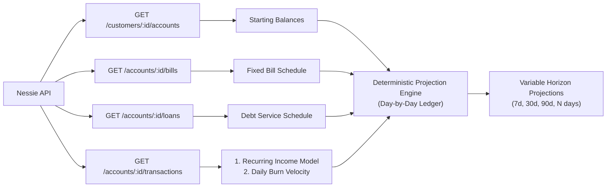

# Financial Forecasting Handoff — Dynamic Trend & Pattern Analysis

This guide provides instructions for an agent or developer implementing the **financial forecasting and predictive cashflow engine**. 

> **Important Rule: ZERO HARDCODING**  
> Do not hardcode payroll amounts, pay dates, bill schedules, or daily burn rates. All trends, intervals, obligations, and discretionary habits must be extracted dynamically by querying the user's live Nessie data and computing deterministic projections using minor-unit arithmetic (integer cents).

---

## 1. Data Ingestion Architecture

To compute a forward-looking forecast for any user, the engine queries four Nessie endpoints:



### Necessary Endpoints
1. **Accounts:** `GET /customers/{customerId}/accounts`
   - Yields starting liquid balance (`balance_cents` across Checking and Savings, or spendable credit on Credit Cards).
2. **Fixed Bills:** `GET /accounts/{checkingId}/bills`
   - Yields structured recurring obligations (`payment_amount`, `recurring_date`, `status: "recurring"`).
3. **Active Loans:** `GET /accounts/{checkingId}/loans`
   - Yields fixed debt service obligations (`monthly_payment_cents`, `status: "in_repayment"`).
4. **Historical Transactions:** `GET /accounts/{accountId}/transactions?limit=250` (page through cursors)
   - Yields historical cashflows to derive payroll cadence and discretionary run-rate.

---

## 2. Dynamic Pattern & Trend Extraction Algorithms

### Algorithm A: Detecting Recurring Income (Payrolls & Deposits)
Do not assume every user gets paid on the 1st and 15th, or bi-weekly on Fridays. Discover the user's specific cadence dynamically:

1. **Filter Deposits:** Extract all completed incoming funds:
   $$\{ t \in \text{transactions} \mid t.\text{kind} = \text{'deposit'} \land t.\text{status} = \text{'completed'} \land t.\text{amount\_cents} > 20000 \}$$
2. **Cluster by Source/Descriptor:** Group by normalized `t.description` (e.g. `INOVA HEALTH SYSTEMS PAYROLL`).
3. **Calculate Interval Cadence ($\Delta t$):** Sort deposits chronologically and calculate day differences between consecutive deposits:
   $$\Delta t_i = \text{round}\left(\frac{\text{Date}_{i} - \text{Date}_{i-1}}{86,400,000 \text{ ms}}\right)$$
   - If median $\Delta t \in [13, 15] \rightarrow$ **Bi-weekly** (every 14 days).
   - If median $\Delta t \in [6, 8] \rightarrow$ **Weekly** (every 7 days).
   - If median $\Delta t \in [28, 31] \rightarrow$ **Monthly** (every 30 days).
   - If deposits cluster on 1st & 15th $\rightarrow$ **Semi-monthly**.
4. **Determine Inflow Magnitude:** Compute median deposit amount:
   $$\text{projectedDepositCents} = \text{median}(\text{deposit amounts})$$
5. **Anchor Future Paydays:** Project forward from the latest deposit date:
   $$\text{NextPayday}_k = \text{LatestPayday} + (k \times \text{intervalDays})$$

---

### Algorithm B: Fixed Scheduled Outflows (Bills & Debt Service)
Fixed commitments are non-negotiable cash deductions that occur on specific calendar days:

1. **Bills from `/bills`:**
   Filter where `b.status === 'recurring'`. Convert dollars to integer cents:
   $$\text{billAmountCents} = \text{round}(b.\text{payment\_amount} \times 100)$$
   Deduce that in month $M$, this bill falls on:
   $$\text{DueDate} = \text{Date}(Y_M, M, \min(b.\text{recurring\_date}, \text{daysInMonth}(M)))$$
2. **Loans from `/loans`:**
   Filter where `l.status === 'in_repayment'`. Deduct `l.monthly_payment_cents` on the user's established statement date (or 1st of each month).

---

### Algorithm C: Discretionary Daily Burn Velocity (Run-Rate)
Discretionary spending (dining, coffee, retail, fuel, groceries) fluctuates day to day, but establishes a stable aggregate daily velocity over 30–90 days:

1. **Filter Variable Outflows:**
   Extract transactions from the last $W$ days (e.g., $W = 60$ or $90$ days):
   $$\{ t \mid t.\text{kind} = \text{'purchase'} \land t.\text{status} = \text{'completed'} \land t.\text{created\_at} \ge \text{Now} - W \}$$
   *(Exclude internal transfers and bill payments to avoid double counting).*
2. **Compute Daily Burn Rate ($R_{\text{daily}}$):**
   $$R_{\text{daily}} = \text{round}\left(\frac{\sum t.\text{amount\_cents}}{W}\right)$$
   *(For example, \$3,600 spent on variable purchases over 60 days $= \$60.00$/day burn rate).*

---

## 3. Variable-Horizon Projection Engine

To allow a user to see what they will have **1 week, 1 month, 3 months, or $N$ days** from now:

### Simulation Ledger (Day-by-Day)
Simulate cash balances day-by-day from $t = 1$ to $t = \text{horizonDays}$:

$$\text{Balance}(t) = \text{Balance}(t - 1) + \text{Inflows}(t) - \text{FixedBills}(t) - R_{\text{daily}}$$

```typescript
export interface DailyForecastPoint {
  date: string;                  // YYYY-MM-DD
  dayOffset: number;             // 1, 2, ... horizonDays
  projectedBalanceCents: number; // Balance at end of day
  inflowCents: number;           // Payroll / income landing today
  fixedOutflowCents: number;     // Bills / loans due today
  burnCents: number;             // Expected variable discretionary burn
  events: string[];              // ["Payroll +$1,250.00", "Rent -$1,450.00"]
}
```

### Key Metrics to Expose to User
1. **Forecasted Balance at Horizon:** $\text{Balance}(\text{horizonDays})$
2. **Lowest Liquidity Trough (The "Safety Dip"):**
   $$\text{MinBalance} = \min_{1 \le t \le \text{horizon}} \text{Balance}(t)$$
   *(Crucial: A user might have \$2,000 in 30 days, but dip to \$50 on day 14 right before payday because rent was due on day 1. The trough warns them against overspending before day 14).*
3. **Safe Discretionary Spend Today:**
   $$\text{SafeSpendToday} = \max(0, \text{MinBalance} - \text{EmergencyReserveBuffer})$$

---

## 4. Drop-in Implementation Reference

Here is a clean, dependency-free reference implementation you can import directly:

```typescript
import { format } from "node:util";

export interface ForecastRequest {
  horizonDays: number; // 7 for a week, 30 for a month, 90 for 3 months
  safetyReserveCents?: number; // e.g. 50000 ($500.00 buffer)
}

export async function computeDynamicForecast(
  customerId: string,
  { horizonDays, safetyReserveCents = 50000 }: ForecastRequest,
  nessieBaseUrl: string,
  nessieApiKey: string
) {
  const headers = { Authorization: `Bearer ${nessieApiKey}` };

  // 1. Fetch Accounts
  const { items: accounts } = await fetch(
    `${nessieBaseUrl}/customers/${customerId}/accounts`,
    { headers }
  ).then((r) => r.json());

  const checking = accounts.find((a: any) => a.type === "Checking") || accounts[0];
  let startingBalanceCents = checking.balance_cents;

  // 2. Fetch Bills & Loans
  const [{ items: bills }, { items: loans }, { items: txns }] = await Promise.all([
    fetch(`${nessieBaseUrl}/accounts/${checking.id}/bills`, { headers }).then((r) => r.json()),
    fetch(`${nessieBaseUrl}/accounts/${checking.id}/loans`, { headers }).then((r) => r.json()),
    fetch(`${nessieBaseUrl}/accounts/${checking.id}/transactions?limit=250`, { headers }).then((r) => r.json()),
  ]);

  // 3. Dynamic Payroll Detection
  const deposits = txns
    .filter((t: any) => t.kind === "deposit" && t.status === "completed")
    .sort((a: any, b: any) => new Date(a.created_at).getTime() - new Date(b.created_at).getTime());

  let payrollCadenceDays = 14; // fallback bi-weekly
  let payrollAmountCents = 0;
  let lastPayDate = new Date();

  if (deposits.length >= 2) {
    const deltas: number[] = [];
    for (let i = 1; i < deposits.length; i++) {
      const diffMs = new Date(deposits[i].created_at).getTime() - new Date(deposits[i - 1].created_at).getTime();
      deltas.push(Math.round(diffMs / 86400000));
    }
    deltas.sort((a, b) => a - b);
    payrollCadenceDays = deltas[Math.floor(deltas.length / 2)] || 14;

    const amounts = deposits.map((d: any) => d.amount_cents).sort((a: any, b: any) => a - b);
    payrollAmountCents = amounts[Math.floor(amounts.length / 2)];
    lastPayDate = new Date(deposits[deposits.length - 1].created_at);
  }

  // 4. Dynamic Daily Variable Burn Rate (over last 60 days)
  const nowMs = Date.now();
  const windowDays = 60;
  const recentPurchases = txns.filter((t: any) => {
    const ageDays = (nowMs - new Date(t.created_at).getTime()) / 86400000;
    return t.kind === "purchase" && t.status === "completed" && ageDays <= windowDays;
  });
  const totalVariableSpendCents = recentPurchases.reduce((sum: number, t: any) => sum + t.amount_cents, 0);
  const dailyBurnCents = Math.round(totalVariableSpendCents / windowDays);

  // 5. Day-by-Day Simulation
  const timeline = [];
  let currentBalance = startingBalanceCents;
  let minBalanceCents = startingBalanceCents;
  let minBalanceDate = new Date().toISOString().slice(0, 10);

  const MS_PER_DAY = 86400000;

  for (let day = 1; day <= horizonDays; day++) {
    const simDate = new Date(nowMs + day * MS_PER_DAY);
    const dateStr = simDate.toISOString().slice(0, 10);
    const dayOfMonth = simDate.getDate();

    let inflowCents = 0;
    let fixedOutflowCents = 0;
    const events: string[] = [];

    // Check Payroll
    const daysSinceLastPay = Math.round((simDate.getTime() - lastPayDate.getTime()) / MS_PER_DAY);
    if (daysSinceLastPay > 0 && daysSinceLastPay % payrollCadenceDays === 0) {
      inflowCents += payrollAmountCents;
      events.push(`Paycheck deposit (+$${(payrollAmountCents / 100).toFixed(2)})`);
    }

    // Check Bills
    for (const b of bills) {
      if (b.status === "recurring" && b.recurring_date === dayOfMonth) {
        const costCents = Math.round(b.payment_amount * 100);
        fixedOutflowCents += costCents;
        events.push(`${b.nickname || b.payee} (-$${b.payment_amount.toFixed(2)})`);
      }
    }

    // Check Loans (1st of month)
    if (dayOfMonth === 1) {
      for (const l of loans) {
        if (l.status === "in_repayment") {
          fixedOutflowCents += l.monthly_payment_cents;
          events.push(`${l.type} Payment (-$${(l.monthly_payment_cents / 100).toFixed(2)})`);
        }
      }
    }

    // Apply ledger movements
    currentBalance = currentBalance + inflowCents - fixedOutflowCents - dailyBurnCents;

    if (currentBalance < minBalanceCents) {
      minBalanceCents = currentBalance;
      minBalanceDate = dateStr;
    }

    timeline.push({
      date: dateStr,
      dayOffset: day,
      projectedBalanceCents: currentBalance,
      inflowCents,
      fixedOutflowCents,
      burnCents: dailyBurnCents,
      events,
    });
  }

  return {
    horizonDays,
    startingBalanceCents,
    finalProjectedBalanceCents: currentBalance,
    minimumProjectedBalanceCents: minBalanceCents,
    minimumBalanceDate: minBalanceDate,
    safeSpendBufferCents: Math.max(0, minBalanceCents - safetyReserveCents),
    derivedTrends: {
      payrollCadenceDays,
      payrollAmountCents,
      dailyDiscretionaryBurnCents: dailyBurnCents,
    },
    timeline,
  };
}
```

---

## 5. Integrating with Deal Feasibility Checks

When evaluating whether an offer (e.g. 5% back at Best Buy on a \$200 item) should be recommended to the user:
1. Run `computeDynamicForecast` for `horizonDays = 30`.
2. Inspect `minimumProjectedBalanceCents`:
   - If `itemCostCents > minimumProjectedBalanceCents - safetyReserveCents`:
     - **Decline / Warn Recommendation:** Even though current balance is sufficient today, an upcoming fixed bill (e.g. Rent on the 1st) will cause an overdraft before the next paycheck.
   - If `itemCostCents <= safeSpendBufferCents`:
     - **Approve Recommendation:** The purchase fits comfortably within both current and forecast liquidity.
