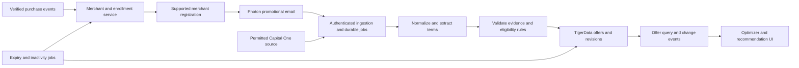

# Deals implementation plan — Photon email and Capital One offers

Originally prepared November 7, 2026, with the preparation-only readiness audit at approximately 10:11 PM CST. **Section 15 is the current implementation handoff and supersedes earlier preparation/readiness snapshots.** The deals code and TigerData schema/roles are implemented; live acceptance remains incomplete. No real merchant registrations, emails, commits or pushes have been performed.

## 1. Goal and project fit

Build the acquisition and lifecycle layer that supplies trustworthy, user-eligible deals to the financial recommendation engine. It must discover merchants from transaction history, initiate supported rewards registrations, ingest their promotional emails through Photon, normalize offers into TigerData, and expose evidence and redemption conditions to downstream services. Capital One acquisition is a separate source with a strict free/no-exclusive-partnership requirement.

The whole product is a React Native/Expo personal-finance app combining Nessie financial data, Photon communications, Nemotron interpretation, TigerData persistence, and live or simulated location. Budgets are hard constraints. Forecast obligations, suitability, and geographic feasibility affect recommendations. A deal alone is insufficient evidence that a purchase is affordable or appropriate.

Reviewed all repository files: [context.md](../context.md), [spec-checklist.md](../spec-checklist.md), and [README.md](../README.md). At initial review, there was no application scaffold, dependency manifest, database schema, or implementation. Subsequent user decisions and CLI access checks are recorded in section 10; those updates supersede the initial unknowns below where explicitly resolved.

Authority: confirmed requirements and section 14 defaults in context.md remain authoritative; the checklist remains the delivery ledger. This document adds research and proposed engineering decisions, not new user requirements. No checklist item is completed by writing this plan.

**Recommended delivery order:** verify Photon 2.0 email access → establish shared contracts → implement one real merchant end to end → add a second merchant and lifecycle recovery → integrate the optimizer/app → implement Capital One acquisition only if its access gate passes. Research the Capital One gate early so it cannot consume the rest of the build unnoticed.

## 2. Scope and ownership

| Area | Deals workstream owns | Boundary/dependency |
| --- | --- | --- |
| Merchant discovery | Consume historical/new purchase events; resolve program; initiate idempotent enrollment | Financial ingestion supplies verified transactions and canonical merchant IDs; shared place service owns branch coordinates |
| Registration | Selected merchant adapters, separate loyalty/promotion outcomes, verification handoff, existing-member recovery | Photon transports email; it is not a general website signup engine |
| Promotional identities | Per-user addresses on a controlled promotional domain, ownership routing, consent and disablement | Account/domain/DNS access and merchant acceptance must be verified |
| Email acquisition | Photon adapter, authenticated ingress, replay, safe parsing, source retention | Text-derived forecasting and general personal-inbox import are separate workstreams |
| Offer processing | Nemotron extraction proposals; deterministic validation, provenance, expiry, deduplication, revisions | Shared Nemotron runtime/model and TigerData deployment are prerequisites |
| Capital One | Product-specific feasibility decision, adapter if permitted, eligibility/redemption restrictions, honest unavailable state | No free usable collection route has yet been verified |
| Consumer contract | Queryable offer evidence, eligibility results/reasons, lifecycle change events | Optimizer owns payable-cost arithmetic, hard budgets, liquidity, suitability, travel, stacking calculation and ranking |
| User experience | Enrollment/source status and offer terms/actions, integrated into shared app screens | App team owns navigation, authentication, onboarding, recommendation detail and settings shell |
| Cleanup | One-calendar-year inactivity, promotion unsubscribe, local suppression, return handling | Preserve external loyalty accounts and earned rewards by default |

### Minimum implementation target

- One end-to-end merchant first, then a proposed target of **two supported merchants** for the required different-merchant registration demonstration. Two is a planning default, not a confirmed team commitment.
- Historical purchases and later new merchants both initiate the process. Unsupported merchants receive a reason and explicit status.
- Real enrollment outcomes distinguish loyalty membership from email marketing subscription. A welcome email is not automatically an offer, and a submitted form is not proof of enrollment.
- Actual Photon promotional mail produces evidence-backed, user-scoped offers. Handle both plain text and HTML; quarantine unreadable content instead of inventing terms.
- Deduplication, expiry, consent withdrawal, cross-user isolation, observable failures, inactivity cleanup and return behavior are part of completion, not optional polish.
- A Capital One source status and access decision are required. Actual aggregation remains required by the project but **blocked until a compliant free route is demonstrated**; a link-out alone does not complete REWARD-05.

### Outside this workstream

- Nessie account/balance/transaction synchronization, conversational onboarding, text obligation extraction, cash-flow forecasts, GPS/background feasibility, notification policies, and voice-call implementation. Supply contracts to those owners.
- Full product catalog ingestion, real-time inventory, arbitrary basket pricing, routing, and reward-point valuation. An offer does not establish a product's price or availability.
- Automatic purchases, card applications, credit-product marketing, reward redemption, or automatic Capital One activation. Redemption/activation handoff can be shown without performing a transaction.
- A universal web agent that registers at every merchant; paid deal feeds; exclusive partnerships; comprehensive market coverage; shared pools of personalized coupons.
- CAPTCHA bypass, invented identity details, duplicate loyalty accounts, automatic deletion of loyalty value, and unsupported guarantees of savings.

### Later expansion, after required work

More merchant adapters, image/PDF offer extraction, broader supported offer formulas, richer offer browsing, and reconciliation of expected versus actually paid cashback. The minimal pipeline must still explicitly flag unsupported formulas and image-only terms. Never quietly drop a required lifecycle feature as a stretch goal.

## 3. Research findings and source decisions

Sources below were accessed November 7, 2026. Distinguish **documented capability** from **tested integration**: no authenticated provider or merchant end-to-end test has been run.

### Photon: use 2.0 beta

The user supplied [Hackathon Guidelines for Photon 2.0](https://somethingreat.notion.site/Hackathon-Guidelines-for-Photon-2-0-3f8e443f36bb81f9893fed0d08a4c01d). The guide calls for Photon 2.0 with a live channel, includes email, and says beta use is free without a promo code. For the adjacent voice workstream, it directs hackathon calls through an SMS number and a Voice profile connected over SIP. Its SDK link points to Spectrum documentation; use the beta contracts below for this implementation instead of mixing versions. Event eligibility and credits still need confirmation for this team's account; the guide is not evidence of an active credit balance.

| Evidence | Consequence for this plan |
| --- | --- |
| [Version index](https://photon.codes/docs/llms.txt) distinguishes stable Spectrum from beta API/SDKs | Select beta `@photon-ai/api` if the shared server is TypeScript; beta API origin is `https://api.photon.codes/v1`. Pin an actual SDK/payload version during implementation. Do not mix stable authentication or webhook formats. |
| [Beta email guide](https://photon.codes/docs/beta/get-started/email) documents controlled-domain DNS, receiving MX, address resolution on first inbound mail, and message listing | Prefer an unused subdomain. No separate mailbox-creation call is needed for the documented inbound-first flow. This does not establish access to arbitrary Gmail/Outlook history. |
| [Beta webhooks](https://photon.codes/docs/beta/message-delivery/webhook) documents signed events, duplicate delivery and durable acceptance | Use Standard Webhooks verification of the original body; validate the event schema separately. Persist accepted event and queued work atomically. |
| [Beta plans](https://photon.codes/docs/beta/plans-and-billing) list one email domain on Free, no included emails, and $0.001/email; [billing](https://photon.codes/docs/beta/billing) counts received and sent email | The hackathon guide's free-use statement and standard billing differ. Verify event credits/waivers, expiration and budget before enabling usage. Domain ownership may also have a cost. |

**Remaining Photon integration gates:** provider completion of domain verification, available credits, real-message HTML/attachment fidelity and receipt timestamps/headers, rate limits, replay/history retention, and deletion behavior. Project access, email-list access, domain ownership/DNS publication and the inbound-event schema are now verified (section 13); webhook creation permissions have not been exercised. Prove recipient-to-user routing with two addresses before multi-user use. The dedicated-address approach is a design proposal, not a claim that Photon supplies per-user isolation automatically.

The email guide was retrieved directly after browser indexing failed; the supplied Notion guide was read through its public page-content response. No login, account creation, message sending or DNS change occurred during research.

### Capital One: split the products before building an adapter

| Product/source | Verified finding | Implementation implication |
| --- | --- | --- |
| Capital One Offers | [Program terms](https://capitaloneoffers.com/Capital-One-Offers-Terms-and-Conditions.pdf) restrict participation to qualifying accounts and individualized offers. Online and explicitly supported card-linked purchases follow different activation/redemption paths. | Store user/account eligibility, channel, activation state and operative terms. Never treat chain proximity as proof of in-store redemption. |
| Offers user experience | [Official explanation](https://www.capitalone.com/learn-grow/money-management/capital-one-offers/) describes online purchases in the same session within 24 hours; in-store offers require activation and the associated card. Payouts are delayed and may be rewards or statement credits. | Keep immediate payment separate from conditional future benefit. Preserve provider navigation rather than substituting a generic merchant URL. |
| Capital One Shopping | [Shopping terms](https://capitaloneshopping.com/our-terms/terms-of-service), especially §§3, 6 and 9, distinguish gift-card rewards from cash and restrict collection, database compilation, automation and scraping. They also flag disposable/relay email use. | No default scraper; no burner-account enrollment for Shopping; do not label its rewards as cash. A publicly visible page is not an approved aggregation feed. |
| Banking portal collection | [Online banking terms](https://www.capitalone.com/digital/corporate-terms/), Acceptable Use, restrict automated or manual monitoring/copying without prior written permission | Logged-in scraping and manual bulk copying are not assumed fallbacks. User consent alone does not establish provider permission. |
| DevExchange / “Credit Offers API” | [DevExchange](https://developer.capitalone.com/) describes approved partner onboarding and contracting. [Capital One's Credit Offers article](https://www.capitalone.com/tech/cloud/a-serverless-and-go-journey/) concerns credit-card acquisition offers. | Neither proves a free merchant-cashback feed. Do not confuse credit-card applications with shopping offers or treat Nessie financial data as proof of offer eligibility. |

**Research conclusion:** no documented, free, no-partnership bulk Capital One shopping-offer API was identified in the official sources reviewed. This is a bounded research result, not proof that no route exists. General scraping is not a viable default under the reviewed conditions.

Choose the Capital One mode with evidence:

1. **Real acquisition:** only if a documented/export/partner-permitted route can be used at zero acquisition cost without the prohibited partnership requirement. Record allowed storage/display, audience, coverage, quotas, refresh and revocation semantics; test with an actual eligible account.
2. **Personal email/import candidate:** investigate only if the source's terms permit this use and the intended recipient's provenance is preserved. Forwarding, screenshots, manual import or a browser extension are not automatic workarounds. These would cover a subset, not a complete catalog.
3. **Unavailable plus external navigation:** proposed degradation if no route passes. Show that Capital One data is not connected and let the user visit the official service. Do not import invented rates or use this state as evidence of successful aggregation. Keep DISC-07/REWARD-05 unresolved and record the unmet requirement in the demo/handoff.

Merchant email integration may proceed independently of this gate. Adopting mode 3 as a permanent reduction of the original feature needs an explicit later scope decision; this plan does not silently make that reduction.

### Initial merchant feasibility shortlist

These are research candidates, not selected/demo-ready integrations. Selection must match merchants in the actual demo user's transaction history and locations.

| Candidate | Official evidence | What still needs proof |
| --- | --- | --- |
| Chipotle | [Rewards terms](https://www.chipotle.com/rewards-terms) distinguish account/rewards enrollment from optional marketing; [account form](https://www.chipotle.com/order/create-account) mentions verification texts | Allowed automation, identity/phone handling, existing account recovery, actual email offer availability, unsubscribe path |
| Panera | [MyPanera](https://www.panerabread.com/content/panerabread_com/en-us/mypanera/meet-mypanera.html) provides enrollment; [email preference help](https://panerabread.my.site.com/custhelp/s/article/How-do-I-update-my-email-preferences-for-MyPanera) uses the existing account | Allowed automation, verification, actual terms/email delivery and cleanup; do not accidentally enroll in a paid subscription |

Select programs only after inspecting their current terms and real flows. Prefer an observed promotion relevant to the demo purchase; do not depend on a welcome coupon arriving immediately. If a candidate cannot support the required flow, mark it unsupported and evaluate another merchant instead of claiming generic signup support.

## 4. Proposed architecture and contracts

Use the shared authenticated backend, worker/job mechanism and TigerData database. The user has delegated backend conventions: select Node.js 24+, TypeScript, a Fastify HTTP API, PostgreSQL access through `pg`, versioned SQL migrations and a PostgreSQL-backed jobs/outbox table with a worker process. Keep API and worker in the same repository; no Redis or separate microservice fleet is needed initially. Package versions and deployment target will be pinned during implementation. Neither a vector database nor a time-series extension is required by this feature's logic.



### Entities and invariants

| Entity | Minimum proposed contract |
| --- | --- |
| `deal_source_connection` | Owner, provider/product, project/connection reference, secret reference, consent version, status, cursor, last successful sync, failure code, access-policy evidence |
| `promotional_identity` | Owner, normalized address, Photon recipient ID when known, domain, verification/disabled timestamps; unique address-to-owner mapping |
| `merchant_program` | Canonical merchant, program ID, loyalty/promotion capabilities, adapter/version, permitted flow, required identity inputs, verified domains, unsubscribe method |
| `enrollment` | Owner/program uniqueness, loyalty status, promotional status, lifecycle state, activation time, last verified purchase, inactivity deadline, retry/verification metadata, external membership reference |
| `source_message` | Owner, provider/project/message/event IDs, received time, sender/recipient, sanitized text or restricted raw reference, content hash, retention deadline, trust observations |
| `offer` and `offer_revision` | Owner/audience, source product/message/URL, canonical merchant/branch scope, terms/evidence references, structured benefit/conditions, validity, freshness, lifecycle status, revision and parser/model versions |
| `offer_eligibility` | Owner/offer revision, eligible/ineligible/unknown, reasons, account/payment/activation evidence and timestamps; reevaluate when input versions change |
| `deal_job` / `deal_event` | Owner, stable idempotency key, attempts, bounded retry schedule, lease/state, result, correlation ID; outgoing invalidation event saved transactionally |

Personalized emails, coupon codes, tracking links and account offers are private by default. Public visibility requires explicit source evidence and allowed reuse; do not infer it from a non-personalized title. Deduplicate within the authorized audience. Two users receiving the same campaign do not share coupon ownership.

### Offer fields needed by the optimizer

- Merchant and branch applicability; online/in-store/in-app/pickup channels; eligible products/categories and explicit exclusions.
- Benefit type: fixed discount, percentage, fixed price, conditional cashback, points, gift-card reward, BOGO, or unsupported formula. Preserve “up to”/range language without converting it to a guaranteed maximum benefit.
- Amounts in integer minor units plus currency; rates as exact decimal/rational values or basis points. Record caps, minimum eligible spend, quantity constraints and the calculation basis, including treatment of taxes/fees/shipping when evidenced.
- Start/end time, source timezone, inclusive/exclusive semantics, date-only/uncertain validity and observation time. Missing expiry remains unknown; a local freshness deadline is not a merchant expiration date.
- Required code, loyalty membership, new/existing-customer restriction, user/account/card eligibility, activation, payment method, permitted redemption path, single-use state and stacking rules. Unknown stacking does not mean stackable.
- Price basis and evidence, separately from discount. A 20% promotion without a verified eligible price cannot yield an exact dollar saving.
- Reward payout form and timing, conditions/refund risk, and valuation status. Points/gift-card value must not silently become spendable cash.
- Field-level evidence references, extraction confidence, review status, last verification, stale-after policy and revision. Model confidence alone never verifies eligibility.

Proposed states: `pending_extraction`, `needs_review`, `active`, `stale`, `expired`, `withdrawn`, `rejected`. Activation and user eligibility are separate from these content states. An active offer can still be ineligible for a particular user or basket.

### Integration interfaces

These are proposed internal contracts, not Photon endpoints:

- Input `merchant.purchase_observed`: owner, stable transaction ID, merchant/branch references, purchase occurrence time, import time, status and provenance. Corrections/refunds need a documented eligibility policy; imported_at never substitutes for purchase time.
- Query `getOfferCandidates(owner, merchantIds, channel, asOf, purchaseContext)`: returns revisions, evidence, required actions, freshness, and eligibility/rejection reasons. Authenticated owner comes from the caller, not an arbitrary request body.
- Output `offer.changed`, `offer.expired`, `offer.withdrawn`, `enrollment.changed`, `deal_source.degraded`: owner, entity/revision, time and reason; invalidate dependent recommendations reliably.
- App reads source/enrollment status and offer detail; requests retry, verification continuation, consent withdrawal or manual correction through authenticated actions. Corrections retain original source evidence and authorship.

Agree these contracts with financial-ingestion, agent, optimizer and app owners before implementing provider adapters. Monetary application belongs to one shared deterministic module; do not introduce a second cost calculator in the email parser.

## 5. Photon and merchant workflow

### Setup and delivery

1. Confirm the supplied Photon 2.0 project and funding; record configuration names, never secret values. Proposed names: `PHOTON_PROJECT_ID`, `PHOTON_API_KEY`, `PHOTON_WEBHOOK_SECRET`, `PHOTON_EMAIL_DOMAIN`. Use setup-only permissions separately from runtime where supported.
2. Connect an unused controlled subdomain. Publish the exact domain-specific records returned by Photon, verify sending and receiving independently, and preserve existing working inbox MX records. Follow the [beta email setup](https://photon.codes/docs/beta/get-started/email).
3. Allocate an opaque per-user local address and register ownership before it receives mail. Verify merchant acceptance of that identity. Keep the same identity across retries and returning users.
4. Prove real inbound plain-text and HTML delivery, recipient identity and message IDs. Subscribe only to the required beta email event types using the selected event catalog. Do not guess event names or copy stable Spectrum handlers.
5. Verify `webhook-id`, `webhook-timestamp`, and `webhook-signature` over the original body with the destination secret; then enforce project, recipient and schema checks. Commit event deduplication and queued processing together before acknowledging. A verified signature authenticates Photon delivery, not the truth of the merchant's claims. See [beta webhook contract](https://photon.codes/docs/beta/message-delivery/webhook).
6. Use paginated message-list reconciliation with a durable checkpoint/overlap and message deduplication to recover missed events. Measure its limits; do not copy the bounded quickstart's start-at-launch behavior into a persistent inbox consumer. If recovery is unavailable, surface a sync gap.

Do not auto-reply to promotional mail. Sending is limited to supported enrollment/verification/unsubscribe operations with recipient and purpose checks; arbitrary email instructions cannot invoke tools.

### Enrollment state machine

`discovered → queued → in_progress → enrolled`

Branches: `needs_user_input`, `unsupported`, `retryable_failure`. Cleanup: `inactive → unsubscribe_pending → unsubscribed`. Store loyalty and marketing results independently within this lifecycle so partial success is visible.

- Historical and incremental purchases upsert one owner/program enrollment. Use a stable operation key and a lease/unique constraint to prevent simultaneous signup attempts.
- Look for an existing membership first; do not make another account just because the promotional address is new. If account matching requires user action, pause the adapter with a precise reason.
- Use a small allowlisted merchant adapter: known URL/API/form fields, supported consent choices, typed actions, success evidence and verification rules. Nemotron may interpret unfamiliar text; it does not decide that an unknown site is trusted.
- Let users complete CAPTCHA, phone/identity requirements and unsupported verification. Persist resumable state. Do not invent personal information or use a Photon number as proof of the user's identity.
- After timeout, reconcile the actual outcome before resubmitting. Retry limits cannot prevent duplicate external accounts unless uncertain results are checked.
- Accept enrollment only on sufficient merchant evidence; retain a redacted reference. Save whether loyalty, marketing or both actually succeeded.

### Extraction and validation

Sanitize HTML to text without executing scripts or loading tracking resources. Classify receipts, verification requests, welcome messages, newsletters and genuine offers separately. One message can contain multiple offers; plain/HTML alternatives are not two offers.

Use deterministic parsers for known merchant templates and Nemotron for unstructured terms. Require schema-valid proposals with supporting text locations. Reject unsupported currency, impossible dates, contradictory conditions and missing critical evidence. Limit Nemotron input to necessary content; external text must not authorize tool calls or override the extraction schema.

Resolve sender/merchant using the registry and available authentication evidence; display names alone are insufficient. Keep ambiguous merchant/branch matches unresolved. Fetch additional terms only through bounded, allowlisted HTTPS access with private-address/redirect defenses. Missing or image-only terms produce review status; OCR is an optional later capability.

Deduplicate delivery by provider IDs, then repeated campaigns by owner/source/campaign or normalized terms fingerprint. Do not merge different expirations, personalized codes or changed rates. Preserve immutable revisions and invalidate consumers when terms change.

## 6. Freshness, cleanup and failure behavior

- Recheck validity at query time even if the expiry job has not run. Never offer an expired or locally disabled promotion.
- Set per-source freshness policies from documented behavior and observed delivery. Proposed initial scheduling: event-driven email processing plus a periodic reconciliation job; final interval must fit measured quotas. Absence of a new email does not prove an old offer was withdrawn.
- If a permitted catalog source returns a complete authoritative snapshot, missing items can be withdrawn; do not withdraw from an incomplete page or failed sync. Record snapshot completeness.
- Set inactivity deadline to **one calendar year after the later of activation and last verified purchase**, in the user's timezone, as context.md specifies. Proposed leap-day rule: clamp February 29 to February 28 in the following non-leap year. Test that rule explicitly.
- At the deadline, suppress promotional ingestion/use locally, request supported unsubscribe, and remove unnecessary stale local offers. Preserve loyalty membership/rewards. External unsubscribe remains pending until confirmed; local suppression is not proof that the merchant stopped sending.
- Serialize cleanup with purchase updates and recheck deadline/version before external action. On a later valid purchase, reuse the enrollment/account, restore authorized ingestion or initiate resubscription as required. Do not override explicit user opt-out or revoked consent.
- Invalid credentials, quota exhaustion, database failure, parser failure and provider outages produce actionable status, bounded retries and an audit trail. Replayed jobs must not repeat completed side effects.

Proposed retention default for review: restricted raw promotional content for at most seven days; minimal sanitized evidence through offer validity plus 30 days; then purge unnecessary content and retain minimal lifecycle/idempotency metadata for a documented period. Define handling for unknown-expiry offers and provider-side deletion limitations before deployment. A consent withdrawal stops new work immediately and queues deletions across this feature's stores.

## 7. Ordered implementation backlog and gates

All items below are future work. Parallelizable means independent engineering work, not authorization to skip a prerequisite.

| Step | Deliverable and acceptance evidence | Checklist mapping |
| --- | --- | --- |
| D-01 | Record Photon beta project access, SDK/API versions, domain/DNS access, exact scopes, credits/usage limits, payload samples and a real received email. Resolve hackathon/free-tier discrepancy. | DISC-01, DISC-02, DISC-10 |
| D-02 | Write Capital One access decision for Offers and Shopping separately. Test the candidate route if one is allowed; otherwise record blocked acquisition, considered alternatives and measured coverage as zero. | DISC-07, REWARD-05 |
| D-03 | Select two merchant programs from actual history; document allowed flow, identity requirements, membership recovery, consent, email delivery and unsubscribe. First demonstrate one real registration. | REWARD-01–03 |
| D-04 | Agree backend/job/auth interfaces and TigerData migrations for the entities above. Verify uniqueness, ownership and rollback/recovery. Obtain the shared Nemotron extraction contract. | DISC-04–05, DATA-01–04, AGENT-01–02 |
| D-05 | Implement signed Photon ingestion, durable processing, HTML/plain handling, checkpoint recovery and source status. Replay a delivery and restart midway without data loss/duplicates. | DATA-06–07, SEC-01–02 |
| D-06 | Implement schema-based extraction, evidence validation and first merchant parser; persist revisions and distinguish incomplete terms from verified facts. | REWARD-04, AGENT-01, SEC-04 |
| D-07 | Implement selected merchant enrollment adapters, historical/incremental triggers, resumable verification and uncertain-outcome reconciliation; expand to the second merchant. | REWARD-01–03, DATA-03 |
| D-08 | Implement eligible-candidate query, expiry/freshness, deduplication and material-change events; prove optimizer rejects unknown/ineligible combinations. | REWARD-06, OPT-02–04, OPT-09 |
| D-09 | Implement Capital One adapter only after D-02 passes; otherwise ship explicit unavailable/link-out state and leave aggregation incomplete. Measure accessible offers, freshness and restrictions. | REWARD-05, APP-02 |
| D-10 | Implement inactivity cleanup, safe unsubscribe, return flow and consent withdrawal, including cleanup/purchase races. | REWARD-07–08, SEC-05, QA-03 |
| D-11 | Integrate enrollment/source screens and offer evidence/redemption detail; verify authenticated navigation, secrets/log redaction and failure recovery. | APP-02, APP-04, SEC-01–06 |
| D-12 | Run actual-data demo rehearsal; record latency/extraction errors and all blocked requirements. Publish setup/runbook within the repository only when implementation is complete. | DEMO-02–04, QA-04–05, HANDOFF-01–02 |

D-01 and D-02 are the first investigations. Contracts and merchant research can progress while account setup is pending. D-04 is needed before durable ingestion; D-05/D-06 and D-07 converge on the first complete flow. D-09 must not block the independent merchant path. Do not assign fabricated dates or hour estimates while the actual deadline and capacity are unknown.

## 8. Validation and demonstration

| Scenario | Required result |
| --- | --- |
| Same historical batch/event/job replayed; worker crashes after persistence | One enrollment, one processed source message, no repeated external signup |
| Two simultaneous enrollment attempts or uncertain form response | Reconcile and resume; never create a duplicate account |
| Cross-user request, forged recipient/owner, tampered/stale webhook | Rejected before mutation or sensitive data access |
| Plain/HTML variants, multiple offers, receipt or welcome message | Correct classification and offer count; no invented discount |
| Malicious email instructions, executable HTML, private-network link | No tool escalation, secret disclosure or unsafe fetch |
| “Up to” rate, unknown expiry, missing price, unknown stacking/card/channel | Explicit uncertainty; no guaranteed savings or false eligibility |
| Online offer near physical branch; activation required but unproven | Not treated as an already-redeemable in-store opportunity |
| Same campaign revised or coupon individualized | Correct revision/ownership; downstream recommendation invalidated |
| Cashback arrives later; reward is points/gift card | Immediate affordability unchanged; unverified values excluded |
| Expiry boundary, date-only timezone, one-year leap/DST boundary | Consistent documented validity and cleanup |
| Cleanup overlaps a purchase; later return; user opted out | Correct lifecycle, no duplicate membership, consent preserved |
| Photon/DB/model outage, exhausted credits, partial source snapshot | Honest degraded state, bounded retry, no fabricated data or withdrawal |

Use synthetic cases only in isolated automated tests, clearly labeled. The demo requirement permits simulated movement, not fabricated deals, purchases, email, calls or recommendations. Real previously received mail may be reprocessed with its original timestamps/provenance and described as a replay; do not present it as newly received or an expired offer as current.

Deals demonstration: show a real merchant discovered from source history → actual registration/verification outcome → real Photon promotional email → validated stored terms → offer handed to the same optimizer used by live and simulated location. Show the second merchant and an actionable failure/recovery state. Show Capital One acquisition only if D-02 passed; otherwise disclose its unavailability. Do not promise to wait for cashback settlement during a hackathon demo.

Definition of done: required deals behavior above is implemented, observed and tied to checklist evidence; all source restrictions and remaining gaps are documented. A functioning email path does not mean Capital One aggregation is complete, and an available offer does not mean the overall recommendation engine is complete.

## 9. Open dependencies to resolve during implementation

1. Photon domain provisioning completion, actual event credits and demo permissions, real-message fidelity and recovery window. Project credentials, DNS publication and the webhook schema are verified; see section 13.
2. A permitted free Capital One acquisition route, if any; actual eligible user/account evidence; scope decision if aggregation cannot be delivered.
3. Selected merchant flows and authorized identity inputs; real relevant promotional mail and independently evidenced purchase prices.
4. Shared auth, backend/worker hosting, TigerData deployment/migration conventions, Nemotron model/endpoint and output validation.
5. Upstream purchase semantics, canonical merchant/branch IDs, consent contract, optimizer eligibility/price contract, and UI ownership.
6. Actual deadline, capacity, operating budget and raw/provider retention policy.

These are recorded gates, not a new clarification interview. Independent planning and implementation can proceed where the relevant prerequisites are satisfied.

## 10. Dependency update and CLI verification — November 7, 2026

The user reports existing TigerData and Photon setup, instructs use of their CLIs, delegates backend conventions, and authorizes searching/scraping/other acquisition techniques to obtain structured Capital One offers. Capital One acquisition is an implementation-owned investigation, not a request for the user to locate an API. Source access restrictions and user eligibility still affect what can actually be acquired and claimed; no live Capital One dataset has been collected yet.

| Dependency | Observed status | Remaining action |
| --- | --- | --- |
| TigerData | Resolved: the user authorized resetting service `ylg4ko70w8` (`nessential-db`, DEV). Tiger CLI generated and saved a new master password; subsequent read-only `SELECT 1` returned `connection_ok = 1`. | No credential input needed to start. Other clients using the previous master password must update. Keep the new credential out of source control and use a restricted application role during implementation. |
| Photon | Verified beta API access to project `pho_prj_01m6wh04gseh78gcs73agt2kj6` (`Nessiessential`). The supplied key can read project/resources and initiate domain setup. The installed CLI exposes stable Spectrum commands, so beta HTTP API was used for this setup. | Project ID/key blocker is resolved. All six required DNS records match public and authoritative DNS. Photon still reports provisioning running; billing access returns 403. See section 13. |
| Nessie | User supplied the key and [v2 docs](https://v2.nessieisreal.com/docs#description/nessie-v2.). Read the [OpenAPI document](https://v2.nessieisreal.com/openapi.json), version 2.1.1. Read-only `GET /accounts?limit=1` returned HTTP 200 with zero items. The user subsequently authorized generating fake data for testing. | No starting-data blocker. Use documented seed/resource APIs for explicitly labeled synthetic tests during implementation. Inspect existing data first, avoid destructive resets, and do not trigger real merchant enrollment from test events. Testing authorization does not turn generated transactions or offers into real demo evidence. |
| Backend | User delegated conventions; implementation choices are recorded in section 4. | No user decision needed to start local API/worker implementation. Remote deployment access can be resolved later; Photon webhooks need public HTTPS, or a documented live-event transport can be used locally. |
| Nemotron | No endpoint/model or credentials supplied or verified. It is not needed for initial development. | Start with deterministic parsers for selected merchant templates and review/unsupported status for unknown formats. Defer Nemotron access until implementing interpretation of unfamiliar, unstructured offer terms. It is not involved in basic ingestion, structured Capital One data, persistence or lifecycle logic. |
| Promotional email | The user added the six generated records for `deals.getcompfy.com`; all match on both Cloudflare authoritative nameservers and public resolver 1.1.1.1. | No further DNS edits indicated. Await Photon verification, then test actual reception during implementation. Do not submit a duplicate setup request. |

The Nessie key is intentionally absent from repository files. Its v2 API uses Bearer authentication, integer-cent transaction amounts and transaction/merchant endpoints. It is explicitly a mock banking API; the name of its hosted production endpoint does not make its data live customer banking data. The application's ownership checks must still distinguish app users within the team's Nessie tenant.

### Is a domain mandatory?

**For email generally, no. For Photon's documented native email integration, yes: a controlled domain or subdomain with DNS access is required.** The [Photon beta email guide](https://photon.codes/docs/beta/get-started/email) routes incoming email using receiving MX records and verifies sending records. An ordinary `@gmail.com` address cannot change the DNS for `gmail.com`. No native connect-your-Gmail-inbox flow was established in the Photon documentation reviewed.

A burner is an address used for a limited purpose; it need not be a Gmail account. An address such as `opaque-user-id@deals.example.com` can serve that purpose through Photon. If the team already controls a domain, an unused subdomain avoids buying another domain or creating a Google mailbox per user. Provider usage charges/credits still need verification.

An actual Gmail burner is possible through a separate Gmail API connector. Google's [Gmail API overview](https://developers.google.com/workspace/gmail/api/guides) and [Node.js quickstart](https://developers.google.com/workspace/gmail/api/quickstart/nodejs) describe mailbox reading with a Google Cloud project, enabled API, OAuth credentials and user authorization. That adds a provider integration and replaces Photon as the email reader; Photon could still handle calls/texts, but this would be a change to the current email requirement. Simply inventing a Gmail address does not create a working inbox or grant API access. Forwarding Gmail into Photon also needs a Photon receiving address, so it does not remove the documented domain prerequisite.

During the initial checks, no schemas, accounts, DNS records, keys or provider configurations were changed. The later authorized TigerData password reset is recorded in section 11. No purchases or messages were sent, and the Nessie seed/simulation endpoints were not invoked.

### Cloudflare actions for getcompfy.com

The user has configured `deals.getcompfy.com`; all required records were verified in this audit. The following is reference guidance for future maintenance, not outstanding DNS work. Use the subdomain so the root domain's existing email service is preserved. After connecting that subdomain in Photon, obtain its actual DKIM CNAME, bounce MX/SPF TXT, receiving MX and any additional verification records. Record values are generated for the domain; do not invent or copy sample values.

In Cloudflare, open `getcompfy.com` → DNS → Records → Add record, and enter each Photon-provided type/name/value and MX priority. Use DNS-only mode for the email CNAME records. Do not replace root-domain MX records or enable a competing receiving service on the same subdomain. Wait for Photon to verify both sending and receiving. No Gmail mailbox or separate domain purchase is needed. See [Photon email setup](https://photon.codes/docs/beta/get-started/email) and [Cloudflare DNS instructions](https://developers.cloudflare.com/dns/manage-dns-records/how-to/create-dns-records/).

The user completed the Cloudflare entries, and independent DNS checks confirm the required values. Cloudflare management access is unnecessary for the remaining checks. Photon project access and TigerData are verified. Remaining provider setup is Photon verification and confirmation of email funding/entitlement. Nemotron and pre-existing Nessie data are not prerequisites to start implementation.

## 11. Setup results and operator steps — November 7, 2026

### TigerData: repaired

With explicit user authorization, ran `tiger service update-password ylg4ko70w8 --auto-generate --version-check=false`. Generated output was captured without displaying the credential. The CLI's configured credential storage now works: `tiger db query ylg4ko70w8 --read-only --version-check=false --timeout 15s -c 'SELECT 1 AS connection_ok' -o json` succeeded.

Important operational consequence: clients configured with the previous `tsdbadmin` password must obtain the replacement through secure local credential handling and update their connection configuration. No database tables/data, service sizing or other users were modified. Runtime application credentials should be separated from this administrative login during implementation.

### Brev: access verified; original failure not reproduced

Used the installed Brev CLI v0.6.337 and the Brev CLI skill. `brev ls --org rishi.sandrana-4a543b-ipod --json` reported `following-copper-silkworm` (`deokpaysz`) RUNNING, build COMPLETED, shell READY and health HEALTHY.

Both non-interactive `brev exec` and the user's exact interactive command succeeded:

```sh
brev shell following-copper-silkworm --org rishi.sandrana-4a543b-ipod
```

The interactive session logged in as `shadeform`, returned hostname `brev-deokpaysz`, and `nvidia-smi` reported NVIDIA L40S with 46068 MiB memory. The session was then exited normally. No restart, instance reset, replacement, port exposure, software installation or model deployment was performed. The original failure was not reproduced, so its cause cannot be asserted. If the user's own terminal still fails, collect the exact error there; `brev refresh --org rishi.sandrana-4a543b-ipod` is the documented SSH-config refresh command, not a fix that has been proven necessary here.

Brev machine access does not imply that a Nemotron inference server is running. GPU/model setup is deferred until the feature needs inference.

### Find the Photon project ID

1. Open [Photon Beta dashboard](https://app.beta.photon.codes).
2. Select the existing organization/project in the top-left project switcher.
3. Open the project's **Settings**.
4. Copy **Project ID**, beginning `pho_prj_`, as described by [Photon project setup](https://photon.codes/docs/beta/get-started/project). This is an identifier, not the secret API key.

The user subsequently supplied the ID, and project API access has been verified (section 12). These steps remain a reference; no new project needs to be created.

### Cloudflare: setup workflow (completed by the user; retained for reference)

1. The agent has already initiated `deals.getcompfy.com` setup through the beta API (section 12). Open **Email** in the selected Photon beta project and use that existing setup; do not connect it again.
2. Open that domain's setup page and obtain **every DNS record Photon displays**. Preserve each record's type, hostname, target/value and MX priority. The actual values are now recorded in section 13.
3. Open Cloudflare → select **getcompfy.com** → **DNS** → **Records** → **Add record** for each entry.
4. Select the matching **Type**. In **Name**, use the host relative to `getcompfy.com` (for example, `deals` for the host `deals.getcompfy.com`); ensure the final hostname contains the domain only once. Paste the exact Photon **Content/Target**. For MX, copy its **Priority**. Use **TTL: Auto** and, for CNAME entries, **Proxy status: DNS only** (gray cloud).
5. Add all DKIM CNAME, SPF/verification TXT, receiving MX and bounce MX records supplied by Photon. Do not substitute an A record, copy sample records, replace the root domain's MX records, or configure competing Cloudflare Email Routing for this receiving subdomain.
6. Return to Photon and wait for verification/Connected status, checking both sending and receiving. A later real inbound test will confirm delivery and owner routing.

DNS publication is now verified; no additional Cloudflare access or record changes are requested. Photon provider verification remains pending. TigerData and previously verified Brev access do not block development.

## 12. Photon domain provisioning — initial November 7, 2026 snapshot

- Project: `pho_prj_01m6wh04gseh78gcs73agt2kj6`, name `Nessiessential`, slug `nessiessential`.
- Access verified: project read and platform-resource/operation reads returned HTTP 200. The supplied API key remains outside repository files.
- Requested domain: `deals.getcompfy.com`.
- Submitted once through `POST /v1/projects/{id}/platforms/email/domains`; Photon returned HTTP 202.
- Stable idempotency key: `hackutd-deals-getcompfy-com-setup-v1`.
- Operation: `pho_opr_01m6wm910dfvk94fa4jh8gv7b9`.
- Accepted at November 7, 2026, 9:47 PM America/Chicago (API timestamp `2026-11-08T03:47:17.840Z`).
- Observed state: `running`; initial operation detail contains the domain but no manual DNS records yet. Accepted provisioning is not proof of a connected/verified email domain.

Resume by reading `GET /v1/projects/{id}/platforms/operations/pho_opr_01m6wm910dfvk94fa4jh8gv7b9`. The documented operation response supplies manual records when it reaches the DNS-waiting stage. Preserve the existing operation/idempotency key instead of creating a duplicate. At that initial snapshot, no Cloudflare changes or email sends had been performed. The user subsequently added DNS records; current status follows.


## 13. Current readiness audit — November 7, 2026, approximately 10:11 PM CST

**Ready to begin implementation when the user authorizes it; not yet ready to claim working end-to-end email or Capital One acquisition.** This turn is preparation only. No code, schema, runtime secrets, webhook destination, merchant account, test data or email was created. The specification/checklist remains unchanged. Prior setup results above are historical where they conflict with this section.

### Verified prerequisites

| Area | Evidence | Consequence |
| --- | --- | --- |
| Local runtime | Installed Node.js `v24.12.0` | Matches selected Node 24 backend baseline; dependency installation is implementation work. |
| TigerData | Fresh read-only queries authenticated to service `ylg4ko70w8`, database `tsdb`, role `tsdbadmin`; schema-creation privilege is true; public base-table count is zero | Ready for versioned migrations. This is not evidence that application tables/roles exist. Create a restricted runtime role during implementation; other clients still need the replacement admin password if using its old value. |
| Photon project/key | Project access previously verified; current email message list/count and webhook-destination list succeed | No additional project ID or replacement key needed to start. Zero messages and zero destinations were observed; no mail-delivery claim is made. |
| Photon contract | API version `2026-07-01` is selectable, status `preview`; contract namespace `@photon-hq/contracts`, reported package version `0.30.0`. Event catalog and `message.received` JSON schema are readable | Pin the verified webhook version; accept email variants and explicitly reject unrelated platforms. Schema availability is not a real-message fidelity test. Recheck compatibility before dependency installation. |
| Cloudflare DNS | All six records below match resolver `1.1.1.1` and both authoritative nameservers, `amalia.ns.cloudflare.com` and `austin.ns.cloudflare.com` | The user's DNS entries are correct; no further Cloudflare changes are indicated. |
| Nessie | Earlier authenticated read succeeded; user authorized synthetic test-data creation | No pre-existing dataset required. Seed isolated test data later; do not enroll merchants from synthetic purchases. |
| Brev/Nemotron | Earlier SSH and L40S checks succeeded; no model server deployed | Compute access is available based on that check. Nemotron is deferred, not a prerequisite for deterministic ingestion and normalization. |

### Exact DNS records verified

These are public DNS values returned by this project's Photon provisioning operation, not credentials. MX priorities are 10; CNAME entries resolve directly to the expected SES targets.

| Type | Name relative to `getcompfy.com` | Value | Priority |
| --- | --- | --- | --- |
| CNAME | `jzk3a56xxx73s55lanafyzkbcyb26abp._domainkey.deals` | `jzk3a56xxx73s55lanafyzkbcyb26abp.dkim.amazonses.com` | — |
| CNAME | `lqamgdousfukenauqcmemgwukgd6ugzk._domainkey.deals` | `lqamgdousfukenauqcmemgwukgd6ugzk.dkim.amazonses.com` | — |
| CNAME | `rjbc4xm6eergymclk3tf47wcnyzc6lgj._domainkey.deals` | `rjbc4xm6eergymclk3tf47wcnyzc6lgj.dkim.amazonses.com` | — |
| MX | `bounce.deals` | `feedback-smtp.us-west-2.amazonses.com` | 10 |
| TXT | `bounce.deals` | `v=spf1 include:amazonses.com ~all` | — |
| MX | `deals` | `inbound-smtp.us-west-2.amazonaws.com` | 10 |

### Outstanding dependencies and ownership

| Dependency | Who handles it | Needed when / next action |
| --- | --- | --- |
| Photon finishes domain verification | Provider; agent rechecks | Operation `pho_opr_01m6wm910dfvk94fa4jh8gv7b9` still reports `running`, with no email-domain resource. Its latest recorded check at `2026-11-08T04:12:26.747Z` reports `dkimReady=true` and `identityReady=true`, but `dnsReady=false` and `mailFromReady=false`. Its per-record check still labels five records missing, despite both authoritative nameservers and public DNS showing all six expected values. Provider verification has progressed but is incomplete. Allow the provider to recheck; do not recreate the domain or change correct records. If it remains stuck despite authoritative matches, inspect the existing domain in the dashboard and contact Photon with the operation ID and DNS evidence. Live receipt testing waits for a usable domain. |
| Email entitlement / available credits | User dashboard check, or suitably scoped read access | `GET /v1/projects/{projectId}/billing` returns HTTP 403 with the supplied key. In Photon Beta, select `Nessiessential` and inspect its billing/usage and any organization-level credit balance: confirm email is enabled and usable credits/hackathon allowance exist, or the applicable payment requirement. Report the status; no new secret is needed just to confirm it. Do not assume the guide's free beta language proves this account is funded. No purchase or billing change was attempted. |
| Public HTTPS webhook and signing secret | Implementation agent | Select a development tunnel/deployment, build the receiver, then create one destination for the pinned event version and store its generated secret outside source control. Destination creation permission is untested; readable destinations do not prove write permission. Until then, email listing provides the documented reconciliation path, not evidence of a working webhook. |
| Real message receipt and owner isolation | Implementation agent with an authorized tester | After provider readiness, test two distinct recipient aliases and verify payload fidelity, ownership routing, replay and durable acknowledgement. Sending a test message and enrolling a real person are later explicit test actions, not part of this preparation turn. Real merchant signup may require the tester's consent, identity details, phone verification or CAPTCHA completion; these are normal onboarding inputs, not missing infrastructure credentials. |
| Capital One source feasibility | Implementation agent | Early D-02 investigation must demonstrate a permitted, accessible free source with structured terms, provenance and eligibility. No dataset or coverage has yet been verified. Account-specific Offers may ultimately require an eligible user's authorized session; that is a conditional dependency, not a request for credentials now. Public Shopping data cannot silently substitute for account Offers. If no route works, disclose REWARD-05 as unmet and obtain a scope decision before claiming feature completion. |
| Two real merchant adapters and sample promotions | Implementation agent; tester for identity/verification | Validate actual enrollment and promotion availability before selecting demo merchants. Chipotle/Panera remain research candidates. No guarantee of immediate promotional delivery; secure real samples early once receipt is usable. |
| Shared auth, contracts, deployment and retention | Implementation agent, coordinated with adjacent workstreams | Implement authenticated owner mapping before any multi-user access. Keep the proposed transaction/offer contracts in section 4, select hosting, and finalize retention/provider-deletion behavior before live deployment. These are delegated engineering decisions, not reasons to request another API key now. |

### Start order and stop conditions

1. Recheck the existing Photon operation and obtain the billing status. Infrastructure-independent implementation may start with current access; live email acceptance tests cannot pass until provider readiness and entitlement are established.
2. Pin dependencies, establish API/worker/auth boundaries, add migrations and a restricted database role, and load supplied credentials through untracked runtime configuration. Add only placeholder configuration examples and ignore rules to source control; do not copy secrets from the conversation into docs or mobile code.
3. Investigate Capital One acquisition and real merchant flows early, alongside the first ingestion slice. Preserve a visible unsupported/blocked status if source access fails; do not replace required real offers with invented fixtures.
4. Build and test one real email-to-offer flow, then multi-user isolation, replay/recovery, second merchant and inactivity lifecycle. Synthetic Nessie data is for isolated automated/integration tests. Use actual source evidence for demonstration claims.
5. Add Nemotron only when the selected extraction slice needs unstructured interpretation. Verify a serving endpoint and credentials at that stage; a healthy Brev machine alone is not a model API.

**User input needed now:** confirmation of Photon email entitlement/credits from the dashboard, because the current key cannot read billing. No further DNS entries, domain purchase, Gmail mailbox, TigerData credential reset, pre-seeded Nessie dataset or Nemotron endpoint is needed to begin the initial implementation. Provider verification and source feasibility remain explicit gates; this document does not mark them complete.

## 14. New-session handoff: CLI access, secrets and SSH

Read `context.md`, `spec-checklist.md`, this section and the current readiness matrix in section 13 first. **The latest authorization is preparation only: do not implement, send messages, register merchants, commit or push until the user requests that phase.** Earlier authorized TigerData password reset and Photon domain creation are already complete actions; do not repeat them to recover context.

### Workspace and local credentials

- Workspace: `/home/oisenhart/projects/HackUTD-2026`; shell: zsh; installed Node: `v24.12.0`.
- Supplied Photon and Nessie keys are now saved in **`.env.deals.local`**, with owner-only mode `0600`. `.gitignore` excludes that exact file. This is local secret storage, not an encrypted vault; do not print, commit, upload, or include its contents in tool/model output.
- The file also contains `PHOTON_API_BASE_URL`, `PHOTON_PROJECT_ID`, `PHOTON_EMAIL_DOMAIN`, `NESSIE_API_BASE_URL` and `TIGER_SERVICE_ID`. It does **not** contain a TigerData password, webhook signing secret, SSH private key or Nemotron credentials.
- Load it only into the backend/tool process that needs it. These values must never enter Expo/mobile bundles, screenshots, debug logs or command-line arguments. Use an HTTP client's in-memory authorization header, or curl configuration supplied on stdin; do not enable verbose tracing.

```sh
cd /home/oisenhart/projects/HackUTD-2026
set +x
set -a
source .env.deals.local
set +a
```

A new session **on this machine/workspace** can use this file and the existing CLI stores. A fresh clone or another machine will not have them; transfer secrets through a secure channel or authenticate the CLIs again. Do not infer that Git preserves secrets or `/tmp` research files. The project documents contain resource identifiers and retrieval instructions, never key values.

### TigerData CLI and database

- Executable: `/usr/bin/tiger`; observed version `0.28.0`.
- Service ID: `ylg4ko70w8`; current name: `nessential-db`; project ID: `f5218zols4`; DEV service in `us-west-2`.
- SQL endpoint: `ylg4ko70w8.f5218zols4.tsdb.cloud.timescale.com:31849`; database `tsdb`; current administrative role `tsdbadmin`. Obtain connection parameters through the CLI rather than constructing a URL that omits TLS settings.
- CLI default config directory is `~/.config/tiger`; default password storage is `keyring`. Existing CLI-managed SQL credential access was verified after the authorized password reset. Preserve that store; no new password reset is needed.
- Cloud management authentication and SQL password authentication are separate. `tiger auth status` alone does not prove SQL access.

```sh
tiger auth status --version-check=false
tiger db query ylg4ko70w8 --read-only --version-check=false --timeout 15s \
  -c 'SELECT 1 AS connection_ok' -o json
```

When implementation requires the administrative connection URI, capture it in-process without printing it; the documented CLI command is `tiger db uri ylg4ko70w8 --with-password --version-check=false`. Its stdout contains a secret. For example, assign stdout to a private shell variable with tracing disabled, pass it directly to the intended migration process, then unset it. Do not paste it into a Markdown file or logs. Create a restricted application role during implementation. Existing clients using the previous admin password must update through secure credential handling.

### Photon beta API versus installed CLI

- Installed `photon` version: `2.2.0` (`@photon-ai/cli`). It exposes stable Dashboard/Spectrum commands and was authenticated against the stable backend, where it listed no projects. That is **not** evidence that this beta project is missing.
- Useful local diagnostics: `photon --version`, `photon env`, `photon config show` (documented as omitting secrets). Do not run `photon --debug` with credentials.
- Use the verified **beta HTTP API** for this project's operations; the installed CLI does not expose the needed beta domain-provisioning contract. No CLI login replacement is required for the existing project API key to work.
- API base: `https://api.photon.codes`; dashboard: `https://app.beta.photon.codes`; authentication: `Authorization: Bearer` with `PHOTON_API_KEY` from the local secret file.
- Project ID: `pho_prj_01m6wh04gseh78gcs73agt2kj6`; name `Nessiessential`; slug `nessiessential`.
- Email domain: `deals.getcompfy.com`; existing provisioning operation: `pho_opr_01m6wm910dfvk94fa4jh8gv7b9`.
- Original setup idempotency key: `hackutd-deals-getcompfy-com-setup-v1`. Resume/read the existing operation; do not submit setup again.
- Webhook API version: `2026-07-01` (preview); reported contracts package `@photon-hq/contracts` version `0.30.0`. No webhook destination/signing secret exists yet.

Read-only paths relative to the API base:

| Purpose | Path |
| --- | --- |
| Project | `/v1/projects/{projectId}` |
| Domain progress | `/v1/projects/{projectId}/platforms/operations/pho_opr_01m6wm910dfvk94fa4jh8gv7b9` |
| Provisioned domains | `/v1/projects/{projectId}/platforms/resources?type=email_domain` |
| Email reconciliation | `/v1/projects/{projectId}/messages?platform=email&pageSize=1` (response array is `items`; follow pagination for actual synchronization) |
| Destinations | `/v1/projects/{projectId}/webhooks/destinations` |
| Event catalog | `/v1/projects/{projectId}/webhooks/event-types?apiVersion=2026-07-01` |
| Inbound schema | `/v1/projects/{projectId}/webhooks/event-types/message.received/schema?apiVersion=2026-07-01` |
| Billing | `/v1/projects/{projectId}/billing` (current key returns 403; user dashboard check remains needed) |

Use curl or an equivalent working client. Python urllib requests previously encountered edge 403/code 1010 while curl succeeded; distinguish edge/client rejection from an API permission error. Domain operation responses can include signed automatic-setup URLs: redact `automaticSetup`, setup URLs and secret/token fields before displaying or saving diagnostic output. Public DNS records are safe to retain.

Authoritative documentation: [OpenAPI](https://api.photon.codes/openapi.json), [beta project setup](https://photon.codes/docs/beta/get-started/project), [email setup](https://photon.codes/docs/beta/get-started/email), [webhook contract](https://photon.codes/docs/beta/message-delivery/webhook). Retrieve fresh schemas if local temporary research files are gone.

### Nessie API

- Base: `https://v2-prod-api.nessieisreal.com`; `Authorization: Bearer` with `NESSIE_API_KEY` from the local secret file. Do not put the key in the query string.
- [Documentation](https://v2.nessieisreal.com/docs#description/nessie-v2.) and [OpenAPI](https://v2.nessieisreal.com/openapi.json); previously verified spec version `2.1.1`.
- Read-only check: `GET /accounts?limit=1`; earlier result was HTTP 200 with an empty `items` array.
- `POST /data/seed` and `POST /simulations` are documented options for later authorized synthetic tests. Neither was invoked. Inspect existing data first, label generated records and keep them from causing real merchant registrations. No reset is required to resume work.

### Brev SSH / GPU access

- CLI version: `0.6.337`; instance: `following-copper-silkworm`; ID: `deokpaysz`; organization: `rishi.sandrana-4a543b-ipod`.
- Read the installed skill before Brev operations: `/home/oisenhart/.agents/skills/brev-cli/SKILL.md` (alternate installed copy: `/home/oisenhart/.codex/skills/brev-cli/SKILL.md`).
- Existing Brev-managed authentication/SSH credentials worked. No separate SSH password was supplied or needed. Do not copy private keys into this repository.

```sh
brev ls --org rishi.sandrana-4a543b-ipod --json
brev exec following-copper-silkworm --org rishi.sandrana-4a543b-ipod 'hostname'
brev shell following-copper-silkworm --org rishi.sandrana-4a543b-ipod
```

The interactive shell needs a terminal/PTY. Previously observed remote user was `shadeform`, hostname `brev-deokpaysz`, GPU NVIDIA L40S with 46068 MiB. The observed SSH gateway was `global.prd.ga.run.brev.nvidia.com:28760`; treat this as historical diagnostic information, not a permanent endpoint or substitute for Brev's current SSH configuration. Prefer `brev shell`/`brev exec`.

If access fails, inspect instance/org status and the exact error first. `brev refresh --org rishi.sandrana-4a543b-ipod` is the documented SSH-config refresh step; it was not needed in the successful checks. Do not reset/restart/delete the instance as a routine troubleshooting step. No model, inference endpoint, forwarded port or Nemotron API credential has been configured by this workstream.

### Resume checklist

1. Load the local environment without printing secrets; verify TigerData with the read-only query.
2. Recheck the existing Photon operation; public DNS was correct, DKIM/identity were ready, and DNS/MAIL FROM flags were still pending at the last audit.
3. Carry forward the outstanding billing confirmation; don't ask again for the project ID, domain, Nessie key or Photon key already stored locally.
4. Keep Capital One and merchant feasibility gates visible. No Capital One session, API credential or structured dataset exists yet.
5. Obtain the user's instruction to begin implementation before creating application code, migrations, webhooks or external registrations. Preserve the existing no-commit/no-push instruction.

## 15. Implementation handoff — November 7, 2026

The user's `/goal` request authorized implementation and supersedes section 14's historical preparation-only instruction. The API, worker, TigerData schema/restricted roles and Expo deals screens have been implemented. **This does not establish full acceptance of this plan:** real email receipt, two real merchant registrations, Capital One acquisition, shared-app/optimizer integration and actual-data rehearsal remain unobserved or blocked.

- [Setup, contracts, credential handling and operations](../docs/deals-runbook.md)
- [D-01–D-12 evidence, source decisions, tests and remaining gates](../docs/deals-validation.md)
- [Current context update](../context.md#16-deals-implementation-update--november-7-2026)

The existing Photon domain operation has succeeded; a fresh check found one domain resource and zero messages. Billing remains 403. Automatic approval review rejected starting a Cloudflare tunnel because it would forward potentially private API/email/webhook traffic externally without explicit authorization for that payload and destination. No destination or signing secret was created; do not work around the rejection.

TigerData now contains the versioned deals schema, two candidate merchant programs and separate restricted runtime roles. Runtime credentials live only in the ignored owner-only local file. No fake demo offers/purchases, external registrations, emails, commits or pushes were produced. Candidate merchant adapters use explicit assisted verification states; they do not assert working automatic website submissions. Capital One acquisition coverage remains zero and REWARD-05 remains unmet.

Software validation: 22 domain tests and 20 PostgreSQL/API integration tests pass; backend/mobile typechecks, production build, iOS/Android exports and dependency audits pass. Physical-device, real-message, real-signup and actual-data acceptance must still be completed before claiming the deals goal achieved.

### Follow-up: approved free ingress and verified model

The user subsequently approved a free Cloudflare tunnel. It is connected, one signed Photon destination exists, and public transport tests pass without inserting synthetic offers/messages. Destination reconciliation preserves the secret and avoids duplicates across hostname changes. The previous tunnel rejection is resolved; do not continue treating it as a pending approval.

The existing Brev Nemotron service was discovered and reused through a loopback-only SSH forward. The live adapter now passes four explicitly synthetic extraction cases, with deterministic monetary/source normalization and strict evidence rejection. Current software totals are 33 unit/model tests and 20 PostgreSQL/API tests; see the updated validation report and evaluation JSON.

The user still cannot confirm Photon funding. This is a Photon Beta project/organization Billing check, independent of Cloudflare. Standard Free email is metered; keep entitlement unconfirmed until a usable included allowance/credit or hackathon grant is verified. No billing changes or real email actions were taken. Actual-data acceptance and Capital One acquisition remain unmet.

### Operator email-debug update

The user confirms Photon should allow email and requests diagnosis. Billing 403 alone is not a receiving error. Actual pre-debug counts were zero owners/aliases/enrollments/messages, and the reader flag was off. Enabled the reader, created a dedicated diagnostic alias, reloaded API/worker, and successfully reconciled the real Photon inbox (`ready`, zero messages). Waiting for one operator-sent `DEALS-INBOUND-TEST` message to trace actual receipt/routing. No merchant registrations or outbound email sends were performed. Merchant adapters remain assisted handoffs, which is unfinished enrollment implementation rather than demonstrated Photon failure.


### Actual inbound receipt and enrollment continuation — November 7, 2026, latest

This update supersedes earlier zero-message/billing-blocked snapshots. The operator confirmed Photon email availability and sent `DEALS-INBOUND-TEST`. The actual message passed the signed webhook, owner routing, durable storage and worker in 1993 ms; reconciliation reused the same message and extraction job. The job completed once without error. The personal test sender correctly produced no merchant offer. Evidence: [redacted inbound trace](../docs/deals-inbound-evidence.json). Billing endpoint 403 is a permission limitation, not an email-receiving outage.

Migration `002_enrollment_flow.sql` is applied to TigerData. Explicit owner registration needs no fabricated purchase. Versioned existing-account checks, submitted/uncertain outcome preservation, stale-proof rejection and independent loyalty/marketing confirmation are implemented. Partial confirmation preserves previous verified results. The app exposes promotional-only intent and never equates submitting a form with external success. Validation now passes 33 unit/model tests plus 28 PostgreSQL/API scenarios (61 total), backend/mobile typechecks/builds and both mobile exports.

The user chose Chipotle and Panera, then stated an existing Chipotle membership and no Panera membership. Prepared requests are saved with the stable alias: Chipotle → update existing preferences; Panera → complete signup. No external merchant account/form/confirmation has been completed. Browser access currently reports its host unavailable. Panera requires accurate registration/contact information and SMS OTP; Chipotle specifies an SMS-capable number. The alias is appropriate for promotional mail; required verification and existing account access remain user steps.

Still open within deals: actual merchant signup/preference updates, real promotional messages and evidence review/candidate demonstration, a second real owner alias/plain-text sample, actual unsubscribe/return, observed UI and real-template extraction measurements. Capital One acquisition remains absent with zero offers; source-status/link-out is not aggregation. The separate finance, forecast, location, calls and optimizer implementations are excluded from this request's remaining blockers. The full deals flow is not complete. See [current validation](../docs/deals-validation.md) and [runbook](../docs/deals-runbook.md). No commit or push.
